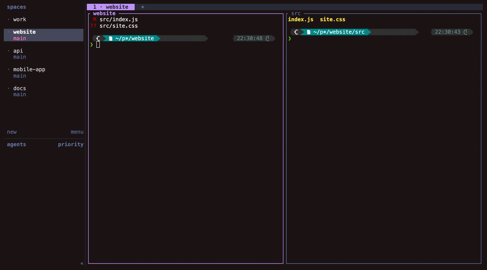
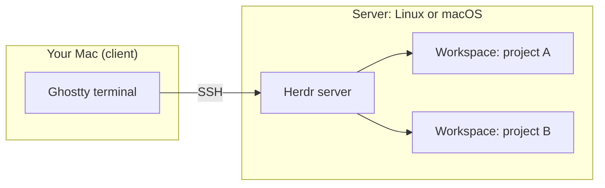
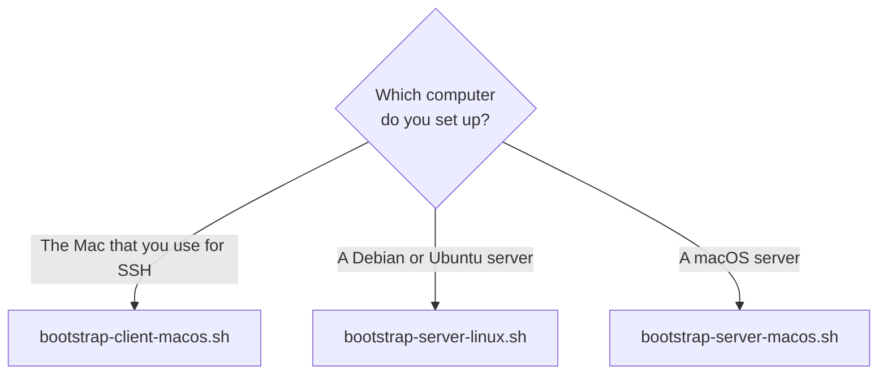
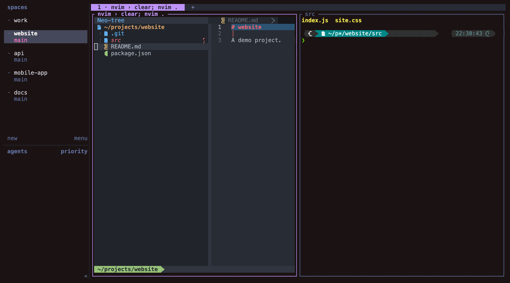
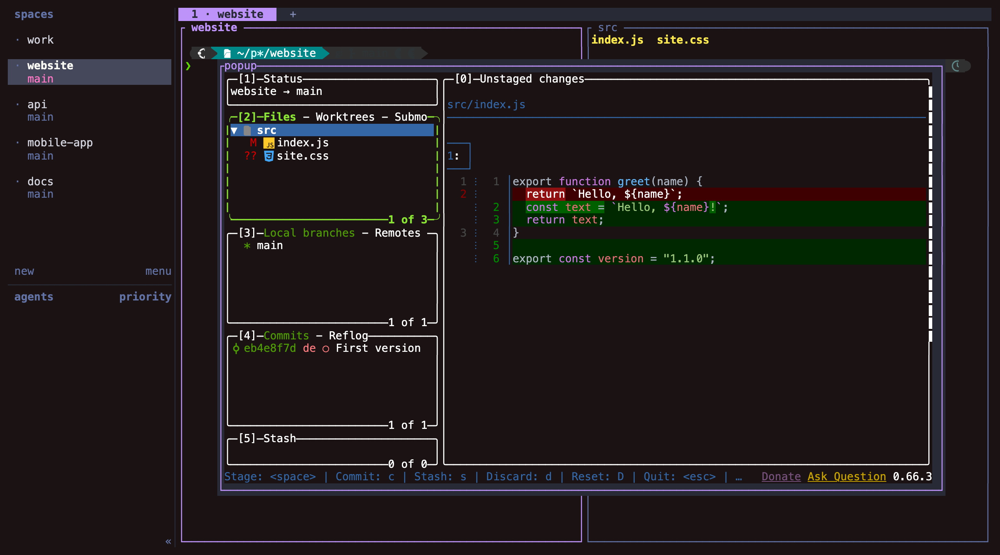
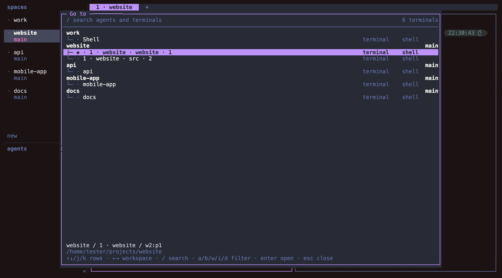

# herdr-bootstrap

Shell scripts that set up [Herdr](https://herdr.dev) on a new computer. Herdr is a terminal multiplexer for coding agents. A terminal multiplexer keeps your terminals running on a server after you disconnect.

You run one script on each computer. The script installs the tools, writes the configuration, and starts Herdr. You can run a script again at any time.



## How the parts fit



Your terminals run on the server. Herdr keeps them running after you close Ghostty or lose the connection.

## Choose a script



Set up the server first.

## Quick start

On the server, clone this repository and run the script for its system:

```bash
git clone <repository-url> ~/herdr-bootstrap
```

```bash
cd ~/herdr-bootstrap && ./bootstrap-server-linux.sh
```

On your Mac, clone the repository and give the SSH name of each server:

```bash
cd ~/herdr-bootstrap && ./bootstrap-client-macos.sh --server my-server
```

Then connect and open Herdr:

```bash
ssh my-server
```

```bash
herdr
```

## Documents

| Document | Use |
|----------|-----|
| [docs/setup.md](docs/setup.md) | The full steps for each computer |
| [docs/cheat-sheet.md](docs/cheat-sheet.md) | Keys and commands for daily use |
| [docs/updating.md](docs/updating.md) | Update the tools, or add something new |
| [docs/agent-setup.md](docs/agent-setup.md) | Ask a coding agent to do the setup |

## What you get

| Part | Client | Server |
|------|:------:|:------:|
| Ghostty with keys that reach Herdr | yes | |
| Terminal description for Ghostty on each server | yes | |
| Free `Ctrl` arrow keys in macOS | yes | |
| zsh, Oh My Zsh, and Powerlevel10k, with a different color on each side | yes | yes |
| fzf, zoxide, eza, bat, and fd | yes | yes |
| Herdr, with keys, colors, and sidebar | | yes |
| Auto Title plugin | | yes |
| Agent skill and integration for each agent program that it finds | | yes |
| Neovim with a file tree, and lazygit with delta | | yes |
| `hopen`, which opens all the projects of a list | | yes |
| A login service that starts Herdr, and a check for new versions | | yes |

The scripts do not install the agent programs. Install them first, or run the server script again after you install one.

## Screens

### Open a file tree with Neovim

`nvim .` shows a file tree. A click shows a preview of the file. A double-click keeps the file open.



### See your changes with lazygit

`Cmd+Shift+G` opens lazygit over the current pane. `q` closes it.



### Go anywhere

`Cmd+K` lists each workspace, tab, and agent. Type to search, and press `Enter` to go.



The screens come from a test container with demo projects.

## Ask an agent to do the setup

The folder [skills](skills/) has instructions for coding agents. [docs/agent-setup.md](docs/agent-setup.md) shows what to say to an agent.

## Rules that the scripts follow

- A script makes a backup before it replaces a file.
- A script never stops a Herdr server that was already running, because a stop closes every pane.
- Tools from release pages have a pinned version and a checksum.
- Herdr and Neovim do not contact their sites in the background. The update check asks the Homebrew API.

## Tests

| Test | What it checks |
|------|----------------|
| `tests/run-linux.sh` | A full server setup in throwaway Ubuntu and Debian containers |
| `tests/run-systemd.sh` | The login service in a container with real systemd |
| `tests/run-macos.sh` | The macOS scripts on a Mac, with a temporary home folder and stub commands |

A container cannot run macOS. For that reason, `tests/run-macos.sh` does not change macOS shortcuts or install Homebrew packages.

## Credits

The idea for these keys, colors, and tools comes from the guide [Herdr setup](https://learn.datalumina.com/docs/herdr) by Dave Ebbelaar. The configuration files in this repository are new files. They are not copies of the files in that guide.

The Auto Title plugin is [kryptamine/herdr-auto-title](https://github.com/kryptamine/herdr-auto-title).
