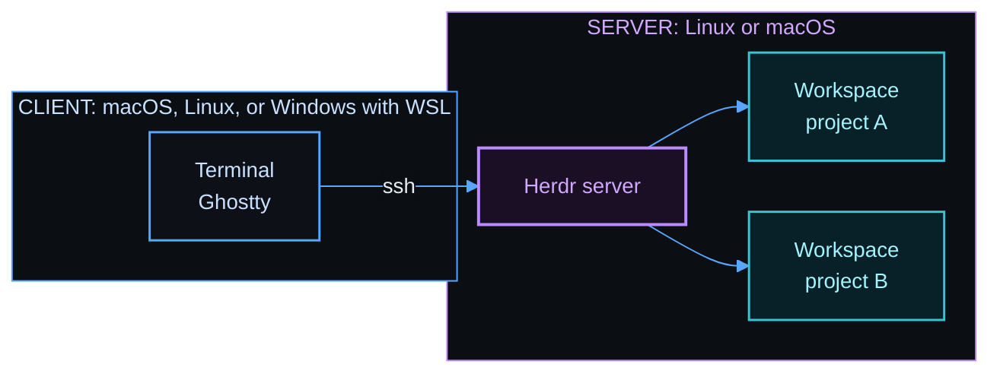

# herdspace

herdspace is a workspace and session manager for [Herdr](https://herdr.dev). Herdr is a terminal multiplexer for coding agents. It keeps your terminals and agents running on a server after you disconnect.


With herdspace, you can:

- Open every project of a VS Code workspace file in one Herdr session, with one command.
- Split each project into named panes from a template, for example an editor, an agent, and lazygit.
- Start the template programs again after a restart.
- Set up Herdr and its tools on a new server and client with one command, on macOS, Linux, or Windows with WSL.

herdspace has two parts. `hopen` opens your projects. `bootstrap.sh` sets up a computer, and the server setup includes `hopen`.

## Quick start

### Use hopen on a computer that has Herdr

You need Herdr, Python 3, and curl. Install `hopen` and its templates:

```bash
curl -fsSL https://github.com/MussaCharles/herdspace/releases/download/v0.1.0-alpha.4/install.sh | bash
```

### Set up a new computer

Set up the server first. Run this command on the server:

```bash
curl -fsSL https://github.com/MussaCharles/herdspace/releases/download/v0.1.0-alpha.4/bootstrap.sh | bash -s -- server
```

Run this command on the computer that you use to connect. Give the SSH name of the server:

```bash
curl -fsSL https://github.com/MussaCharles/herdspace/releases/download/v0.1.0-alpha.4/bootstrap.sh | bash -s -- client --server my-server
```

The script finds the system, downloads the release, and compares its checksum. Then it runs the setup for that system. Run it again at any time. It does only what is missing, and it asks before it replaces a file that you changed.

[docs/setup.md](docs/setup.md) has every option and the steps for each system.

## Open your projects

A VS Code workspace file lists project folders. `hopen` opens each folder as a Herdr workspace. Each file becomes one Herdr session with the name of the file.

Create `~/work.code-workspace`:

```json
{
  "folders": [
    { "name": "website", "path": "./code/website" },
    { "name": "api", "path": "./code/api" }
  ]
}
```

Open it:

```bash
hopen work
```

| Command | Effect |
|---------|--------|
| `hopen work` | Open the projects of one list, and attach to that session. |
| `hopen --all` | Open every list. |
| `hopen --list` | Show every list and its state. |
| `hopen work --template code` | Split each new project with a template. |
| `hopen --templates` | Show every template. |
| `hopen --apply grid` | Split the current tab with a template. |

Run `hopen` again at any time. It starts a stopped session and adds only the new folders. It never closes anything. [docs/setup.md](docs/setup.md#open-many-projects-at-once) has more about the list file.

## Templates

A template splits a project into named panes, and it starts a program in each pane. This is the `code` template, with Neovim, an agent pane, and lazygit:


The other templates are `agent`, `grid`, and `review`. You can add your own template as a small text file. [docs/templates.md](docs/templates.md) shows each template.

## See it work

The videos come from real Ghostty on a Linux client. The client connects with SSH to a test server. The keys show at the bottom of each video.

### Move between panes

`Alt+Up` and `Alt+Down` go to the previous or next pane. `ctrl+b`, `z` makes one pane fill the tab.


### Use a template

`hopen --apply review` splits the current tab into named panes, and it starts a program in each pane.


[docs/templates.md](docs/templates.md#open-every-project) has more videos.

## How the parts fit



Your terminals run on the server. Herdr keeps them running after you close Ghostty or lose the connection.

## Documents

| Document | Use |
|----------|-----|
| [docs/setup.md](docs/setup.md) | Set up each computer, every option, and what the setup installs |
| [docs/templates.md](docs/templates.md) | Templates, and videos that show how to move between panes |
| [docs/cheat-sheet.md](docs/cheat-sheet.md) | Keys and commands for daily use |
| [docs/windows-wsl.md](docs/windows-wsl.md) | Use Windows as a client with WSL |
| [docs/agent-setup.md](docs/agent-setup.md) | Ask a coding agent to do the setup |
| [docs/updating.md](docs/updating.md) | Update the tools, add something new, and make a release |
| [docs/testing.md](docs/testing.md) | The tests, and how to run them |

## Credits

The idea for these keys, colors, and tools comes from the guide [Herdr setup](https://learn.datalumina.com/docs/herdr) by Dave Ebbelaar. The configuration files in this repository are new files. They are not copies of the files in that guide.

The Auto Title plugin is [kryptamine/herdr-auto-title](https://github.com/kryptamine/herdr-auto-title).

## License

MIT. See [LICENSE](LICENSE).
