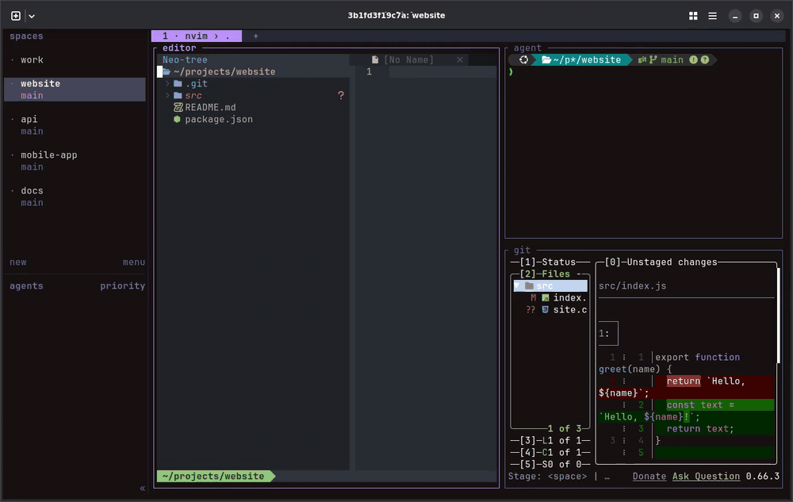
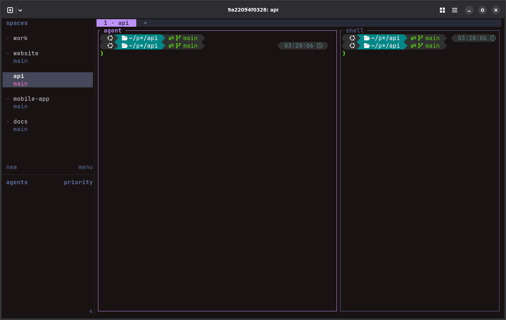
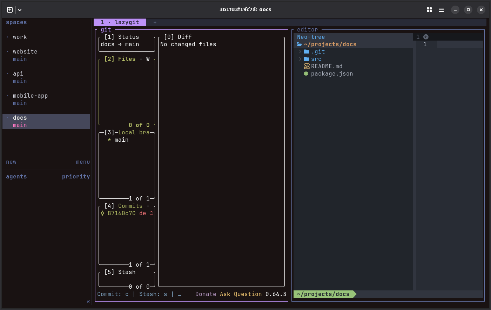
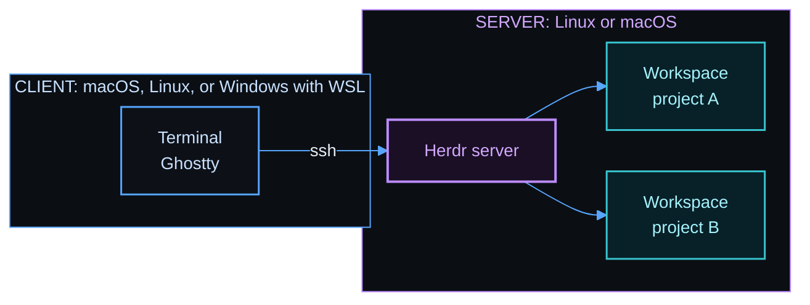

# herdspace

herdspace sets up [Herdr](https://herdr.dev) and its tools on your machines, and opens your projects in Herdr with one command. Herdr is a terminal multiplexer for coding agents. It keeps your terminals and agents running after you disconnect.



## Quick start

The server machine runs Herdr, your projects, and your agents. The client machine is the machine that you use, and it connects to the server with SSH. One machine can also be both. Each command below downloads the [setup](docs/setup.md) of the newest release, makes sure that its checksum is correct, and runs it. Run the same command again to update. Read [Before you start](docs/setup.md#before-you-start) first.

### Server machine

```bash
curl -fsSL https://github.com/MussaCharles/herdspace/releases/latest/download/bootstrap.sh | bash -s -- server
```

It installs Herdr, `hopen`, Neovim and its tools, and the shell.

### Client machine

Set up the server first. Replace `my-server` with the SSH name of the server:

```bash
curl -fsSL https://github.com/MussaCharles/herdspace/releases/latest/download/bootstrap.sh | bash -s -- client --server my-server
```

It installs Ghostty, the [Herdr keys](docs/keyboard-shortcuts.md), and the shell. If you have no SSH name for the server, follow [Connect to the server with SSH](docs/ssh.md) first.

### One machine as both

```bash
curl -fsSL https://github.com/MussaCharles/herdspace/releases/latest/download/bootstrap.sh | bash -s -- both
```

### Only hopen

If a machine has the Herdr terminal program `herdr` already, this command installs only `hopen` and its templates, and changes nothing else. It needs curl and Python 3.11 or later. To install `herdr`, see [Install Herdr](https://github.com/herdrdev/herdr#install). The Herdr app (`herdr-app`, `hc`) is a different program, and `hopen` does not work with it.

```bash
curl -fsSL https://github.com/MussaCharles/herdspace/releases/latest/download/install.sh | bash
```

To let a coding agent do the setup, paste a prompt from [Ask an agent to do the setup](docs/agent-setup.md#install-with-an-agent). The [setup guide](docs/setup.md) has every option, for example `--version <tag>`.

## Open your projects

A list is a file that you write yourself. It holds the projects of one Herdr session, and `hopen` opens each project as a Herdr workspace. The list of the session `my-projects` is `~/my-projects/herdspace.toml`:

```toml
[[project]]
name = "website"
path = "~/code/website"
template = "code"

[[project]]
name = "api"
path = "~/code/api"
```

| Command | Effect |
|---------|--------|
| `hopen my-projects` | Open the projects of one list, and attach to that session. |
| `hopen` | Choose a list from a menu. |
| `hopen .` | Open the current folder, with no list. |
| `hopen --all` | Open every list. |
| `hopen --list` | Show every list and its state. |
| `hopen my-projects --template code` | Split each new project with a template. |
| `hopen --templates` | Show every template. |
| `hopen --apply grid` | Split the current tab with a template. |

Run `hopen` again at any time. It starts a stopped session and adds only the new projects. It never closes anything. The [hopen guide](docs/hopen.md) has every command and setting, and how to use a VS Code workspace file as the list.

## Templates

A template splits a project into named panes, and it starts a program in each pane.

| `code` | `agent` |
|:------:|:-------:|
|  |  |
| Neovim, an agent, and lazygit | An agent and a shell |
| `grid` | `review` |
|  |  |
| Two agents, tests, and a shell | lazygit and Neovim, to read what an agent changed |

The default is `plain`, one pane with a shell. The [templates guide](docs/templates.md) shows how to add your own template.

## How the parts fit

<details>
<summary>The client connects to the Herdr server with SSH.</summary>



</details>

Your terminals run on the server. Herdr keeps them running after you close Ghostty or lose the connection. If you come from VS Code or tmux, the [From VS Code](docs/vscode.md) and [From tmux](docs/tmux.md) guides have the match for each action.

## Documentation

- [hopen guide](docs/hopen.md): write a list, its settings, the commands, and how to install, update, or remove `hopen`.
- [Setup guide](docs/setup.md): set up a server and a client, every option, and what the setup installs.
- [Templates and panes](docs/templates.md): each template, how to add your own, and videos of the pane keys.
- [From VS Code](docs/vscode.md): the herdspace command or key for each VS Code action.
- [From tmux](docs/tmux.md): the Herdr command or key for each tmux action, and how to run agents side by side.
- [Keyboard shortcuts](docs/keyboard-shortcuts.md): the keys that the setup changes, and how to keep the keys of your terminal.
- [Cheat sheet](docs/cheat-sheet.md): keys and commands for daily use, with a [table of daily commands](docs/cheat-sheet.md#daily-commands) and links to the official Herdr docs.
- [Connect to the server with SSH](docs/ssh.md): what `my-server` means, and how to set up the SSH name and key.
- [Windows with WSL](docs/windows-wsl.md): use a Windows machine as a client.
- [Ask an agent to do the setup](docs/agent-setup.md): what to say to a coding agent.
- [Updating](docs/updating.md): update the tools, add something new, and make a release.
- [Testing](docs/testing.md): the tests, and how to run them.
- [CI](docs/ci.md): the tests that GitHub Actions runs for each pull request and each release.
- [Repository settings](docs/repository-settings.md): the GitHub settings of this repository, and the reason for each one.

## Credits

herdspace builds on [Herdr](https://github.com/herdrdev/herdr), and we thank its authors for a great tool. herdspace is inspired by the guide [Herdr setup](https://learn.datalumina.com/docs/herdr) by Dave Ebbelaar.

The setup installs these tools. Thanks to their authors:

- Herdr plugin: [Auto Title](https://github.com/kryptamine/herdr-auto-title)
- Terminal: [Ghostty](https://github.com/ghostty-org/ghostty)
- Shell: [Oh My Zsh](https://github.com/ohmyzsh/ohmyzsh), [Powerlevel10k](https://github.com/romkatv/powerlevel10k), [zsh-autosuggestions](https://github.com/zsh-users/zsh-autosuggestions), and [zsh-syntax-highlighting](https://github.com/zsh-users/zsh-syntax-highlighting)
- Command-line tools: [fzf](https://github.com/junegunn/fzf), [zoxide](https://github.com/ajeetdsouza/zoxide), [eza](https://github.com/eza-community/eza), [bat](https://github.com/sharkdp/bat), and [fd](https://github.com/sharkdp/fd)
- Editor and Git: [Neovim](https://github.com/neovim/neovim), [lazygit](https://github.com/jesseduffield/lazygit), and [delta](https://github.com/dandavison/delta)

## License

MIT. See [LICENSE](LICENSE).
