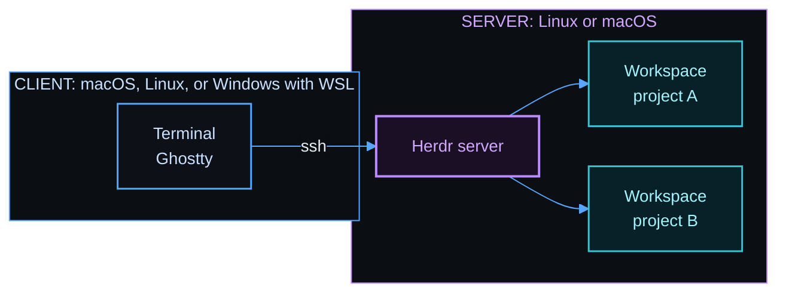

# herdspace

herdspace is a workspace and session manager for [Herdr](https://herdr.dev). Herdr is a terminal multiplexer for coding agents. It keeps your terminals and agents running after you disconnect.

herdspace uses two machines. The server machine runs Herdr, your projects, and your agents. The client machine is the machine that you use, and it connects to the server machine with SSH. One machine can also be both.


With herdspace, you can:

- Open every project of a VS Code workspace file in one Herdr session, with one command.
- Split each project into named panes from a template, for example an editor, an agent, and lazygit.
- Start the template programs again after a restart.
- Set up Herdr and its tools on a new server machine and client machine with one command, on macOS, Linux, or Windows with WSL.

herdspace has two parts. `hopen` opens your projects. `bootstrap.sh` sets up a machine, and the server setup includes `hopen`.

## Quick start

The setup is one command on each machine. First run the server command on the server machine. Then run the client command on the client machine, which connects to the server with SSH. If you use one machine for everything, run only the command in [One machine as both](#one-machine-as-both).

### Server machine

Run this command on the server machine. It installs Herdr, its tools, and `hopen`:

```bash
curl -fsSL https://github.com/MussaCharles/herdspace/releases/download/v0.1.1/bootstrap.sh | bash -s -- server
```

### Client machine

Run this command on the client machine. It sets up Ghostty, the shell, and the Herdr keys. Give the SSH name of the server in place of `my-server`:

```bash
curl -fsSL https://github.com/MussaCharles/herdspace/releases/download/v0.1.1/bootstrap.sh | bash -s -- client --server my-server
```

`my-server` is an example of an SSH name, a short name for the server in `~/.ssh/config`. If you do not have one, or you connect with an IP address, follow [Connect to the server with SSH](docs/ssh.md) first.

### One machine as both

If Herdr runs on the machine that you use, and you do not connect to another machine, run this command. It does the server setup and then the client setup on this machine:

```bash
curl -fsSL https://github.com/MussaCharles/herdspace/releases/download/v0.1.1/bootstrap.sh | bash -s -- both
```

### Only hopen, on a machine that has Herdr

If a machine has Herdr already, you can install only `hopen` and its templates. You need Python 3 and curl:

```bash
curl -fsSL https://github.com/MussaCharles/herdspace/releases/download/v0.1.1/install.sh | bash
```

### How the commands work

`bootstrap.sh` finds the system, downloads the release, and compares its checksum. Then it runs the setup for that system. Run it again at any time. It does only what is missing, and it asks before it replaces a file that you changed. The [setup guide](docs/setup.md) has every option and the steps for each system.

### Ask an agent to do the setup

You can also give the setup to a coding agent, for example Claude Code or Codex. Start the agent on the machine that you want to set up, and paste one of these prompts. The agent reads [install.md](install.md) and runs the same commands as above.

On the server machine:

```text
Set up herdspace on this machine as the server. Fetch and follow the instructions in https://raw.githubusercontent.com/MussaCharles/herdspace/v0.1.1/install.md
```

On the client machine. Replace `my-server` with the SSH name or the address of your server:

```text
Set up herdspace on this machine as the client for my-server. Fetch and follow the instructions in https://raw.githubusercontent.com/MussaCharles/herdspace/v0.1.1/install.md
```

On one machine that is both:

```text
Set up herdspace on this machine as both the server and the client. Fetch and follow the instructions in https://raw.githubusercontent.com/MussaCharles/herdspace/v0.1.1/install.md
```

The agent shows you what will change before it changes anything, and it gives you each command that needs your password.

## Open your projects

A VS Code workspace file lists project folders. `hopen` opens each folder as a Herdr workspace. Each file becomes one Herdr session with the name of the file.

Create `~/work.code-workspace`:

```json
{
  "folders": [
    { "name": "website", "path": "./code/website" },
    { "name": "api", "path": "./code/api" }
  ]
}
```

Open it:

```bash
hopen work
```

| Command | Effect |
|---------|--------|
| `hopen work` | Open the projects of one list, and attach to that session. |
| `hopen --all` | Open every list. |
| `hopen --list` | Show every list and its state. |
| `hopen work --template code` | Split each new project with a template. |
| `hopen --templates` | Show every template. |
| `hopen --apply grid` | Split the current tab with a template. |

Run `hopen` again at any time. It starts a stopped session and adds only the new folders. It never closes anything. The [setup guide](docs/setup.md#open-many-projects-at-once) has more about the list file.

## Templates

A template splits a project into named panes, and it starts a program in each pane.

| `code` | `agent` |
|:------:|:-------:|
|  |  |
| Neovim, an agent, and lazygit | An agent and a shell |
| **`grid`** | **`review`** |
|  |  |
| Two agents, tests, and a shell | lazygit and Neovim, to read what an agent changed |

The default is `plain`, one pane with a shell. You can add your own template as a small text file. The [templates guide](docs/templates.md) shows how, and it has videos of the keys that move between panes.

## How the parts fit



Your terminals run on the server. Herdr keeps them running after you close Ghostty or lose the connection.

## Documentation

- [Setup guide](docs/setup.md): set up a server and a client, every option, and what the setup installs.
- [Templates and panes](docs/templates.md): each template, how to add your own, and videos of the pane keys.
- [Cheat sheet](docs/cheat-sheet.md): keys and commands for daily use.
- [Connect to the server with SSH](docs/ssh.md): what `my-server` means, and how to set up the SSH name and key.
- [Windows with WSL](docs/windows-wsl.md): use a Windows machine as a client.
- [Ask an agent to do the setup](docs/agent-setup.md): what to say to a coding agent.
- [Updating](docs/updating.md): update the tools, add something new, and make a release.
- [Testing](docs/testing.md): the tests, and how to run them.

## Credits

The idea for these keys, colors, and tools comes from the guide [Herdr setup](https://learn.datalumina.com/docs/herdr) by Dave Ebbelaar. The configuration files in this repository are new files. They are not copies of the files in that guide.

The Auto Title plugin is [kryptamine/herdr-auto-title](https://github.com/kryptamine/herdr-auto-title).

## License

MIT. See [LICENSE](LICENSE).
