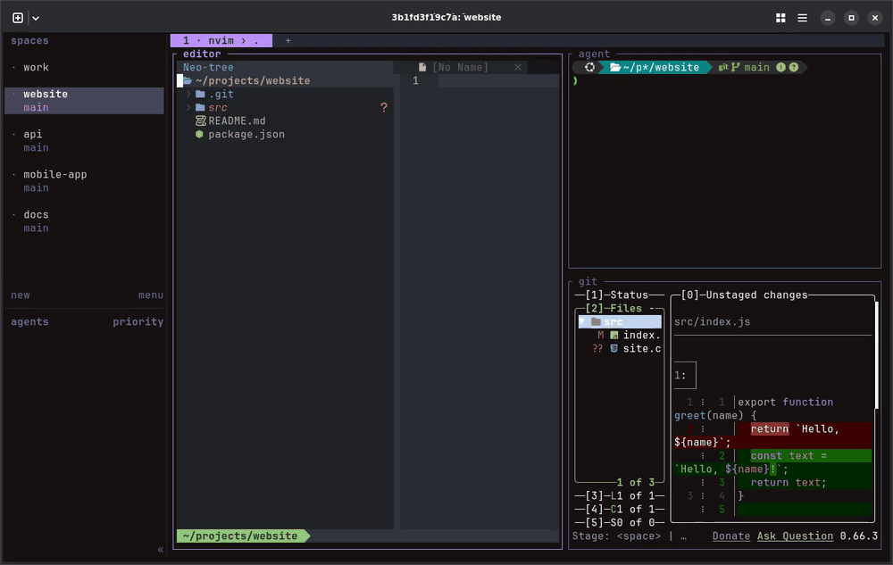
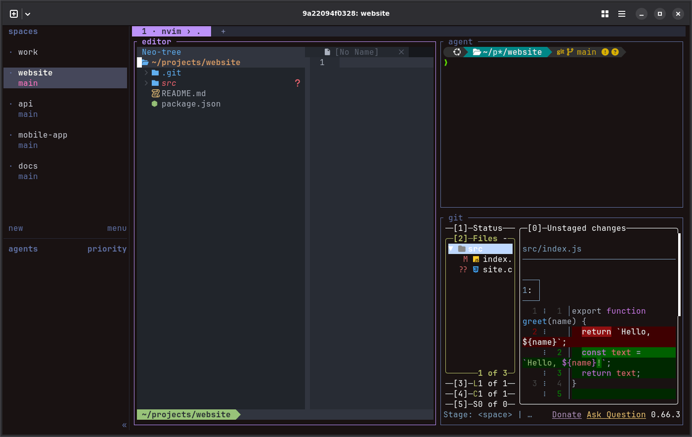
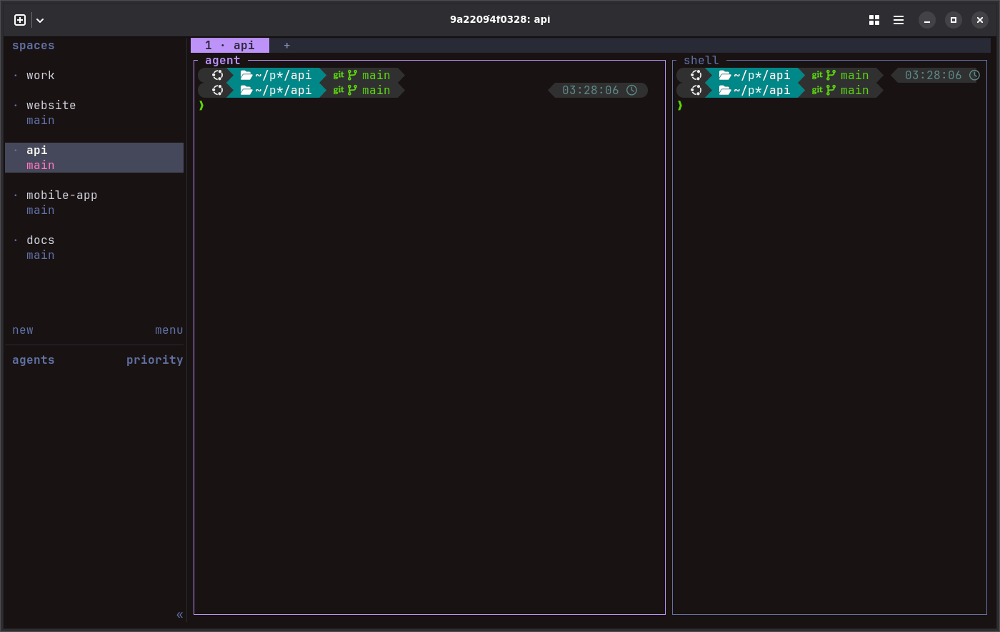
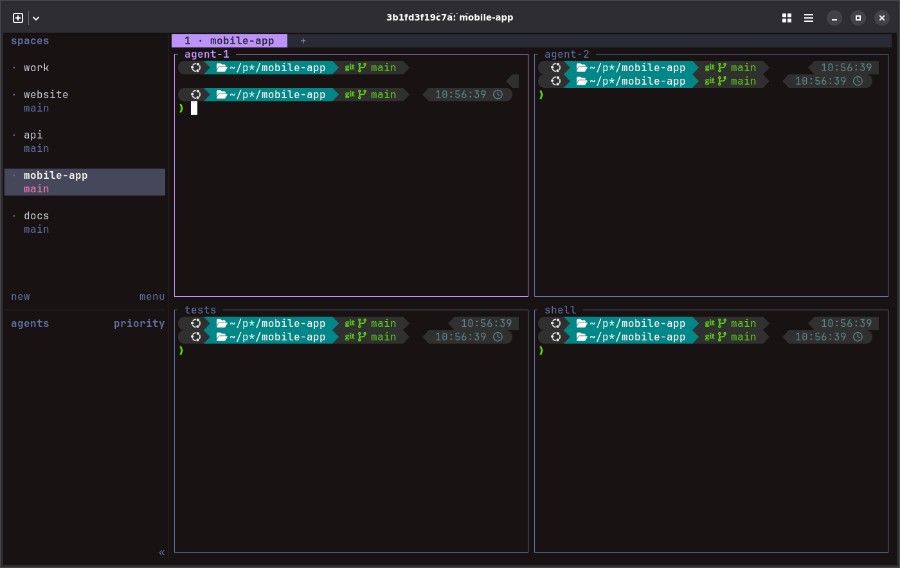
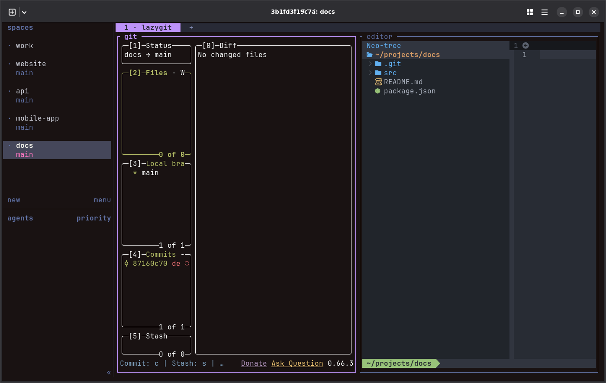
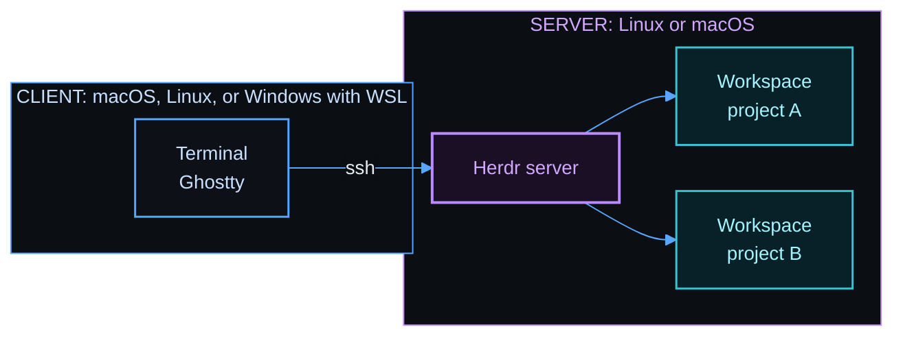

# herdspace

herdspace sets up [Herdr](https://herdr.dev) and its tools on your machines, and then opens your projects in Herdr with one command. Herdr is a terminal multiplexer for coding agents. It keeps your terminals and agents running after you disconnect.

herdspace has two parts:

| Part | What it does | Where it runs |
|------|--------------|---------------|
| `bootstrap.sh`, the setup | Sets up a machine: Herdr, the editor and its tools, the shell, and the keys. Run it one time for each machine, and again to update. | Each machine: the server machine, the client machine, or one machine as both |
| [`hopen`](docs/hopen.md), the project opener | Opens each project of a list in one Herdr session, split into named panes from a template. | The server machine. The server setup installs it. |

herdspace uses two machines. The server machine runs Herdr, your projects, and your agents. The client machine is the machine that you use, and it connects to the server machine with SSH. One machine can also be both.



With herdspace, you can:

- Set up Herdr and its tools on a new server machine and client machine with one command, on macOS, Linux, or Windows with WSL.
- Open every project of a list in one Herdr session, with one command. The list is a `herdspace.toml` file, or a VS Code workspace file.
- Split each project into named panes from a template, for example an editor, an agent, and lazygit.
- Start the template programs again after a restart.

## Quick start

Each option is one command. Three of them run the setup script `bootstrap.sh`: for a server machine, a client machine, and one machine as both. The command downloads the script from the newest release, compares its checksum, and runs it with a role: `server`, `client`, or `both`. The script does only what is missing, and it asks before it replaces a file that you changed. Run it again at any time to update. Read [Before you start](docs/setup.md#before-you-start) for the few items that you do yourself.

| You want to | Use | It runs | It installs |
|-------------|-----|---------|-------------|
| Run Herdr on a server, and connect to it from the machine that you use | [Server machine](#server-machine), then [Client machine](#client-machine) | `bootstrap.sh server` on the server, then `bootstrap.sh client` on the client | On the server: Herdr, `hopen`, the editor and its tools, and the shell. On the client: Ghostty, its keys, and the shell. The client gets no `hopen`, because `hopen` runs on the server. |
| Run Herdr on the machine that you use, with no server | [One machine as both](#one-machine-as-both) | `bootstrap.sh both` | All of the above, on one machine |
| Add `hopen` to a machine that has Herdr already | [Only hopen](#only-hopen) | `install.sh` | Only `hopen` and its templates |
| Let a coding agent do the setup for you | [Ask an agent](#ask-an-agent) | The agent runs one of the above | The same |

### Server machine

Run this command on the server machine. It downloads the setup script `bootstrap.sh`, and runs it with the role `server`. It installs Herdr, its tools, and `hopen`:

```bash
curl -fsSL https://github.com/MussaCharles/herdspace/releases/latest/download/bootstrap.sh | bash -s -- server
```

### Client machine

Set up the server machine first. Then run this command on the client machine. It runs `bootstrap.sh` with the role `client`, and it sets up Ghostty, the shell, and the [Herdr keys](docs/keyboard-shortcuts.md). Give the SSH name of the server in place of `my-server`:

```bash
curl -fsSL https://github.com/MussaCharles/herdspace/releases/latest/download/bootstrap.sh | bash -s -- client --server my-server
```

`my-server` is an example of an SSH name, a short name for the server in `~/.ssh/config`. If you do not have one, or you connect with an IP address, follow [Connect to the server with SSH](docs/ssh.md) first.

### One machine as both

Run this command on the machine that you use. It runs `bootstrap.sh` with the role `both`: the server setup and then the client setup, on this machine:

```bash
curl -fsSL https://github.com/MussaCharles/herdspace/releases/latest/download/bootstrap.sh | bash -s -- both
```

### Only hopen

If a machine has Herdr already, you can install only `hopen` and its templates. This command runs `install.sh`, not `bootstrap.sh`, so it changes nothing else on the machine. You need curl and Python 3.11 or later:

```bash
curl -fsSL https://github.com/MussaCharles/herdspace/releases/latest/download/install.sh | bash
```

### Ask an agent

Start a coding agent, for example Claude Code or Codex, on the machine that you want to set up. Paste the prompt for your option. The agent reads the [agent install steps](install.md) and runs the same commands as above.

On the server machine:

```text
Set up herdspace on this machine as the server. Fetch and follow the instructions in https://raw.githubusercontent.com/MussaCharles/herdspace/main/install.md
```

On the client machine. Replace `my-server` with the SSH name or the address of your server:

```text
Set up herdspace on this machine as the client for my-server. Fetch and follow the instructions in https://raw.githubusercontent.com/MussaCharles/herdspace/main/install.md
```

On one machine that is both:

```text
Set up herdspace on this machine as both the server and the client. Fetch and follow the instructions in https://raw.githubusercontent.com/MussaCharles/herdspace/main/install.md
```

The agent shows you what will change before it changes anything, and it gives you each command that needs your password.

To teach your agent to use herdspace every day, install the herdspace skill. See [Teach your agent to use herdspace](docs/agent-setup.md#teach-your-agent-to-use-herdspace).

### How the commands work

To install a specific release, add `--version <tag>`. The [setup guide](docs/setup.md) has every option of `bootstrap.sh`, and the steps for each system.

## Open your projects

A list holds the projects of one Herdr session. `hopen` opens each project as a Herdr workspace. The list of the session `my-projects` is `~/my-projects/herdspace.toml`:

```toml
[[project]]
name = "website"
path = "~/code/website"
template = "code"

[[project]]
name = "api"
path = "~/code/api"
```

Open it:

```bash
hopen my-projects
```

| Command | Effect |
|---------|--------|
| `hopen my-projects` | Open the projects of one list, and attach to that session. |
| `hopen` | Choose a list from a menu. |
| `hopen .` | Open the current folder, with no list. |
| `hopen --all` | Open every list. |
| `hopen --list` | Show every list and its state. |
| `hopen my-projects --template code` | Split each new project with a template. |
| `hopen --templates` | Show every template. |
| `hopen --apply grid` | Split the current tab with a template. |

Run `hopen` again at any time. It starts a stopped session and adds only the new projects. It never closes anything. A list can also set a start command, environment values, and extra tabs for each project. The [hopen guide](docs/hopen.md) has every command and setting.

If you come from VS Code, `hopen` also reads a VS Code workspace file, so that VS Code and Herdr share one list. See [Use a VS Code workspace file](docs/hopen.md#use-a-vs-code-workspace-file). The [From VS Code](docs/vscode.md) guide has the herdspace match for each VS Code action.

## Templates

A template splits a project into named panes, and it starts a program in each pane.

| `code` | `agent` |
|:------:|:-------:|
|  |  |
| Neovim, an agent, and lazygit | An agent and a shell |
| **`grid`** | **`review`** |
|  |  |
| Two agents, tests, and a shell | lazygit and Neovim, to read what an agent changed |

The default is `plain`, one pane with a shell. You can add your own template as a small text file. The [templates guide](docs/templates.md) shows how, and it has videos of the keys that move between panes.

## How the parts fit



Your terminals run on the server. Herdr keeps them running after you close Ghostty or lose the connection.

## Documentation

- [hopen guide](docs/hopen.md): write a list, its settings, the commands, and how to install, update, or remove `hopen`.
- [Setup guide](docs/setup.md): set up a server and a client, every option, and what the setup installs.
- [Templates and panes](docs/templates.md): each template, how to add your own, and videos of the pane keys.
- [From VS Code](docs/vscode.md): the herdspace command or key for each VS Code action.
- [Keyboard shortcuts](docs/keyboard-shortcuts.md): the keys that the setup changes, and how to keep the keys of your terminal.
- [Cheat sheet](docs/cheat-sheet.md): keys and commands for daily use.
- [Connect to the server with SSH](docs/ssh.md): what `my-server` means, and how to set up the SSH name and key.
- [Windows with WSL](docs/windows-wsl.md): use a Windows machine as a client.
- [Ask an agent to do the setup](docs/agent-setup.md): what to say to a coding agent.
- [Updating](docs/updating.md): update the tools, add something new, and make a release.
- [Testing](docs/testing.md): the tests, and how to run them.
- [CI](docs/ci.md): the tests that GitHub Actions runs for each pull request and each release.
- [Repository settings](docs/repository-settings.md): the GitHub settings of this repository, and the reason for each one.

## Credits

herdspace builds on [Herdr](https://github.com/herdrdev/herdr), and we thank its authors for a great tool. herdspace is inspired by the guide [Herdr setup](https://learn.datalumina.com/docs/herdr) by Dave Ebbelaar.

The setup installs these tools. Thanks to their authors:

- Herdr plugin: [Auto Title](https://github.com/kryptamine/herdr-auto-title)
- Terminal: [Ghostty](https://github.com/ghostty-org/ghostty)
- Shell: [Oh My Zsh](https://github.com/ohmyzsh/ohmyzsh), [Powerlevel10k](https://github.com/romkatv/powerlevel10k), [zsh-autosuggestions](https://github.com/zsh-users/zsh-autosuggestions), and [zsh-syntax-highlighting](https://github.com/zsh-users/zsh-syntax-highlighting)
- Command-line tools: [fzf](https://github.com/junegunn/fzf), [zoxide](https://github.com/ajeetdsouza/zoxide), [eza](https://github.com/eza-community/eza), [bat](https://github.com/sharkdp/bat), and [fd](https://github.com/sharkdp/fd)
- Editor and Git: [Neovim](https://github.com/neovim/neovim), [lazygit](https://github.com/jesseduffield/lazygit), and [delta](https://github.com/dandavison/delta)

## License

MIT. See [LICENSE](LICENSE).
