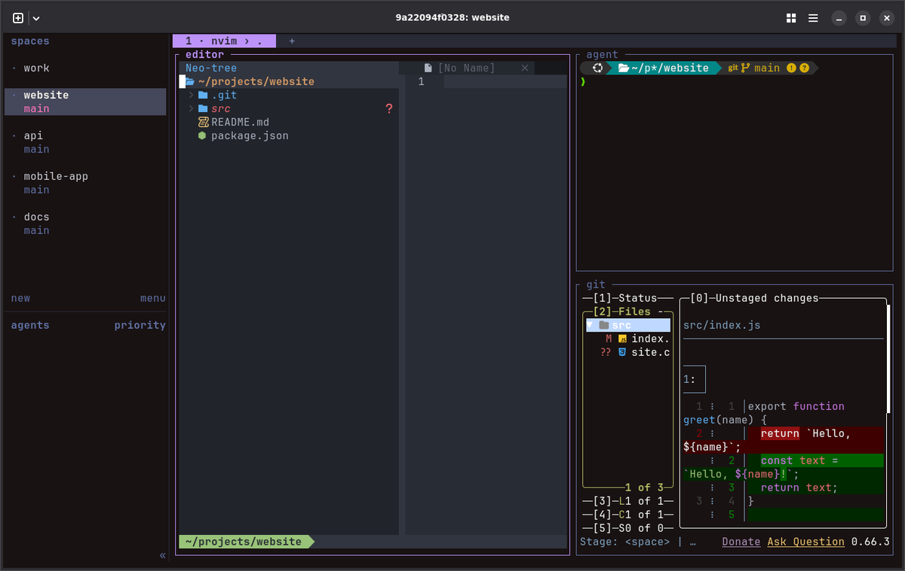
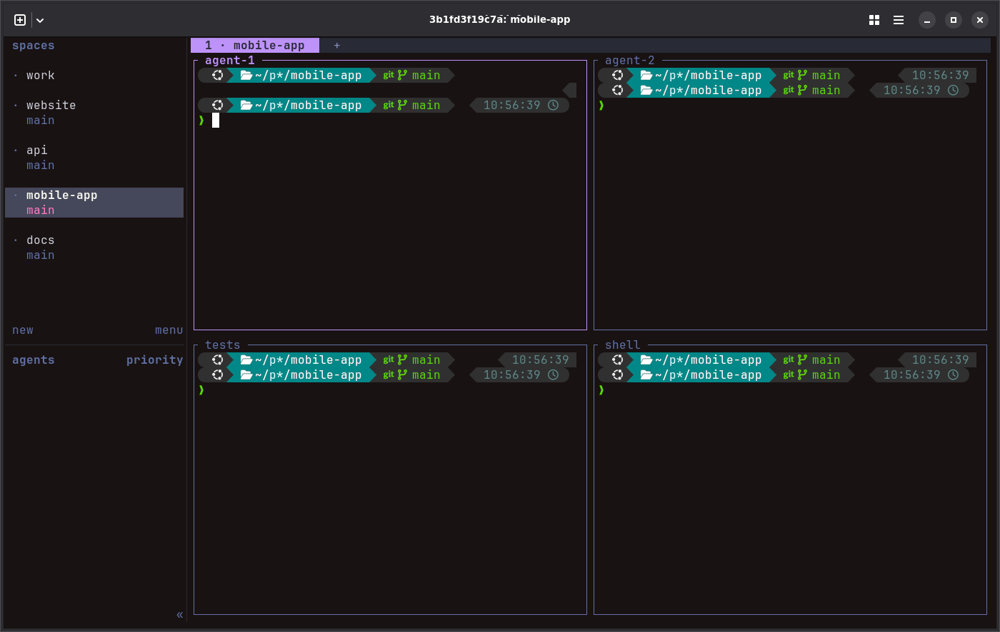
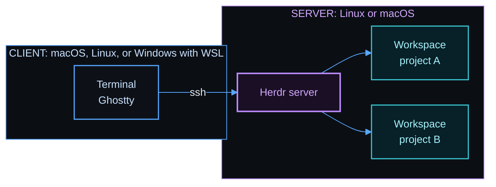

# herdspace

herdspace sets up [Herdr](https://herdr.dev) and its tools on your machines, and opens your projects in Herdr with one command. Herdr is a terminal multiplexer for coding agents. It keeps your terminals and agents running after you disconnect.

[Documentation index](docs/README.md) · [Setup guide](docs/setup.md) · [Cheat sheet](docs/cheat-sheet.md) · [Keys by task](docs/cheat-sheet.md#by-task) · [Changelog](CHANGELOG.md)

## Quick start

The server machine runs Herdr, your projects, and your agents. The client machine is the machine that you use, and it connects to the server with SSH. One machine can also be both. Each command below downloads the [setup](docs/setup.md) of the newest release, makes sure that its checksum is correct, and runs it. To update later, see [Update](#update). Read [Before you start](docs/setup.md#before-you-start) first.

### Server machine

```bash
curl -fsSL https://github.com/MussaCharles/herdspace/releases/latest/download/bootstrap.sh | bash -s -- server
```

It installs Herdr, `hopen`, Neovim and its tools, and the shell.

### Client machine

Set up the server first. Replace `my-server` with the SSH name of the server:

```bash
curl -fsSL https://github.com/MussaCharles/herdspace/releases/latest/download/bootstrap.sh | bash -s -- client --server my-server
```

It installs Ghostty, the [Herdr keys](docs/keyboard-shortcuts.md), and the shell. If you have no SSH name for the server, follow [Connect to the server with SSH](docs/ssh.md) first.

### One machine as both

```bash
curl -fsSL https://github.com/MussaCharles/herdspace/releases/latest/download/bootstrap.sh | bash -s -- both
```

### Only hopen

If a machine has the Herdr terminal program `herdr` already, this command installs only `hopen` and its templates, and changes nothing else. It needs curl and Python 3.11 or later. To install `herdr`, see [Install Herdr](https://github.com/herdrdev/herdr#install). The Herdr app (`herdr-app`, `hc`) is a different program, and `hopen` does not work with it.

```bash
curl -fsSL https://github.com/MussaCharles/herdspace/releases/latest/download/install.sh | bash
```

To let a coding agent do the setup, paste a prompt from [Ask an agent to do the setup](docs/agent-setup.md#install-with-an-agent). The [setup guide](docs/setup.md) has every option, for example `--version <tag>`.

## Open your projects

A list is a file that you write yourself. It holds the projects of one Herdr session, and `hopen` opens each project as a Herdr workspace. The list of the session `my-projects` is `~/my-projects/herdspace.toml`:

```toml
[[project]]
name = "website"
path = "~/code/website"
template = "code"

[[project]]
name = "api"
path = "~/code/api"
```

| Command | Effect |
|---------|--------|
| `hopen my-projects` | Open the projects of one list, and attach to that session. |
| `hopen` | Choose a list from a menu. |
| `hopen .` | Open the current folder, with no list. |
| `hopen --all` | Open every list. |
| `hopen --list` | Show every list and its state. |
| `hopen my-projects --template code` | Split each new project with a template. |
| `hopen --templates` | Show every template. |
| `hopen --apply grid` | Split the current tab with a template. |

Run `hopen` again at any time. It starts a stopped session and adds only the new projects. It never closes anything. The [hopen guide](docs/hopen.md) has every command and setting, and how to use a VS Code workspace file as the list.

## Templates

A template splits a project into named panes, and it starts a program in each pane.

| `code` | `agent` |
|:------:|:-------:|
|  |  |
| Neovim, an agent, and lazygit | An agent and a shell |
| `grid` | `review` |
|  |  |
| Two agents, tests, and a shell | lazygit and Neovim, to read what an agent changed |

The default is `plain`, one pane with a shell. The [templates guide](docs/templates.md) shows how to add your own template. To see four projects open in Herdr, each in its own workspace, watch the [demo](docs/templates.md#open-every-project).

## Find your way in Herdr

| Action | Mac | Linux |
|--------|-----|-------|
| Every action, in groups: the command palette | `Cmd+Shift+P` | `Ctrl+Shift+P` |
| Quick open a file of the project | `Cmd+P` | `Ctrl+B`, then `F` |
| Go to any workspace, tab, or agent | `Cmd+K` | `Ctrl+Shift+K` |
| New tab, close tab | `Cmd+T`, `Cmd+W` | `Ctrl+Shift+T`, `Ctrl+Shift+W` |
| Next or previous pane | `Alt+Up`, `Alt+Down` | The same |
| lazygit over the pane | `Cmd+Shift+G` | `Ctrl+Shift+G` |

The palette lists every action, as in VS Code: projects, tasks, files, git, agents, layout, tabs, sessions, and help. Type a few letters to find an action. See [The command palette](docs/hopen.md#the-command-palette).

The keys for each task have their own page: [move around](docs/navigation.md), [panes and layout](docs/layout.md), [files and the editor](docs/files.md), [git and worktrees](docs/git.md), [sessions](docs/sessions.md), and [agents](docs/agents.md).

## Commands

Each command runs in a shell on the server. In Herdr, the palette and the keys above run most of them for you.

| Command | Effect |
|---------|--------|
| `hopen --palette` | The command palette: every action, in groups. In Herdr, `Cmd+Shift+P`. |
| `hopen --quick-open` | Choose a file of the project, and open it in the editor of the tab, with the focus on it. In Herdr, `Cmd+P`. |
| `ff` | Find a file in the current folder, and open it. |
| `fif TEXT` | Search in the files, and open a result at its line. |
| `hopen --task test` | Run the task `test` of the current project. With no name, choose from a menu. See [Tasks](docs/hopen.md#tasks). |
| `hopen --ports` | Show the ports that your programs listen on, and their projects. |
| `hopen --apply grid` | Split the current tab with a template. |
| `herdspace update` | Update herdspace to the latest release. See [Update](#update). |
| `herdspace --version` | Show the installed and the latest version. |
| `herdspace editor normal` | On a server: Neovim shows the warnings and the spell marks, as LazyVim does. `herdspace editor reader` hides them again. |
| `herdspace keys normal` | On a client: give `Cmd+T`, `Cmd+W`, and `Cmd+K` back to Ghostty. `herdspace keys herdr` sends them to Herdr again. |
| `herdspace uninstall --check` | List what an uninstall changes, and change nothing. See [Uninstall](#uninstall). |

The [hopen guide](docs/hopen.md#commands) has every command of `hopen`, and `herdspace help` lists every command of `herdspace`.

## For coding agents

The herdspace skill teaches a coding agent, for example Claude Code or Codex, to use `hopen` and the setup: open your projects, add a project to a list, split a tab with a template, see the Herdr integrations, and check or update the setup. To install it for all your projects, use the [skills CLI](https://github.com/vercel-labs/skills):

```bash
npx skills add MussaCharles/herdspace --skill herdspace -g
```

The server setup also installs the Herdr skill for each agent that it finds, so that the agents can control Herdr. See [Teach your agent to use herdspace](docs/agent-setup.md#teach-your-agent-to-use-herdspace).

## Update

```bash
herdspace update
```

The command runs the setup of the latest release, with the role and the options of your last setup. `herdspace --version` shows the installed and the latest version. When a new release exists, the shell prints one line, at most once a day. See [Update herdspace](docs/setup.md#update-herdspace).

An update changes only the files of herdspace. Your own files stay yours:

| Your file | What herdspace does |
|-----------|---------------------|
| `~/.zshrc` | Adds a marked block that loads the herdspace shell, after a question. See [Your ~/.zshrc](docs/setup.md#your-zshrc). |
| Ghostty file | Adds marked blocks at the top. Your own lines below them win. See [Your Ghostty file](docs/keyboard-shortcuts.md#your-ghostty-file). |
| `~/.config/nvim` | Nothing. The herdspace Neovim has its own folder. See [Your Neovim files](docs/setup.md#your-neovim-files). |
| `export` lines in `~/.bashrc` | On Linux, offers to move them to `~/.zshenv`, so that zsh and the agents have them. See [Exports from your bash files](docs/setup.md#exports-from-your-bash-files). |

If you changed a file of herdspace, the setup asks before it replaces it, and it makes a backup first.

You do not have to stop your Herdr sessions. The new commands work at once. An open shell gets the shell changes after `exec zsh`, and a session uses a new Herdr version after a restart. See [Running sessions](docs/updating.md#running-sessions).

## Uninstall

```bash
herdspace uninstall --check
herdspace uninstall
```

The first command lists what an uninstall changes, and changes nothing. The second removes the files that the setup wrote and the marked blocks in your shell and Ghostty files. A file that you changed stays. It never removes a project, a Herdr session, Herdr, or a package. See [Uninstall herdspace](docs/setup.md#uninstall-herdspace).

## Good to know

- On the client, herdspace sends `Cmd+T`, `Cmd+W`, and `Cmd+K` to Herdr (`Ctrl+Shift+T` and others on Linux). Outside Herdr, for example in an SSH session to another server, these keys do nothing. To give them back to Ghostty, run `herdspace keys normal` on the client. To send them to Herdr again, run `herdspace keys herdr`. See [Switch the keys later](docs/keyboard-shortcuts.md#switch-the-keys-later).
- herdspace sends no telemetry. The setup and the update checks only download files. See [Network use and privacy](docs/setup.md#network-use-and-privacy), and the [supported systems](docs/setup.md#supported-systems).
- A server without herdspace does not know the terminal type of Ghostty. herdspace turns on the `ssh-env` feature of Ghostty, so that the `ssh` command that you type works there. If you still see `'xterm-ghostty': unknown terminal type`, see [A server without herdspace](docs/ssh.md#a-server-without-herdspace).

## How the parts fit

<details>
<summary>The client connects to the Herdr server with SSH.</summary>



</details>

Your terminals run on the server. Herdr keeps them running after you close Ghostty or lose the connection. If you come from VS Code or tmux, the [From VS Code](docs/vscode.md) and [From tmux](docs/tmux.md) guides have the match for each action.

## Documentation

The [documentation index](docs/README.md) lists each guide. herdspace builds on [Herdr](https://github.com/herdrdev/herdr). The [credits](docs/credits.md) name each tool that the setup installs.

## License

MIT. See [LICENSE](LICENSE).
