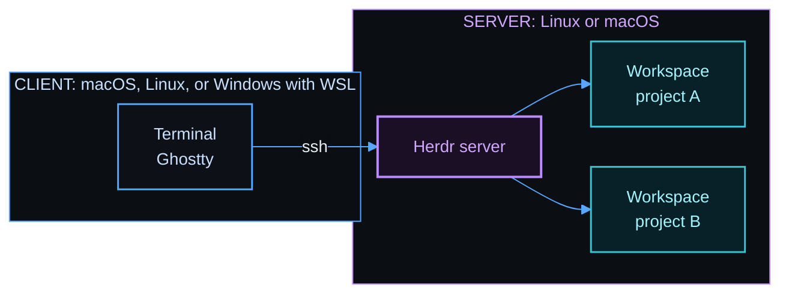
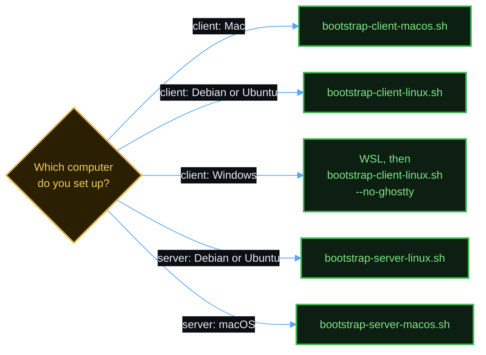

# herdr-bootstrap

Shell scripts that set up [Herdr](https://herdr.dev) on a new computer. Herdr is a terminal multiplexer for coding agents. A terminal multiplexer keeps your terminals running on a server after you disconnect.

You run one script on each computer. The script installs the tools, writes the configuration, and starts Herdr. If you run it again, it does only what is missing.


## How the parts fit



Your terminals run on the server. Herdr keeps them running after you close Ghostty or lose the connection.

## Choose a script



Set up the server first.

## Quick start

On the server, clone this repository and run the script for its system:

```bash
git clone <repository-url> ~/herdr-bootstrap
```

```bash
cd ~/herdr-bootstrap && ./bootstrap-server-linux.sh
```

On your client, clone the repository and give the SSH name of each server. This is the command for a Mac:

```bash
cd ~/herdr-bootstrap && ./bootstrap-client-macos.sh --server my-server
```

On a Debian or Ubuntu client, use `bootstrap-client-linux.sh` with the same option. For Windows, see [docs/windows-wsl.md](docs/windows-wsl.md).

Then connect and open Herdr:

```bash
ssh my-server
```

```bash
herdr
```

## Documents

| Document | Use |
|----------|-----|
| [docs/setup.md](docs/setup.md) | The full steps for each computer |
| [docs/cheat-sheet.md](docs/cheat-sheet.md) | Keys and commands for daily use |
| [docs/templates.md](docs/templates.md) | Templates, and videos that show how to move between panes |
| [docs/windows-wsl.md](docs/windows-wsl.md) | Use Windows as a client with WSL |
| [docs/updating.md](docs/updating.md) | Update the tools, or add something new |
| [docs/agent-setup.md](docs/agent-setup.md) | Ask a coding agent to do the setup |

## What you get

| Part | Client | Server |
|------|:------:|:------:|
| Ghostty with keys that reach Herdr | yes | |
| Terminal description for Ghostty on each server | yes | |
| Free `Ctrl` arrow keys on a Mac | yes | |
| zsh, Oh My Zsh, and Powerlevel10k, with a different color on each side | yes | yes |
| fzf, zoxide, eza, bat, and fd | yes | yes |
| Herdr, with keys, colors, and sidebar | | yes |
| Auto Title plugin | | yes |
| Agent skill and integration for each agent program that it finds | | yes |
| Neovim with a file tree, and lazygit with delta | | yes |
| `hopen`, which opens the projects of one list or of every list, with templates | | yes |
| A login service that starts Herdr, and a check for new versions | | yes |

The scripts do not install the agent programs. Install them first, or run the server script again after you install one.

## See it work

The videos come from real Ghostty on a Linux client, connected with SSH to a test server with demo projects. The keys that the video presses show at the bottom.

### Move between panes

`Alt+Up` and `Alt+Down` go to the previous or next pane. `ctrl+b`, `z` zooms one pane.


### Use a template

`hopen --apply review` splits the current tab into named panes and starts a program in each pane.


[docs/templates.md](docs/templates.md#open-every-project) has more videos: split and close panes, and go to a project by name. [docs/cheat-sheet.md](docs/cheat-sheet.md#neovim) shows Neovim and lazygit.

## Open all your projects

`hopen` reads your VS Code workspace files, and it opens each folder as a Herdr workspace. Each file becomes one session.

| Command | Effect |
|---------|--------|
| `hopen work` | Open the projects of one list, and attach to that session. |
| `hopen --all` | Open every list. |
| `hopen --all work` | Open every list, and attach to one session. |
| `hopen --list` | Show every list and its state. |
| `hopen work --template code` | Split each new workspace with a template. |
| `hopen --templates` | Show every template. |
| `hopen --apply grid` | Split the current tab with a template. |

[docs/setup.md](docs/setup.md#open-many-projects-at-once) shows how to write a list.

## Templates

A template opens each project with named panes, and it starts a program in each pane. This is the `code` template, with Neovim, an agent pane, and lazygit:


The other templates are `agent`, `grid`, and `review`, and you can add your own. [docs/templates.md](docs/templates.md) shows each template and has short videos for moving between panes.

## Ask an agent to do the setup

The folder [skills](skills/) has instructions for coding agents. [docs/agent-setup.md](docs/agent-setup.md) shows what to say to an agent.

## Rules that the scripts follow

- A script does only the parts that are not done. [Run a script again](docs/setup.md#run-a-script-again) lists the options.
- A script asks before it replaces a file that you changed, and it makes a backup first.
- A script never stops a Herdr server that was already running, because a stop closes every pane.
- Tools from release pages have a pinned version and a checksum.
- Herdr and Neovim do not contact their sites in the background. The update check asks the Homebrew API.

## Tests

| Test | What it checks |
|------|----------------|
| `tests/run-linux.sh` | A full server setup in throwaway Ubuntu and Debian containers |
| `tests/run-systemd.sh` | The login service in a container with real systemd |
| `tests/run-client-linux.sh` | A Linux client and a server in two containers, with real Ghostty key presses over SSH |
| `tests/run-macos.sh` | The macOS scripts on a Mac, with a temporary home folder and stub commands |

A container cannot run macOS. For that reason, `tests/run-macos.sh` does not change macOS shortcuts or install Homebrew packages.

## Credits

The idea for these keys, colors, and tools comes from the guide [Herdr setup](https://learn.datalumina.com/docs/herdr) by Dave Ebbelaar. The configuration files in this repository are new files. They are not copies of the files in that guide.

The Auto Title plugin is [kryptamine/herdr-auto-title](https://github.com/kryptamine/herdr-auto-title).
