# Ask an agent to do the setup

Scope: what to say to a coding agent, so that it can do the setup for you. To install, the agent follows [install.md](../install.md). To change herdspace, an agent in a clone follows the skill files in [skills](../skills/).

herdspace uses two machines. The server machine runs Herdr, your projects, and your agents. The client machine is the machine that you use, and it connects to the server machine with SSH.

```mermaid
%%{init: {'theme': 'base', 'themeVariables': {
  'fontFamily': 'Menlo, Consolas, Courier New, monospace', 'fontSize': '14px',
  'primaryColor': '#0d1117', 'primaryTextColor': '#e6edf3', 'primaryBorderColor': '#3fb950',
  'textColor': '#e6edf3', 'lineColor': '#58a6ff', 'secondaryColor': '#161b22', 'tertiaryColor': '#0d1117',
  'edgeLabelBackground': '#0b0f14', 'clusterBkg': '#0b0f14', 'clusterBorder': '#30363d', 'titleColor': '#d2a8ff',
  'actorBkg': '#0d1f12', 'actorBorder': '#3fb950', 'actorTextColor': '#7ee787', 'actorLineColor': '#30363d',
  'signalColor': '#58a6ff', 'signalTextColor': '#e6edf3', 'sequenceNumberColor': '#0b0f14'
}, 'flowchart': {'curve': 'basis', 'nodeSpacing': 34, 'rankSpacing': 42, 'wrappingWidth': 340}}}%%
sequenceDiagram
  autonumber
  actor You
  participant Agent
  participant Machine
  rect rgb(13, 17, 23)
    You->>Agent: Follow install.md
    Agent->>Machine: Find the system and the tools
    Agent->>You: Show the plan
    You->>Agent: Agree
    Agent->>Machine: Run bootstrap.sh
    Machine-->>Agent: Log and warnings
    Agent->>Machine: Run the checks
    Agent->>You: Report the result
  end
```



| Skill file | Use |
|------------|-----|
| [skills/herdspace-server/SKILL.md](../skills/herdspace-server/SKILL.md) | Set up a Linux or macOS server |
| [skills/herdspace-client/SKILL.md](../skills/herdspace-client/SKILL.md) | Set up the macOS or Linux machine that you use for SSH |
| [skills/herdspace-update/SKILL.md](../skills/herdspace-update/SKILL.md) | Add a tool or a setting to this repository |

## Install with an agent

Start the agent on the machine that you want to set up. Paste one of these prompts. The agent reads [install.md](../install.md), which uses the `curl` commands of the release. It does not clone the repository.

On the server machine:

```text
Set up herdspace on this machine as the server. Fetch and follow the instructions in https://raw.githubusercontent.com/MussaCharles/herdspace/v0.1.0/install.md
```

On the client machine. Replace the server names:

```text
Set up herdspace on this machine as the client for my-server and my-other-server. Fetch and follow the instructions in https://raw.githubusercontent.com/MussaCharles/herdspace/v0.1.0/install.md
```

On a machine that has Herdr already, to install only `hopen`:

```text
Install only hopen from herdspace on this machine. Fetch and follow the instructions in https://raw.githubusercontent.com/MussaCharles/herdspace/v0.1.0/install.md
```

## Work in a clone of this repository

The skill files are for a person who changes herdspace. Start the agent in the folder of a clone. If you name the path of a skill file, the agent reads it. You do not need to install the skill.

To set up this machine from the files in the clone:

```text
Read skills/herdspace-server/SKILL.md in this repository and follow it to set up this machine. Show me the plan before you change anything.
```

To add something new, replace the last sentence:

```text
Read skills/herdspace-update/SKILL.md in this repository and follow it. I want to add this tool: <name of the tool and why you want it>.
```

## What stays with you

The agent must stop and ask you in these cases:

- `sudo` or the Homebrew installer asks for a password.
- A step replaces a file that is not from this repository, and you did not agree.
- A step stops a running Herdr server. A stop closes every pane.

## Install a skill for regular use

To make a skill available in every session of Claude Code, copy its folder:

```bash
cp -R skills/herdspace-server ~/.claude/skills/
```
