# Ask an agent to do the setup

Scope: what to say to a coding agent, so that it can do the setup for you. To install, the agent follows the [agent install steps](../install.md). To use herdspace every day, install the [herdspace skill](#teach-your-agent-to-use-herdspace). To change herdspace, an agent in a clone follows the skills that the [agent instructions](../AGENTS.md) list.

herdspace uses two machines. The server machine runs Herdr, your projects, and your agents. The client machine is the machine that you use, and it connects to the server machine with SSH.

```mermaid
%%{init: {'theme': 'base', 'themeVariables': {
  'fontFamily': 'Menlo, Consolas, Courier New, monospace', 'fontSize': '14px',
  'primaryColor': '#0d1117', 'primaryTextColor': '#e6edf3', 'primaryBorderColor': '#3fb950',
  'textColor': '#e6edf3', 'lineColor': '#58a6ff', 'secondaryColor': '#161b22', 'tertiaryColor': '#0d1117',
  'edgeLabelBackground': '#0b0f14', 'clusterBkg': '#0b0f14', 'clusterBorder': '#30363d', 'titleColor': '#d2a8ff',
  'actorBkg': '#0d1f12', 'actorBorder': '#3fb950', 'actorTextColor': '#7ee787', 'actorLineColor': '#30363d',
  'signalColor': '#58a6ff', 'signalTextColor': '#e6edf3', 'sequenceNumberColor': '#0b0f14'
}, 'flowchart': {'curve': 'basis', 'nodeSpacing': 34, 'rankSpacing': 42, 'wrappingWidth': 340}}}%%
sequenceDiagram
  autonumber
  actor You
  participant Agent
  participant Machine
  rect rgb(13, 17, 23)
    You->>Agent: Follow install.md
    Agent->>Machine: Find the system and the tools
    Agent->>You: Show the plan
    You->>Agent: Agree
    Agent->>Machine: Run bootstrap.sh
    Machine-->>Agent: Log and warnings
    Agent->>Machine: Run the checks
    Agent->>You: Report the result
  end
```



## Install with an agent

Start the agent on the machine that you want to set up. Paste one of these prompts. The agent reads the [agent install steps](../install.md), which use the `curl` commands of the newest release. It does not clone the repository.

On the server machine:

```text
Set up herdspace on this machine as the server. Fetch and follow the instructions in https://raw.githubusercontent.com/MussaCharles/herdspace/main/install.md
```

On the client machine. Replace the server names:

```text
Set up herdspace on this machine as the client for my-server and my-other-server. Fetch and follow the instructions in https://raw.githubusercontent.com/MussaCharles/herdspace/main/install.md
```

On one machine that is both:

```text
Set up herdspace on this machine as both the server and the client. Fetch and follow the instructions in https://raw.githubusercontent.com/MussaCharles/herdspace/main/install.md
```

On a machine that has Herdr already, to install only `hopen`:

```text
Install only hopen from herdspace on this machine. Fetch and follow the instructions in https://raw.githubusercontent.com/MussaCharles/herdspace/main/install.md
```

## Teach your agent to use herdspace

The herdspace skill teaches a coding agent to use `hopen` and the setup on any machine. With it, the agent can open your projects, add a project to a list, split a tab with a template, and check or update the setup. Install it for every project, with the [skills CLI](https://github.com/vercel-labs/skills):

```bash
npx skills add MussaCharles/herdspace --skill herdspace -g
```

Then ask the agent, for example: "Open my work projects in Herdr with the code template."

## Work in a clone of this repository

A clone has skills for a person who changes herdspace. They are in `.agents/skills/`, and `.claude/skills/` links to them for Claude Code. The [agent instructions](../AGENTS.md) in `AGENTS.md` list them, and an agent in the clone finds them by itself.

| Skill | Use it when you |
|-------|-----------------|
| `herdspace-hopen` | Change `hopen` or a template. |
| `herdspace-bootstrap` | Change a setup script, a configuration file, or a pinned version. |
| `herdspace-docs` | Write or change a doc. |
| `herdspace-release` | Update the changelog, or make a release. |
| `simple-english` | Write any text that a person reads. |

To add a tool, start the agent in the clone, and replace the last sentence:

```text
Use the herdspace-bootstrap skill. I want to add this tool: <name of the tool and why you want it>.
```

## What stays with you

The agent must stop and ask you in these cases:

- `sudo` or the Homebrew installer asks for a password.
- A step replaces a file that is not from this repository, and you did not agree.
- A step stops a running Herdr server. A stop closes every pane.
