# Ask an agent to do the setup

Scope: what to say to a coding agent, so that it can do the setup for you. An agent can read the skill files in [skills](../skills/) and follow them.

```mermaid
%%{init: {'theme': 'base', 'themeVariables': {
  'fontFamily': 'Menlo, Consolas, Courier New, monospace', 'fontSize': '14px',
  'primaryColor': '#0d1117', 'primaryTextColor': '#e6edf3', 'primaryBorderColor': '#3fb950',
  'textColor': '#e6edf3', 'lineColor': '#58a6ff', 'secondaryColor': '#161b22', 'tertiaryColor': '#0d1117',
  'edgeLabelBackground': '#0b0f14', 'clusterBkg': '#0b0f14', 'clusterBorder': '#30363d', 'titleColor': '#d2a8ff',
  'actorBkg': '#0d1f12', 'actorBorder': '#3fb950', 'actorTextColor': '#7ee787', 'actorLineColor': '#30363d',
  'signalColor': '#58a6ff', 'signalTextColor': '#e6edf3', 'sequenceNumberColor': '#0b0f14'
}, 'flowchart': {'curve': 'basis', 'nodeSpacing': 34, 'rankSpacing': 42, 'wrappingWidth': 340}}}%%
sequenceDiagram
  autonumber
  actor You
  participant Agent
  participant Computer
  rect rgb(13, 17, 23)
    You->>Agent: Read this skill file and follow it
    Agent->>Computer: Find the system and the tools
    Agent->>You: Show the plan
    You->>Agent: Agree
    Agent->>Computer: Run bootstrap.sh
    Computer-->>Agent: Log and warnings
    Agent->>Computer: Run the checks
    Agent->>You: Report the result
  end
```



| Skill file | Use |
|------------|-----|
| [skills/herdspace-server/SKILL.md](../skills/herdspace-server/SKILL.md) | Set up a Linux or macOS server |
| [skills/herdspace-client/SKILL.md](../skills/herdspace-client/SKILL.md) | Set up the macOS or Linux computer that you use for SSH |
| [skills/herdspace-update/SKILL.md](../skills/herdspace-update/SKILL.md) | Add a tool or a setting to this repository |

## Before you ask

Start the agent on the computer that you want to set up, in the folder of this repository. A skill runs commands on that computer.

If you name the path of a skill file, the agent reads it. You do not need to install the skill.

## What to say

To set up a server, paste this prompt:

```text
Read skills/herdspace-server/SKILL.md in this repository and follow it to set up this computer. Show me the plan before you change anything.
```

To set up a client, paste this prompt, and replace the server names:

```text
Read skills/herdspace-client/SKILL.md in this repository and follow it to set up this computer. My servers are my-server and my-other-server. Show me the plan before you change anything.
```

To add something new, paste this prompt, and replace the last sentence:

```text
Read skills/herdspace-update/SKILL.md in this repository and follow it. I want to add this tool: <name of the tool and why you want it>.
```

## What stays with you

The agent must stop and ask you in these cases:

- `sudo` or the Homebrew installer asks for a password.
- A step replaces a file that is not from this repository, and you did not agree.
- A step stops a running Herdr server. A stop closes every pane.

## Install a skill for regular use

To make a skill available in every session of Claude Code, copy its folder:

```bash
cp -R skills/herdspace-server ~/.claude/skills/
```
