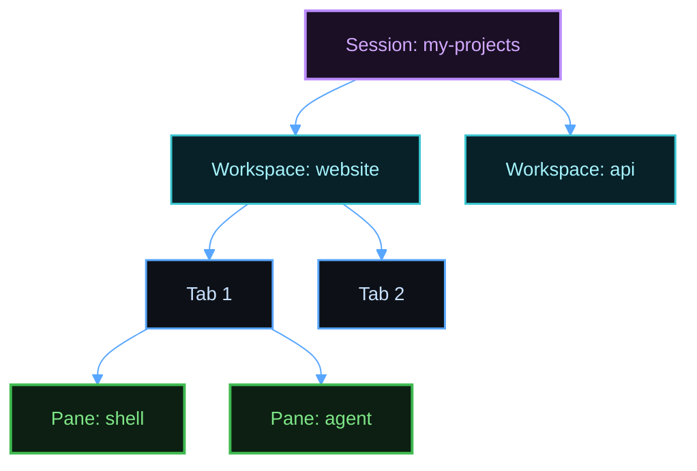
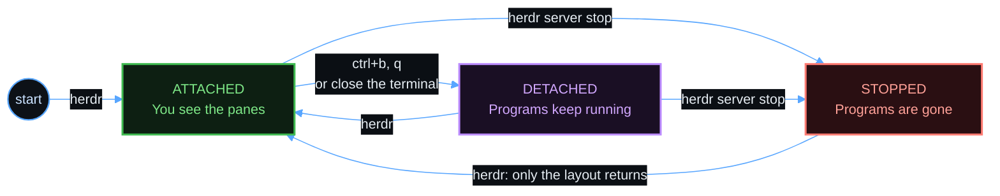
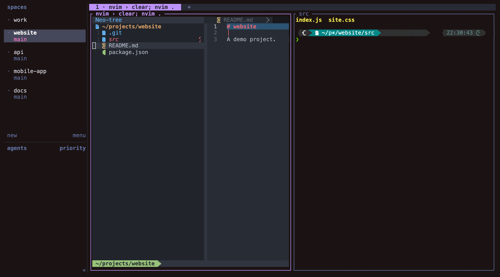
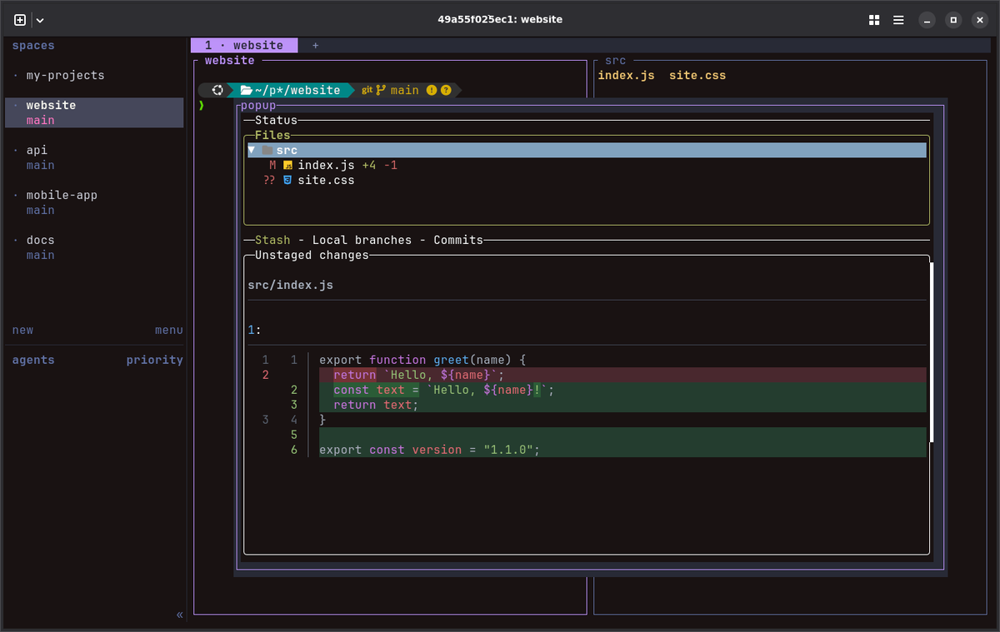

# Herdr cheat sheet

Scope: the commands and keys for daily use of Herdr, with the tools around it. The install steps are in the [setup guide](setup.md). The [keyboard shortcuts guide](keyboard-shortcuts.md) explains which keys the setup changes.

## Words

A session holds workspaces, a workspace holds tabs, and a tab holds panes.



| Word | Meaning |
|------|---------|
| Session | One background server. It keeps its panes running after you leave. `herdr` opens the session named `default`. |
| Workspace | One project, for example one repository. It has its own tabs, and it has one row in the sidebar. |
| Tab | One layout of panes in a workspace. |
| Pane | One real terminal. A pane runs a shell or a program. |
| Sidebar | The list of the workspaces and the agents. |
| Prefix key | The key that tells Herdr that the next key is for Herdr. |
| Direct key | One key press that does a Herdr action, with no prefix key. |
| Attach | Connect your terminal to a running session. |
| Detach | Disconnect your terminal. The session keeps running. |
| Stop | End a session and every program in it. |
| Zoom | Make one pane fill the tab for a short time. |
| Scrollback | The earlier output of a pane. |
| Copy mode | A mode in which the keys move through the scrollback and copy text. |
| Agent | A coding program in a pane, such as Claude Code, OpenCode, Pi, or Hermes. |
| Integration | Files in the folder of an agent program that report the state of the agent to Herdr. |
| Skill | A Markdown file that teaches an agent to control Herdr. |
| Plugin | An added program that Herdr runs, such as Auto Title. |

## How to read the keys

The prefix key is `ctrl+b`. A row such as `ctrl+b`, `c` means: press `ctrl+b`, release it, then press `c`. To see every active key, press `ctrl+b`, then `?`.

## Daily flow

1. Connect with `ssh my-server`.
2. Run `hopen my-projects`. All the projects appear in the sidebar.
3. Click a project in the sidebar, or press `Ctrl+Up` and `Ctrl+Down`.
4. Start an agent in the pane, for example `claude`.
5. Press `ctrl+b`, then `q` to leave. The agent keeps running.

## Open all projects at once

A list is like a Herdr session, and each project in the list is like a Herdr workspace. The list of the session `my-projects` is `~/my-projects/herdspace.toml`.

| Task | Command |
|------|---------|
| Open all the projects of a list | `hopen my-projects` |
| Choose a list from a menu | `hopen` |
| Open the current folder, with no list | `hopen .` |
| Open every list | `hopen --all` |
| Open every list, and attach to one session | `hopen --all my-projects` |
| Show every list and its state | `hopen --list` |
| Split each new workspace with a template | `hopen my-projects --template code` |
| Show every template | `hopen --templates` |
| Split the current tab with a template | `hopen --apply grid` |
| Add a project | Add a `[[project]]` to the list file, then run `hopen` again. |
| Remove a project | Remove the project from the list file, then close its workspace with `ctrl+b`, `shift+d`. |

The list for a session is `~/<session>/herdspace.toml`. A VS Code workspace file, `~/<session>.code-workspace`, also works. `hopen` also adds a workspace with the name of the session, for the folder that holds the list file. Use it to start an agent at the parent level. `hopen` starts a stopped session, adds only the missing projects, and never closes anything. To use a new session, create a list file with the name of the session.

## Start, leave, and return



In the Detached state, your programs keep running. In the Stopped state, your programs are gone, and only the layout returns.

| Task | Command or key |
|------|----------------|
| Start or return to the default session | `herdr` |
| Leave, and keep everything running | `ctrl+b`, `q` |
| Leave by closing the terminal window | Close the window. Everything keeps running. |
| Start or return to a named session | `herdr --session my-projects` |
| Return to a named session | `herdr session attach my-projects` |
| List the sessions | `herdr session list` |
| See the state of the server | `herdr status` |

After a reboot, the login service starts the default session. Run `herdr` to attach. Named sessions stay stopped until you run `hopen`.

## Stop and delete

Do not stop a session to leave it. A stop ends every program in that session. Use `ctrl+b`, `q` to leave.

| Task | Command |
|------|---------|
| Stop the default session | `herdr server stop` |
| Stop a named session | `herdr session stop my-projects` |
| Delete a stopped named session | `herdr session delete my-projects` |
| Start the default session again | `herdr` |

After a stop, the workspaces, tabs, panes, and folders return as new shells. Running programs do not return. An agent with an integration that reports its session resumes its conversation. To see the integrations, run `herdr integration status`.

## Direct keys

These keys work only inside Herdr. In a plain Ghostty window, the `Cmd` keys and the `Ctrl+Shift` keys in this table do nothing.

| Action | Mac | Linux or Windows |
|--------|-----|------------------|
| New tab | `Cmd+T` | `Ctrl+Shift+T` |
| Close tab | `Cmd+W` | `Ctrl+Shift+W` |
| Go to any workspace, tab, or agent | `Cmd+K` | `Ctrl+Shift+K` |
| Previous or next tab | `Ctrl+Left`, `Ctrl+Right` | The same |
| Previous or next workspace | `Ctrl+Up`, `Ctrl+Down` | The same |
| Next or previous pane in the tab | `Alt+Up`, `Alt+Down` | The same |
| Open lazygit over the pane | `Cmd+Shift+G` | `Ctrl+Shift+G` |

## Workspaces

Use one workspace for each project.

| Action | Keys |
|--------|------|
| New workspace | `ctrl+b`, `shift+n` |
| Rename workspace | `ctrl+b`, `shift+w` |
| Close workspace (Herdr asks first) | `ctrl+b`, `shift+d` |
| Open the workspace list | `ctrl+b`, `w` |
| Go to any workspace, tab, or agent | `ctrl+b`, `g` |
| Show or hide the sidebar | `ctrl+b`, `b` |

In the `ctrl+b`, `g` list, type `/` to search and press `Enter` to go. Press `b`, `w`, `i`, or `d` to show only blocked, working, idle, or done agents. Press `a` to show all. Press `Esc` to leave.

## Tabs

| Action | Keys |
|--------|------|
| New tab | `ctrl+b`, `c` |
| Next or previous tab | `ctrl+b`, `n` or `p` |
| Go to tab 1 to 9 | `ctrl+b`, `1` to `9` |
| Rename tab | `ctrl+b`, `shift+t` |
| Close tab | `ctrl+b`, `shift+x` |

The Auto Title plugin names each tab. A name that you set by hand stays.

## Panes

The [templates guide](templates.md) has short videos of these keys.

An ordinary pane closes with no question, and its program stops.

| Action | Keys |
|--------|------|
| Split right | `ctrl+b`, `v` |
| Split down | `ctrl+b`, `-` |
| Move left, down, up, right | `ctrl+b`, `h`, `j`, `k`, `l` |
| Next or previous pane | `ctrl+b`, `tab` or `shift+tab` |
| Zoom the pane, or return | `ctrl+b`, `z` |
| Resize mode | `ctrl+b`, `r` |
| Rename pane | `ctrl+b`, `shift+p` |
| Close pane | `ctrl+b`, `x` |

## Mouse

| Action | Mouse |
|--------|-------|
| Focus a pane, tab, workspace, or agent | Click it |
| Resize a pane | Drag its border |
| Open a menu | Right-click |
| Scroll | Mouse wheel |
| Open a link | `Ctrl`-click |

## Scroll, search, and copy

| Action | Keys |
|--------|------|
| Copy a mouse selection | Select, then `Ctrl+C` |
| Open copy mode | `ctrl+b`, `[` |
| Move in copy mode | `h`, `j`, `k`, `l`, or `PageUp`, `PageDown` |
| Search in copy mode | `/`, then `n` or `N` |
| Start a selection in copy mode | `v` or `Space` |
| Copy in copy mode | `y` or `Enter` |
| Leave copy mode | `q` or `Esc` |
| Open the scrollback in `$EDITOR` | `ctrl+b`, `e` |

## Agents in panes

| State | Meaning |
|-------|---------|
| `blocked` | The agent waits for you. |
| `done` | The agent finished, and you did not see the result. |
| `working` | The agent is busy. |
| `idle` | The agent waits for a prompt. |

| Task | Command |
|------|---------|
| List the agents | `herdr agent list` |
| Explain the state of an agent | `herdr agent explain <pane>` |
| List the panes | `herdr pane list` |

To make one agent start another agent, mention Herdr in the prompt. Add the last two sentences of this prompt each time:

```text
Use Herdr to start an opencode agent named coder in a split next to you. Give it the plan in docs/plan.md and wait until it finishes. If the other agent is blocked on a permission or approval prompt, do not answer it. Stop and tell me.
```

The skill works for each agent program that the server setup found. Every program in a pane can read and type into other panes. Do not let one agent answer the approval prompt of another agent.

## One worktree for each agent

A git worktree is a second checkout of a repository, on its own branch. Give each agent its own worktree, so that two agents do not change the same files. Herdr creates the worktree and opens it as a new workspace.

| Task | Command or key |
|------|----------------|
| New worktree from the selected workspace | `Ctrl+B`, then `Shift+G` |
| New worktree on a branch | `herdr worktree create --branch fix-login` |
| List the worktrees | `herdr worktree list` |
| Open an existing worktree | `herdr worktree open` |
| Remove a worktree checkout | `herdr worktree remove --workspace <id>` |

Herdr puts each checkout in a folder with the name of the repository and the branch. The [Herdr docs](https://herdr.dev/llms.txt) list every option. `hopen` does not close a worktree workspace.

## Jump to folders

zoxide knows only the folders that you visited. Use `cd` with the full path the first time.

| Task | Command or key |
|------|----------------|
| Go to the best match | `z project` |
| Choose from a list | `zi` |
| Search the shell history | `Ctrl+R` |
| Insert a file path | `Ctrl+T` |
| Go to a folder from a list | `Alt+C` |
| List files with `eza` | `ls`, `ll`, `tree` |
| Show a file with `bat` | `cat file` |

## Neovim

Run `nvim .` in a project. Neovim opens the file tree on the left, with the cursor in it. Move with `j` and `k`, or the arrow keys, to see each file on the right. Neovim is a viewer in this setup, because the agents write the code. Its colors are One Dark, on the background of Ghostty. Folder icons have colors by folder name, for example `src`, `tests`, and `docs`.



| Action | Keys |
|--------|------|
| Preview a file | Click it, or move over it with `j` and `k`, or the arrow keys |
| Keep a file open | Double-click it, or press `Enter` |
| Find a file | `Ctrl+P` |
| Search the project | `/` or `Ctrl+Shift+F` |
| Search inside the file | `g`, then `/` |
| Go to a definition | `Ctrl`-click or `Cmd`-click |
| Go back | `Ctrl`-right-click |
| Focus the file tree | `Cmd+E`, or `Ctrl+Shift+E` on Linux |
| Switch the git branch | `Space`, `g`, `c` |
| Show the keys after the leader | `Space` |
| Save | `:w` |
| Quit | `:q`. With unsaved changes, Neovim asks first. |
| Update the plugins | `:Lazy update` |

In a Python project, Neovim uses the `.venv` or `venv` folder of the project, so that the language server finds its packages.

## lazygit

Press `Cmd+Shift+G` in a Herdr pane, or `Ctrl+Shift+G` on Linux. You can also run `lazygit` in a project. The branches of coding agents have their own colors, for example `claude/` and `codex/`. In a narrow pane, the file list is on top and the diff below it.



| Action | Key |
|--------|-----|
| Show every key | `?` |
| Stage or unstage a file | `Space` |
| Stage all files | `a` |
| Commit | `c` |
| Pull | `p` |
| Push | `P` |
| Undo | `z` |
| Check out a branch by name | `b` |
| Switch the diff view: delta with line numbers, or the changed words | `\|` |
| Go back, or close at the top level | `Esc` |
| Close | `q` |

## Configuration

The Herdr configuration is in `~/.config/herdr/config.toml`. After a change, run this command. It does not close any pane:

```bash
herdr server reload-config
```

| Task | Command |
|------|---------|
| Show every default value | `herdr --default-config` |
| Remove every custom key | `herdr config reset-keys` |
| List the plugins | `herdr plugin list` |
| Start the Auto Title plugin | `herdr plugin action invoke restart --plugin herdr.auto-title` |
| Show the state of the integrations | `herdr integration status` |

To update the tools, follow the [updating guide](updating.md). To see what a machine still needs, run its script with `--check`.

## Problems

| Problem | Action |
|---------|--------|
| `Cmd+T`, `Cmd+W`, or `Cmd+K` does nothing | Herdr is not open. Run `herdr`. If Herdr is open, run `./bootstrap.sh client` again. |
| The `Ctrl` arrow keys change the macOS space | Log out and log in. Then look in System Settings, Keyboard, Keyboard Shortcuts, Mission Control. |
| `Ctrl+Shift+F` or `Cmd+E` does nothing in Neovim | Press `/` to search, or click the file tree. |
| A new tab shows only a number | Start the Auto Title plugin. |
| An agent shows the wrong state | Run `herdr agent explain <pane>`. |
| `herdr` refuses to start | You are already in a Herdr pane. Herdr blocks a nested start. |
| `herdr status` shows `server_binary_stale: yes` | Save your work. Run `herdr server stop`, and then run `herdr`. |
| `z project` goes nowhere | Use `cd` with the full path one time. |

## References

- [Herdr documentation](https://herdr.dev/tui/docs/)
- [Herdr keyboard](https://herdr.dev/tui/docs/keyboard/)
- [Herdr session state](https://herdr.dev/tui/docs/session-state/)
- [Herdr CLI reference](https://herdr.dev/tui/docs/cli-reference/)
- [lazygit keybindings](https://github.com/jesseduffield/lazygit/blob/master/docs/keybindings/Keybindings_en.md)
- [LazyVim keymaps](https://www.lazyvim.org/keymaps)
