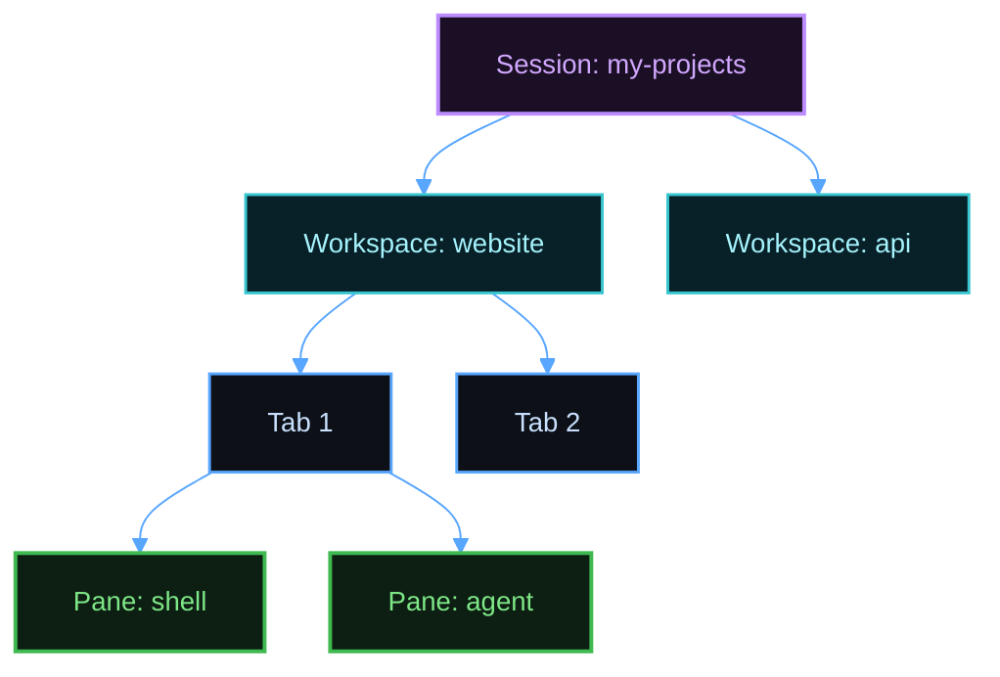

# Herdr cheat sheet

[Documentation index](README.md)

Scope: the commands and keys for daily use of Herdr, with the tools around it. The install steps are in the [setup guide](setup.md). The [keyboard shortcuts guide](keyboard-shortcuts.md) explains which keys the setup changes.

## By task

| Task | Page |
|------|------|
| Move between workspaces, tabs, and panes, and move in the lists | [Move around](navigation.md) |
| Split, swap, resize, and zoom panes, and use templates | [Panes and layout](layout.md) |
| Open, find, and read files, Neovim, and Markdown | [Files and the editor](files.md) |
| lazygit and worktrees | [Git and worktrees](git.md) |
| Start, leave, stop, and delete sessions | [Sessions](sessions.md) |
| Agents in panes | [Agents](agents.md) |

## Daily commands

| Task | Command or key |
|------|----------------|
| Start or attach to the default session | `herdr` |
| Open the projects of a list, and attach | `hopen my-projects` |
| Start or attach to a named session | `herdr --session my-projects` |
| Show the sessions | `herdr session list` |
| Leave the session, and keep every program running | `alt+space`, then `q` |
| Stop a named session, and end every program in it | `herdr session stop my-projects` |
| Stop the default session | `herdr server stop` |
| Delete a stopped session | `herdr session delete my-projects` |
| New tab, close tab, go to anything | `Cmd+T`, `Cmd+W`, `Cmd+K`. On Linux: `Ctrl+Shift+T`, `W`, `K` |
| Show the state of the server | `herdr status` |

The official Herdr docs have every command and key: [documentation](https://herdr.dev/tui/docs/), [CLI reference](https://herdr.dev/tui/docs/cli-reference/), [keyboard](https://herdr.dev/tui/docs/keyboard/), and [session state](https://herdr.dev/tui/docs/session-state/). [Stop and delete](sessions.md#stop-and-delete) explains what a stop ends.

## Words

A session holds workspaces, a workspace holds tabs, and a tab holds panes.



| Word | Meaning |
|------|---------|
| Session | One background server. It keeps its panes running after you leave. `herdr` opens the session named `default`. |
| Workspace | One project, for example one repository. It has its own tabs, and it has one row in the sidebar. |
| Tab | One layout of panes in a workspace. |
| Pane | One real terminal. A pane runs a shell or a program. |
| Sidebar | The list of the workspaces and the agents. |
| Prefix key | The key that tells Herdr that the next key is for Herdr. |
| Direct key | One key press that does a Herdr action, with no prefix key. |
| Attach | Connect your terminal to a running session. |
| Detach | Disconnect your terminal. The session keeps running. |
| Stop | End a session and every program in it. |
| Zoom | Make one pane fill the tab for a short time. |
| Scrollback | The earlier output of a pane. |
| Copy mode | A mode in which the keys move through the scrollback and copy text. |
| Agent | A coding program in a pane, such as Claude Code, OpenCode, Pi, or Hermes. |
| Integration | Files in the folder of an agent program that report the state of the agent to Herdr. |
| Skill | A Markdown file that teaches an agent to control Herdr. |
| Plugin | An added program that Herdr runs, such as Auto Title. |

## How to read the keys

The prefix key is `alt+space`. A row such as `alt+space`, `c` means: press `alt+space`, release it, then press `c`. To see every active key, press `alt+space`, then `?`. To change the prefix, see [The prefix key](keyboard-shortcuts.md#the-prefix-key).

## Daily flow

1. Connect with `ssh my-server`.
2. Run `hopen my-projects`. All the projects appear in the sidebar.
3. Click a project in the sidebar, or press `Ctrl+Up` and `Ctrl+Down`.
4. Start an agent in the pane, for example `claude`.
5. Press `alt+space`, then `q` to leave. The agent keeps running.

## Command palette

The palette is the place to start. Press `Cmd+Shift+P` (Mac) or `Ctrl+Shift+P` (Linux) in Herdr, type a few letters, and press Enter. For example, type `split` to split the pane, `worktree` for a new worktree for an agent, `lazygit` to open lazygit in a new tab, or `keys` to show the keys. To show one session in two windows, type `window`. To open a program beside the current pane, press `Ctrl+V` (right), `Ctrl+S` (below), or `Ctrl+T` (new tab) instead of Enter. See [The command palette](hopen.md#the-command-palette).

## Direct keys

These keys work only inside Herdr. In a plain Ghostty window, the `Cmd` keys and the `Ctrl+Shift` keys in this table do nothing, so use the [replacement keys](keyboard-shortcuts.md#replacement-keys-for-ghostty) there, for example `Cmd+Option+T` for a new Ghostty tab and `Cmd+Option+W` to close it.

| Action | Mac | Linux or Windows |
|--------|-----|------------------|
| New tab | `Cmd+T` | `Ctrl+Shift+T` |
| Close tab | `Cmd+W` | `Ctrl+Shift+W` |
| Go to any workspace, tab, or agent. Move with `j` and `k`, search with `/` | `Cmd+K` | `Ctrl+Shift+K` |
| Previous or next tab | `Ctrl+Left`, `Ctrl+Right` | The same |
| Previous or next workspace | `Ctrl+Up`, `Ctrl+Down` | The same |
| Next or previous pane in the tab | `Alt+Up`, `Alt+Down` | The same |
| Open lazygit over the pane | `Cmd+Shift+G` | `Ctrl+Shift+G` |
| Open the command palette (`hopen --palette`): every action, in groups | `Cmd+Shift+P` | `Ctrl+Shift+P` |
| Quick open a file of the project in the editor of the tab (`hopen --quick-open`) | `Cmd+P` | `Alt+Space`, then `F` |
| Search the files that `.gitignore` names, in the folders that you choose: the palette action "Files: Choose folders" | `Cmd+Shift+P` | `Ctrl+Shift+P` |

## Configuration

The Herdr configuration is in `~/.config/herdr/config.toml`. After a change, run this command. It does not close any pane:

```bash
herdr server reload-config
```

| Task | Command |
|------|---------|
| Show every default value | `herdr --default-config` |
| Remove every custom key | `herdr config reset-keys` |
| List the plugins | `herdr plugin list` |
| Start the Auto Title plugin | `herdr plugin action invoke restart --plugin herdr.auto-title` |
| Show the state of the integrations | `herdr integration status` |

To update herdspace, run `herdspace update`. To remove herdspace, run `herdspace uninstall --check` and then `herdspace uninstall` (see [uninstall](setup.md#uninstall-herdspace)). To see the installed and the latest version, run `herdspace --version`. To update the tools, follow the [updating guide](updating.md). To see what a machine still needs, run its setup command again with `--check` after the role, for example `bash -s -- server --check`.

## Problems

| Problem | Action |
|---------|--------|
| `Cmd+T`, `Cmd+W`, or `Cmd+K` does nothing | Herdr is not open. Run `herdr`, or use the [replacement keys](keyboard-shortcuts.md#replacement-keys-for-ghostty) of Ghostty. To give the keys back to Ghostty, run `herdspace keys normal` on the client. If Herdr is open, run the client setup command again, with the same `--server` names. See [setup](setup.md#macos-client). |
| `'xterm-ghostty': unknown terminal type` on a server | See [A server without herdspace](ssh.md#a-server-without-herdspace). |
| The `Ctrl` arrow keys change the macOS space | Log out and log in. Then look in System Settings, Keyboard, Keyboard Shortcuts, Mission Control. |
| `Ctrl+Shift+F` or `Cmd+E` does nothing in Neovim | If text is selected in Ghostty, `Cmd+E` searches for it in Ghostty. Click once to clear the selection. Otherwise, press `/` to search, or click the file tree. |
| A new tab shows only a number | Start the Auto Title plugin. |
| An agent shows the wrong state | Run `herdr agent explain <pane>`. |
| `herdr` refuses to start | You are already in a Herdr pane. Herdr blocks a nested start. |
| `herdr status` shows `server_binary_stale: yes` | Save your work. Run `herdr server stop`, and then run `herdr`. |
| `z project` goes nowhere | Use `cd` with the full path one time. |

## References

- [Herdr documentation](https://herdr.dev/tui/docs/)
- [Herdr keyboard](https://herdr.dev/tui/docs/keyboard/)
- [Herdr session state](https://herdr.dev/tui/docs/session-state/)
- [Herdr CLI reference](https://herdr.dev/tui/docs/cli-reference/)
- [lazygit keybindings](https://github.com/jesseduffield/lazygit/blob/master/docs/keybindings/Keybindings_en.md)
- [LazyVim keymaps](https://www.lazyvim.org/keymaps)
