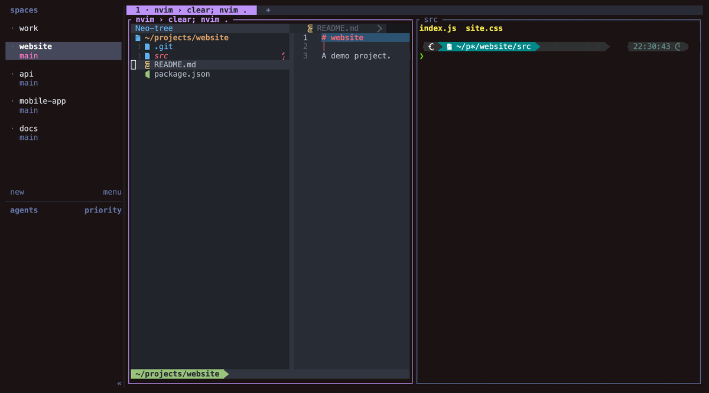

# Files and the editor

[Documentation index](README.md) · [Cheat sheet](cheat-sheet.md) · [Words](cheat-sheet.md#words)

Scope: quick open, find and search in the files, Neovim, and Markdown and images.

## Quick open, find, and search

| Action | Mac | Linux |
|--------|-----|-------|
| Quick open a file of the project in the editor of the tab | `Cmd+P` | `ctrl+b`, `f` |
| Find a file in the shell, and open it | `ff` | `ff` |
| Search in the files, and open a result | `fif TEXT` | `fif TEXT` |

In Herdr, a result of the search of the palette ("Files: Search in the files") opens like quick open, at its line. See [Quick open](hopen.md#quick-open).

## Neovim

Run `nvim .` in a project. If you have your own `~/.config/nvim`, run `NVIM_APPNAME=herdspace-nvim nvim .` for the herdspace editor. See [Your Neovim files](setup.md#your-neovim-files). Neovim opens the file tree on the left, with the cursor in it. Move with `j` and `k`, or the arrow keys, to see each file on the right. Neovim is a viewer in this setup, because the agents write the code. Its colors are One Dark, on the background of Ghostty. Folder icons have colors by folder name, for example `src`, `tests`, and `docs`.

| Action | Keys |
|--------|------|
| Preview a file | Click it, or move over it with `j` and `k`, or the arrow keys |
| Keep a file open | Double-click it, or press `Enter` |
| Find a file | `Ctrl+P` |
| Search the project | `/` or `Ctrl+Shift+F` |
| Search inside the file | `g`, then `/` |
| Go to a definition | `Ctrl`-click or `Cmd`-click |
| Go back | `Ctrl`-right-click |
| Focus the file tree | `Cmd+E`, or `Ctrl+Shift+E` on Linux |
| Switch the git branch | `Space`, `g`, `c` |
| Show the keys after the leader | `Space` |
| Save | `:w` |
| Close the file. With no other file, close Neovim | `Ctrl+Q`. With unsaved changes, Neovim asks first. |
| Quit | `:q`. With unsaved changes, Neovim asks first. |
| Update the plugins | `:Lazy update` |

In a Python project, Neovim uses the `.venv` or `venv` folder of the project, so that the language server finds its packages.

### Markdown and images

Neovim renders a Markdown file in the editor: headings with an icon in place of `###`, tables, code blocks, and checkboxes. The line with the cursor shows the raw text, so that you can edit it. To read a Markdown file, open the palette and choose "Files: Read a Markdown file, rendered". Press `Ctrl+V` instead of Enter to open it on the right of an agent.

| Action | Keys |
|--------|------|
| Show the raw text, or render again | `Space`, `u`, `m` |
| Preview in a browser (on the machine that runs Neovim) | `Space`, `c`, `p` |

Neovim also shows images: an image in a Markdown file, and an image file that you open. It uses the Kitty graphics protocol. Ghostty supports it, and Herdr 0.9.2 and later pass the images of a pane to Ghostty. With no ImageMagick (`magick`), Neovim shows PNG files only. Run `:checkhealth snacks` to see what works in your terminal.

## References

- [Herdr documentation](https://herdr.dev/tui/docs/)
- [Herdr keyboard](https://herdr.dev/tui/docs/keyboard/)
- [Herdr CLI reference](https://herdr.dev/tui/docs/cli-reference/)
