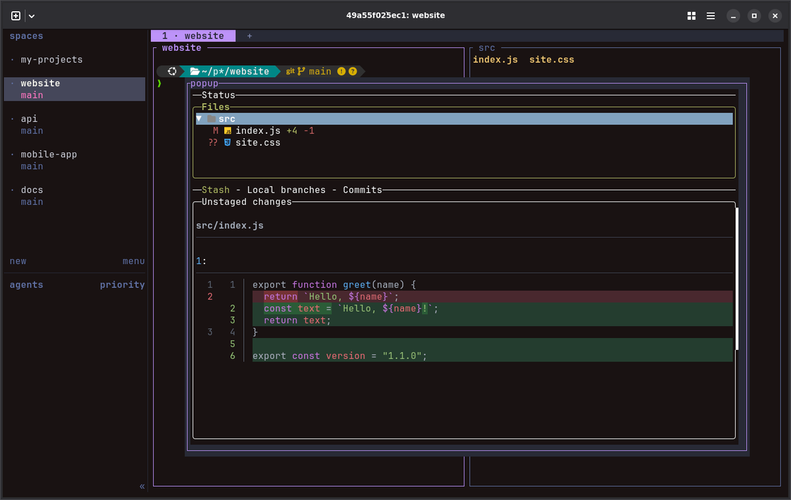

# Git and worktrees

[Documentation index](README.md) · [Cheat sheet](cheat-sheet.md) · [Words](cheat-sheet.md#words)

Scope: lazygit, and one worktree for each agent.

## lazygit

Press `Cmd+Shift+G` in a Herdr pane, or `Ctrl+Shift+G` on Linux. You can also run `lazygit` in a project. The branches of coding agents have their own colors, for example `claude/` and `codex/`. In a narrow pane, the file list is on top and the diff below it.

| Action | Key |
|--------|-----|
| Show every key | `?` |
| Stage or unstage a file | `Space` |
| Stage all files | `a` |
| Commit | `c` |
| Pull | `p` |
| Push | `P` |
| Undo | `z` |
| Check out a branch by name | `b` |
| Switch the diff view: delta with line numbers, or the changed words | `\|` |
| Go back, or close at the top level | `Esc` |
| Close | `q` |

## One worktree for each agent

A git worktree is a second checkout of a repository, on its own branch. Give each agent its own worktree, so that two agents do not change the same files. Herdr creates the worktree and opens it as a new workspace.

| Task | Command or key |
|------|----------------|
| New worktree from the selected workspace | `Ctrl+B`, then `Shift+G` |
| New worktree on a branch | `herdr worktree create --branch fix-login` |
| List the worktrees | `herdr worktree list` |
| Open an existing worktree | `herdr worktree open` |
| Remove a worktree checkout | `herdr worktree remove --workspace <id>` |

Herdr puts each checkout in a folder with the name of the repository and the branch. The [Herdr docs](https://herdr.dev/llms.txt) list every option. `hopen` does not close a worktree workspace.

## References

- [Herdr documentation](https://herdr.dev/tui/docs/)
- [Herdr keyboard](https://herdr.dev/tui/docs/keyboard/)
- [Herdr CLI reference](https://herdr.dev/tui/docs/cli-reference/)
