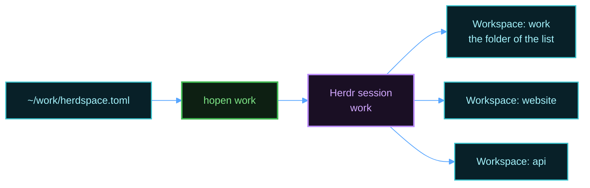

# hopen

Scope: open your projects in Herdr with `hopen`, and install, update, or remove it.

`hopen` reads a list of projects and opens each project as a Herdr workspace in one named session. A list is a `herdspace.toml` file. If you come from VS Code, `hopen` also reads a VS Code workspace file. See [Use a VS Code workspace file](#use-a-vs-code-workspace-file). The server setup installs `hopen`. The [templates guide](templates.md) explains how to split each project into named panes.

## Write a list



Create `~/work/herdspace.toml`:

```toml
[[project]]
name = "website"
path = "~/code/website"

[[project]]
name = "api"
path = "~/code/api"
```

Open it:

```bash
hopen work
```

The name of the folder, `work`, is the name of the session. The first workspace has the name of the session and opens the folder of the list. Run `hopen` again after you add a project. It adds only the new projects.

To open every list at once, run this command:

```bash
hopen --all
```

`hopen --all` starts one session for each list, and it adds the missing workspaces. A terminal can attach to one session at a time, so add a name to attach to that session:

```bash
hopen --all work
```

`hopen` finds a list at `~/<name>/herdspace.toml`. A `herdspace.toml` file is in [TOML](https://toml.io), the format of the Herdr configuration. It needs Python 3.11 or later. On a Mac, the server setup installs it. To install it yourself, run `brew install python`.


## Commands

| Command | Effect |
|---------|--------|
| `hopen work` | Open the projects of one list, and attach to that session. |
| `hopen work --file <path>` | Read the list from another file. |
| `hopen work --no-attach` | Open the projects, but do not attach. |
| `hopen work --template code` | Split each new project with a template. |
| `hopen work --trust` | Use the commands and values of the list with no question. See [Commands and values from a list](#commands-and-values-from-a-list). |
| `hopen --all` | Open every list. |
| `hopen --list` | Show every list and its state. |
| `hopen --templates` | Show every template. |
| `hopen --apply grid` | Split the current tab with a template. |
| `hopen --convert work` | Write `~/work/herdspace.toml` from the VS Code workspace file `work`. It never replaces a file. |
| `hopen --version` | Show the installed release. |

## Settings

All settings are optional. This example opens `website` with the `code` template. It installs the packages one time, sets `PORT`, and adds a tab for the logs:

```toml
# ~/work/herdspace.toml
template = "agent"            # the template for each project with no template

[[project]]
name = "website"
path = "~/code/website"       # or a path relative to this folder
template = "code"
on_open = "npm install"
env = { PORT = "3000" }
tabs = [{ name = "logs", run = "tail -f log/dev.log" }]

[[project]]
name = "api"
path = "~/code/api"
```

| Key | Effect |
|-----|--------|
| `session` | The name of the session, in place of the folder name. |
| `template` | The template for each project that has no template of its own. The default is `plain`. |
| `parent_workspace` | `false` to open no workspace for the folder of the list. The default is `true`. |
| `parent_template`, `on_open`, `env` | At the top of the file: the template, the command, and the values of the parent workspace. |
| `[[project]]` | One project. It needs a `path`. |
| `name` | The name of the workspace. The default is the name of the folder. |
| `template` | In a project: the template of this project. |
| `on_open` | A command. It runs one time, when `hopen` creates the workspace, before the template programs start. |
| `env` | Environment values. Each workspace, tab, and pane that `hopen` creates for the project gets them. |
| `tabs` | More tabs. Each tab has a `name`, and an optional `template` and `run` command. |

`on_open`, `env`, and `tabs` apply when `hopen` creates a workspace. A workspace that exists does not change. A setting with a wrong value gives a warning, and the other projects still open. `on_open` and `tabs` run commands, and `env` sets values. See [Commands and values from a list](#commands-and-values-from-a-list).

## Use a VS Code workspace file

If you use VS Code, you can keep one list for VS Code and Herdr. `hopen` reads a VS Code workspace file at `~/<name>.code-workspace` or at `~/<name>/<name>.code-workspace`. Each folder of the file becomes a workspace. The settings go in the `settings` block, and VS Code ignores them:

```json
{
  "folders": [
    { "name": "website", "path": "./code/website" },
    { "name": "api", "path": "./code/api" }
  ],
  "settings": {
    "hopen.template": "agent",
    "hopen.templates": { "website": "code" },
    "hopen.onOpen": { "website": "npm install" },
    "hopen.env": { "website": { "PORT": "3000" } },
    "hopen.tabs": { "website": [ { "name": "logs", "run": "tail -f log/dev.log" } ] }
  }
}
```

| VS Code setting | `herdspace.toml` key |
|-----------------|----------------------|
| `hopen.session` | `session` |
| `hopen.template` | `template`, at the top |
| `hopen.templates` | `template`, in a project |
| `hopen.parentWorkspace` | `parent_workspace` |
| `hopen.onOpen` | `on_open` |
| `hopen.env` | `env` |
| `hopen.tabs` | `tabs` |

A setting for one folder uses the name of the folder. A setting for the parent workspace uses the name of the session. A VS Code workspace file also works with a Python 3 that is older than 3.11.

To change to a `herdspace.toml` list, run this command. `hopen` then uses the new file, and it prints a warning about the old one until you remove it:

```bash
hopen --convert work
```

## Commands and values from a list

A list file can come from another person, for example in a repository that you clone. For that reason, `hopen` asks before it uses the commands and environment values of a list:

1. The first time, `hopen` shows each command and value, and asks "Use them?". The default answer is no.
2. If you answer yes, `hopen` saves a checksum of the list file in `~/.local/state/hopen/trusted.tsv`. A later run uses the commands and values with no question.
3. After each change to the list file, `hopen` asks again.

With no answer, `hopen` still opens the workspaces, but it runs no command and sets no value from the list. With no terminal, for example in a script, add `--trust` to approve the list.

## Session names

The name of the session comes from the file name, or the folder name for `herdspace.toml`. `hopen.session` and `session` can set another name. A list that only claims a name never takes over a list whose own file or folder has that name. `hopen` skips the claiming list, and it prints a warning. If two lists claim one name and no list has it as its own, `hopen` skips both, and it names them.

## Install only hopen

On a machine that has Herdr already, you can install `hopen` and its templates without the rest of the setup. You need curl and Python 3.11 or later. A VS Code workspace file also works with an older Python 3:

```bash
curl -fsSL https://github.com/MussaCharles/herdspace/releases/latest/download/install.sh | bash
```

`install.sh` copies `hopen` to `~/.local/bin` and the templates to `~/.config/hopen/templates`, after a checksum check.

## Update hopen

Run the install command again. It installs the newest release. `install.sh` keeps a template that you changed, and it writes the new version next to it as `<name>.layout.new`.

## Remove hopen

Run the install command with `--uninstall`. It keeps your templates:

```bash
curl -fsSL https://github.com/MussaCharles/herdspace/releases/latest/download/install.sh | bash -s -- --uninstall
```
