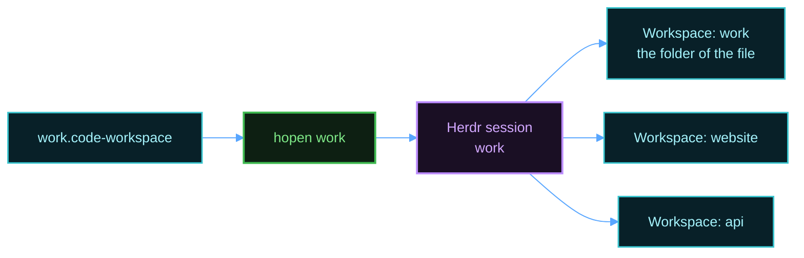
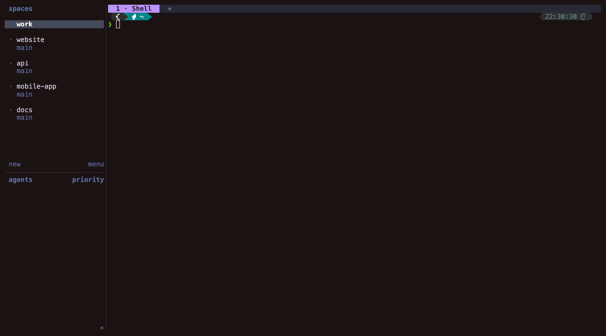

# hopen

Scope: open your projects in Herdr with `hopen`, and install, update, or remove it.

`hopen` reads a VS Code workspace file and opens each folder as a Herdr workspace in one named session. The server setup installs it. The [templates guide](templates.md) explains how to split each project into named panes.

## Write a list



Create `~/work.code-workspace`:

```json
{
  "folders": [
    { "name": "website", "path": "./code/website" },
    { "name": "api", "path": "./code/api" }
  ]
}
```

Open it:

```bash
hopen work
```

The first workspace has the name of the session and opens the folder that holds the file. Run `hopen` again after you add a folder. It adds only the new folders.

To open every list at once, run this command:

```bash
hopen --all
```

`hopen --all` starts one session for each list, and it adds the missing workspaces. A terminal can attach to one session at a time, so add a name to attach to that session:

```bash
hopen --all work
```

`hopen` finds a list at `~/<name>.code-workspace` or at `~/<name>/<name>.code-workspace`.



## Commands

| Command | Effect |
|---------|--------|
| `hopen work` | Open the projects of one list, and attach to that session. |
| `hopen work --file <path>` | Read the list from another file. |
| `hopen work --no-attach` | Open the projects, but do not attach. |
| `hopen work --template code` | Split each new project with a template. |
| `hopen --all` | Open every list. |
| `hopen --list` | Show every list and its state. |
| `hopen --templates` | Show every template. |
| `hopen --apply grid` | Split the current tab with a template. |
| `hopen --version` | Show the installed release. |

## Install only hopen

On a machine that has Herdr already, you can install `hopen` and its templates without the rest of the setup. You need Python 3 and curl:

```bash
curl -fsSL https://github.com/MussaCharles/herdspace/releases/latest/download/install.sh | bash
```

`install.sh` copies `hopen` to `~/.local/bin` and the templates to `~/.config/hopen/templates`, after a checksum check.

## Update hopen

Run the install command again. It installs the newest release. `install.sh` keeps a template that you changed, and it writes the new version next to it as `<name>.layout.new`.

## Remove hopen

Run the install command with `--uninstall`. It keeps your templates:

```bash
curl -fsSL https://github.com/MussaCharles/herdspace/releases/latest/download/install.sh | bash -s -- --uninstall
```
