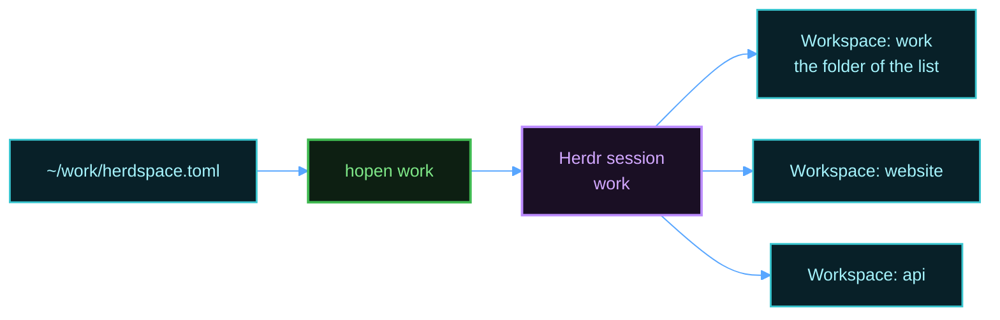

# hopen

Scope: open your projects in Herdr with `hopen`, and install, update, or remove it.

`hopen` reads a list of projects and opens each project as a Herdr workspace in one named session. A list is a `herdspace.toml` file. If you come from VS Code, `hopen` also reads a VS Code workspace file. See [Use a VS Code workspace file](#use-a-vs-code-workspace-file), and the [From VS Code](vscode.md) guide. The server setup installs `hopen`. The [templates guide](templates.md) explains how to split each project into named panes.

## Write a list



Create `~/work/herdspace.toml`:

```toml
[[project]]
name = "website"
path = "~/code/website"

[[project]]
name = "api"
path = "~/code/api"
```

Open it:

```bash
hopen work
```

The name of the folder, `work`, is the name of the session. The first workspace has the name of the session and opens the folder of the list. Run `hopen` again after you add a project. It adds only the new projects.

To choose a list from a menu, run `hopen` with no name. It uses [fzf](https://github.com/junegunn/fzf) if it is installed, and the server setup installs it. With no fzf, or in a terminal with no `TERM`, `hopen` shows a numbered menu. Type a number or a name.

To open every list at once, run this command:

```bash
hopen --all
```

`hopen --all` starts one session for each list, and it adds the missing workspaces. A terminal can attach to one session at a time, so add a name to attach to that session:

```bash
hopen --all work
```

`hopen` finds a list at `~/<name>/herdspace.toml`. A `herdspace.toml` file is in [TOML](https://toml.io), the format of the Herdr configuration. It needs Python 3.11 or later. On a Mac, the server setup installs it. To install it yourself, run `brew install python`.


## Open one folder

To open one folder with no list, as `code .` does in VS Code, run this command in the folder:

```bash
hopen .
```

`hopen` opens the folder as one workspace, in a session with the name of the folder. A path also works, for example `hopen ~/code/api`. A path must have a `/`, or `hopen` reads it as the name of a list. If the folder has a `herdspace.toml` file or a `<folder>.code-workspace` file, `hopen` opens that list. `hopen` asks before it uses the commands and values of that list, as for each list. If the list names a session that another list has, `hopen` stops. In a session name, each character that is not a letter, a number, `.`, `-`, or `_` becomes `-`.

## Commands

| Command | Effect |
|---------|--------|
| `hopen work` | Open the projects of one list, and attach to that session. |
| `hopen` | Choose a list from a menu. |
| `hopen .` | Open the current folder, with no list. See [Open one folder](#open-one-folder). |
| `hopen work --file <path>` | Read the list from another file. |
| `hopen work --no-attach` | Open the projects, but do not attach. |
| `hopen work --template code` | Split each new project with a template. A project that has a workspace already does not change. To split it, run `hopen --apply code` in its tab in Herdr. |
| `hopen work --trust` | Use the commands and values of the list with no question. See [Commands and values from a list](#commands-and-values-from-a-list). |
| `hopen --all` | Open every list. |
| `hopen --list` | Show every list and its state. |
| `hopen --templates` | Show every template. |
| `hopen --apply grid` | Split the current tab with a template. |
| `hopen --convert work` | Write `~/work/herdspace.toml` from the VS Code workspace file `work`. It never replaces a file. |
| `hopen --completion zsh` | Print the shell completion script for zsh or bash. See [Shell completion](#shell-completion). |
| `hopen --task test` | Run the task `test` of the project of the current folder. With no name, choose a task from a menu. See [Tasks](#tasks). |
| `hopen --find` | Choose a file of the current folder with fzf, and open it in the editor. The shell command `ff` does the same. |
| `hopen --grep TEXT` | Search the files of the current folder for TEXT, choose a result, and open the file at that line. The shell command `fif TEXT` does the same. |
| `hopen --ports` | Show each TCP port that your programs listen on, with the program and its project, like the Ports view of VS Code. |
| `hopen --palette` | Choose an action from a menu, like the command palette of VS Code. In Herdr, `Cmd+Shift+P` (Mac) or `Ctrl+Shift+P` (Linux) opens it. See [The command palette](#the-command-palette). |
| `hopen --version` | Show the installed release. |

## Settings

All settings are optional. This example opens `website` with the `code` template. It installs the packages one time, sets `PORT`, and adds a tab for the logs:

```toml
# ~/work/herdspace.toml
template = "agent"            # the template for each project with no template

[[project]]
name = "website"
path = "~/code/website"       # or a path relative to this folder
template = "code"
on_open = "npm install"
env = { PORT = "3000" }
env_file = ".env"
tasks = { test = "npm test", dev = "npm run dev" }
tabs = [{ name = "logs", run = "tail -f log/dev.log" }]

[[project]]
name = "api"
path = "~/code/api"
```

| Key | Effect |
|-----|--------|
| `session` | The name of the session, in place of the folder name. |
| `template` | The template for each project that has no template of its own. The default is `plain`. |
| `parent_workspace` | `false` to open no workspace for the folder of the list. The default is `true`. |
| `parent_template`, `on_open`, `env` | At the top of the file: the template, the command, and the values of the parent workspace. |
| `[[project]]` | One project. It needs a `path`. |
| `name` | The name of the workspace. The default is the name of the folder. |
| `template` | In a project: the template of this project. |
| `on_open` | A command. It runs one time, when `hopen` creates the workspace, before the template programs start. |
| `env` | Environment values. Each workspace, tab, and pane that `hopen` creates for the project gets them. |
| `env_file` | A `.env` file with more environment values. A relative path starts at the folder of the project, or of the list at the top. A value in `env` wins over the same name in the file. |
| `tasks` | Named commands that you run when you want, with `hopen --task`. See [Tasks](#tasks). At the top, the tasks of the parent workspace. |
| `tabs` | More tabs. Each tab has a `name`, and an optional `template` and `run` command. |

A `.env` file has one `KEY=VALUE` on each line. `hopen` skips empty lines and lines that start with `#`. It accepts `export ` in front, and quotes around a value. An env file cannot set a name that can make a program run code, for example `PATH`, `LD_PRELOAD`, `NODE_OPTIONS`, or `PROMPT_COMMAND`. Put such a value in `env`. `on_open`, `env`, `env_file`, and `tabs` apply when `hopen` creates a workspace. A workspace that exists does not change. A setting with a wrong value gives a warning, and the other projects still open. `on_open` and `tabs` run commands, and `env` sets values. See [Commands and values from a list](#commands-and-values-from-a-list).

## Tasks

A task is a named command of a project, such as `test` or `dev`, like a task of `tasks.json` in VS Code. Add the tasks to a project:

```toml
[[project]]
name = "website"
path = "~/code/website"
tasks = { test = "npm test", dev = "npm run dev" }
```

In a folder of the project, run a task:

```bash
hopen --task test
```

`hopen` finds the project that holds the current folder. In Herdr, the task runs in a new pane below the current pane, and the pane has the name of the task. Outside Herdr, the task runs in the current terminal. The task gets the environment values of the project, and it runs in the folder where you started it. With no name, `hopen --task` shows a menu of the tasks. Tab completes the task names.

A task is a command from the list, so it needs the same approval as `on_open`. See [Commands and values from a list](#commands-and-values-from-a-list).

## The command palette

In Herdr, press `Cmd+Shift+P` on a Mac or `Ctrl+Shift+P` on Linux. `Ctrl+B`, then `A` also works. A menu shows the actions that fit the current folder:

- Run a task of the project.
- Find a file, or search in the files, and open the result.
- Open lazygit.
- Show the ports that your programs listen on.
- Split the current tab with a template.
- Show every list, or open every list.

Outside Herdr, run `hopen --palette`. There, the menu also offers to open a list or the current folder. The palette uses fzf if it is installed, and a numbered menu if not. Esc closes it.

## Use a VS Code workspace file

If you use VS Code, you can keep one list for VS Code and Herdr. `hopen` reads a VS Code workspace file at `~/<name>.code-workspace` or at `~/<name>/<name>.code-workspace`. Each folder of the file becomes a workspace. The settings go in the `settings` block, and VS Code ignores them:

```json
{
  "folders": [
    { "name": "website", "path": "./code/website" },
    { "name": "api", "path": "./code/api" }
  ],
  "settings": {
    "hopen.template": "agent",
    "hopen.templates": { "website": "code" },
    "hopen.onOpen": { "website": "npm install" },
    "hopen.env": { "website": { "PORT": "3000" } },
    "hopen.tasks": { "website": { "test": "npm test" } },
    "hopen.tabs": { "website": [ { "name": "logs", "run": "tail -f log/dev.log" } ] }
  }
}
```

| VS Code setting | `herdspace.toml` key |
|-----------------|----------------------|
| `hopen.session` | `session` |
| `hopen.template` | `template`, at the top |
| `hopen.templates` | `template`, in a project |
| `hopen.parentWorkspace` | `parent_workspace` |
| `hopen.onOpen` | `on_open` |
| `hopen.env` | `env` |
| `hopen.envFile` | `env_file` |
| `hopen.tasks` | `tasks` |
| `hopen.tabs` | `tabs` |

A setting for one folder uses the name of the folder. A setting for the parent workspace uses the name of the session. A VS Code workspace file also works with a Python 3 that is older than 3.11.

To change to a `herdspace.toml` list, run this command. `hopen` then uses the new file, and it prints a warning about the old one until you remove it:

```bash
hopen --convert work
```

## Commands and values from a list

A list file can come from another person, for example in a repository that you clone. For that reason, `hopen` asks before it uses the commands and environment values of a list:

1. The first time, `hopen` shows each command and value, and asks "Use them?". The default answer is no. For an env file, it shows the file and its values, but it hides a value whose name looks like a secret, for example `API_TOKEN` or `DB_PASSWORD`.
2. If you answer yes, `hopen` saves a checksum of the list file in `~/.local/state/hopen/trusted.tsv`. A later run uses the commands and values with no question.
3. After each change to the list file or to the values of its env files, `hopen` asks again.

With no answer, `hopen` still opens the workspaces, but it runs no command and sets no value from the list. With no terminal, for example in a script, add `--trust` to approve the list.

## Session names

The name of the session comes from the file name, or the folder name for `herdspace.toml`. `hopen.session` and `session` can set another name. A list that only claims a name never takes over a list whose own file or folder has that name. `hopen` skips the claiming list, and it prints a warning. If two lists claim one name and no list has it as its own, `hopen` skips both, and it names them.

## Shell completion

Press Tab after `hopen` to complete a list name, an option, or a template name after `--template` and `--apply`. The server setup turns it on for zsh. After an install of only `hopen`, add one of these lines to your shell startup file.

For zsh, in `~/.zshrc`, after `compinit` or Oh My Zsh:

```bash
source <(hopen --completion zsh)
```

For bash, in `~/.bashrc`:

```bash
source <(hopen --completion bash)
```

## Install only hopen

On a machine that has Herdr already, you can install `hopen` and its templates without the rest of the setup. You need curl and Python 3.11 or later. A VS Code workspace file also works with an older Python 3:

```bash
curl -fsSL https://github.com/MussaCharles/herdspace/releases/latest/download/install.sh | bash
```

`install.sh` copies `hopen` to `~/.local/bin` and the templates to `~/.config/hopen/templates`, after a checksum check.

## Update hopen

Run the install command again. It installs the newest release. `install.sh` keeps a template that you changed, and it writes the new version next to it as `<name>.layout.new`.

## Remove hopen

Run the install command with `--uninstall`. It keeps your templates:

```bash
curl -fsSL https://github.com/MussaCharles/herdspace/releases/latest/download/install.sh | bash -s -- --uninstall
```
