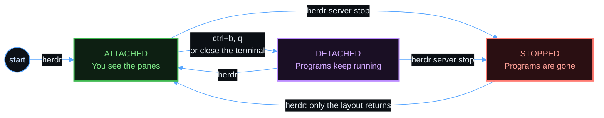

# Sessions

[Documentation index](README.md) · [Cheat sheet](cheat-sheet.md) · [Words](cheat-sheet.md#words)

Scope: open all projects, start, leave, and return to a session, and stop and delete it.

## Open all projects at once

A list is like a Herdr session, and each project in the list is like a Herdr workspace. The list of the session `my-projects` is `~/my-projects/herdspace.toml`.

| Task | Command |
|------|---------|
| Open all the projects of a list | `hopen my-projects` |
| Choose a list from a menu | `hopen` |
| Open the current folder, with no list | `hopen .` |
| Open every list | `hopen --all` |
| Open every list, and attach to one session | `hopen --all my-projects` |
| Show every list and its state | `hopen --list` |
| Split each new workspace with a template | `hopen my-projects --template code` |
| Show every template | `hopen --templates` |
| Split the current tab with a template | `hopen --apply grid` |
| Add a project | Add a `[[project]]` to the list file, then run `hopen` again. |
| Run a task of the project, for example `test` | `hopen --task test` |
| Show the open ports of the projects | `hopen --ports` |
| Remove a project | Remove the project from the list file, then close its workspace with `ctrl+b`, `shift+d`. |

The list for a session is `~/<session>/herdspace.toml`. A VS Code workspace file, `~/<session>.code-workspace`, also works. `hopen` also adds a workspace with the name of the session, for the folder that holds the list file. Use it to start an agent at the parent level. `hopen` starts a stopped session, adds only the missing projects, and never closes anything. To use a new session, create a list file with the name of the session.

## Start, leave, and return

In the Detached state, your programs keep running. In the Stopped state, your programs are gone, and only the layout returns.

| Task | Command or key |
|------|----------------|
| Start or return to the default session | `herdr` |
| Leave, and keep everything running | `ctrl+b`, `q` |
| Leave by closing the terminal window | Close the window. Everything keeps running. |
| Start or return to a named session | `herdr --session my-projects` |
| Return to a named session | `herdr session attach my-projects` |
| List the sessions | `herdr session list` |
| See the state of the server | `herdr status` |

After a reboot, the login service starts the default session. Run `herdr` to attach. Named sessions stay stopped until you run `hopen`.

## Stop and delete

Do not stop a session to leave it. A stop ends every program in that session. Use `ctrl+b`, `q` to leave.

| Task | Command |
|------|---------|
| Stop the default session | `herdr server stop` |
| Stop a named session | `herdr session stop my-projects` |
| Delete a stopped named session | `herdr session delete my-projects` |
| Start the default session again | `herdr` |

After a stop, the workspaces, tabs, panes, and folders return as new shells. Running programs do not return. An agent with an integration that reports its session resumes its conversation. To see the integrations, run `herdr integration status`.

## References

- [Herdr documentation](https://herdr.dev/tui/docs/)
- [Herdr keyboard](https://herdr.dev/tui/docs/keyboard/)
- [Herdr CLI reference](https://herdr.dev/tui/docs/cli-reference/)
