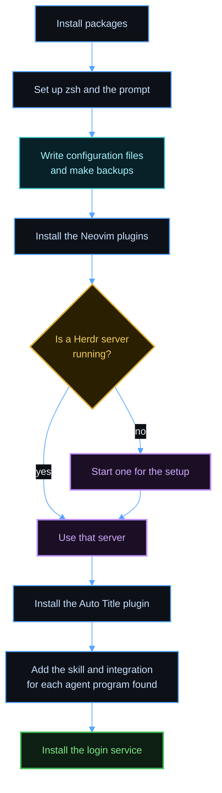
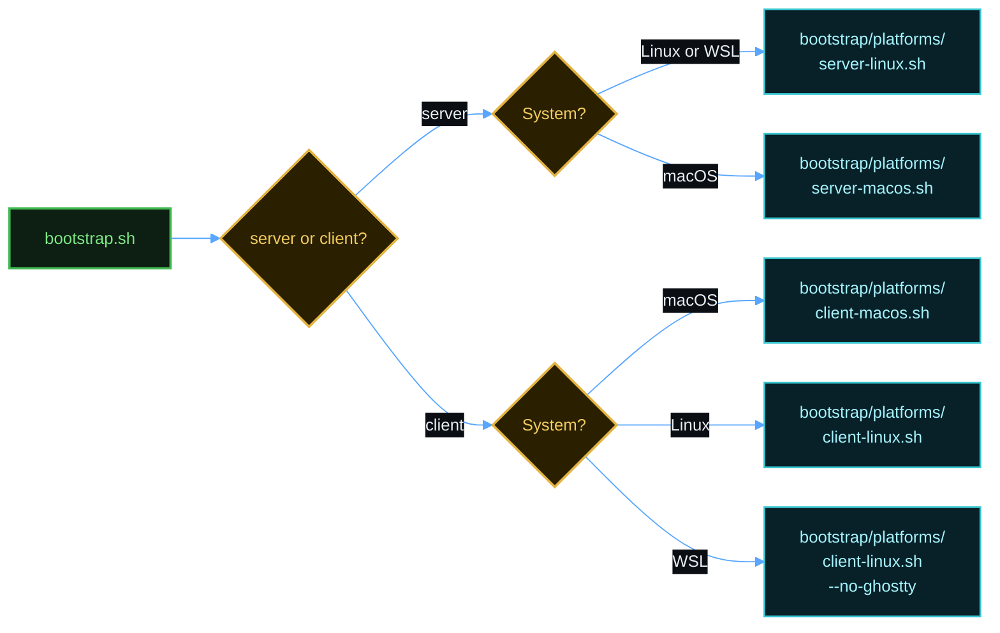
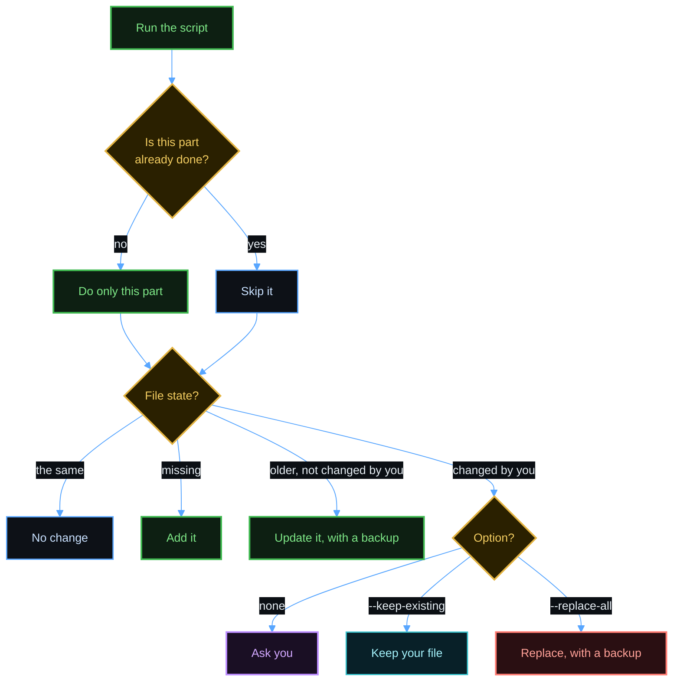

```mermaid
%%{init: {'theme': 'base', 'themeVariables': {
  'fontFamily': 'Menlo, Consolas, Courier New, monospace', 'fontSize': '14px',
  'primaryColor': '#0d1117', 'primaryTextColor': '#e6edf3', 'primaryBorderColor': '#3fb950',
  'textColor': '#e6edf3', 'lineColor': '#58a6ff', 'secondaryColor': '#161b22', 'tertiaryColor': '#0d1117',
  'edgeLabelBackground': '#0b0f14', 'clusterBkg': '#0b0f14', 'clusterBorder': '#30363d', 'titleColor': '#d2a8ff',
  'actorBkg': '#0d1f12', 'actorBorder': '#3fb950', 'actorTextColor': '#7ee787', 'actorLineColor': '#30363d',
  'signalColor': '#58a6ff', 'signalTextColor': '#e6edf3', 'sequenceNumberColor': '#0b0f14'
}, 'flowchart': {'curve': 'basis', 'nodeSpacing': 34, 'rankSpacing': 42, 'wrappingWidth': 340}}}%%
flowchart LR
  classDef cmd fill:#0d1f12,stroke:#3fb950,stroke-width:2px,color:#7ee787
  classDef step fill:#0d1117,stroke:#58a6ff,stroke-width:1.5px,color:#c9e1ff
  classDef ask fill:#2a2000,stroke:#e3b341,stroke-width:2px,color:#f2cc60
  classDef host fill:#1a0f24,stroke:#bc8cff,stroke-width:2px,color:#d2a8ff
  classDef data fill:#082028,stroke:#39c5cf,stroke-width:1.5px,color:#a5f3fc
  classDef stop fill:#2a0f12,stroke:#ff7b72,stroke-width:2px,color:#ffa198
  a["Install Ghostty<br/>and shell tools"]:::step --> b["Write the Ghostty<br/>configuration"]:::data
  b --> c["Copy the terminal<br/>description to each server"]:::cmd
  c --> d["Free the keys<br/>that Herdr uses"]:::step
```

# Setup

Scope: set up a new server machine or client machine with `bootstrap.sh`, or install only `hopen`.

herdspace uses two machines. The server machine runs Herdr, your projects, and your agents. The client machine is the machine that you use, and it connects to the server machine with SSH. Set up the server machine first. Use one section for each machine. If one machine is both, follow [One machine as server and client](#one-machine-as-server-and-client).

You need an SSH connection from the client machine to the server machine that works with no password. The name `my-server` in this document is an example of an SSH name. If you do not have an SSH name for your server, or you connect with an IP address, follow [Connect to the server with SSH](ssh.md) first.



```mermaid
%%{init: {'theme': 'base', 'themeVariables': {
  'fontFamily': 'Menlo, Consolas, Courier New, monospace', 'fontSize': '14px',
  'primaryColor': '#0d1117', 'primaryTextColor': '#e6edf3', 'primaryBorderColor': '#3fb950',
  'textColor': '#e6edf3', 'lineColor': '#58a6ff', 'secondaryColor': '#161b22', 'tertiaryColor': '#0d1117',
  'edgeLabelBackground': '#0b0f14', 'clusterBkg': '#0b0f14', 'clusterBorder': '#30363d', 'titleColor': '#d2a8ff',
  'actorBkg': '#0d1f12', 'actorBorder': '#3fb950', 'actorTextColor': '#7ee787', 'actorLineColor': '#30363d',
  'signalColor': '#58a6ff', 'signalTextColor': '#e6edf3', 'sequenceNumberColor': '#0b0f14'
}, 'flowchart': {'curve': 'basis', 'nodeSpacing': 34, 'rankSpacing': 42, 'wrappingWidth': 340}}}%%
flowchart LR
  classDef cmd fill:#0d1f12,stroke:#3fb950,stroke-width:2px,color:#7ee787
  classDef step fill:#0d1117,stroke:#58a6ff,stroke-width:1.5px,color:#c9e1ff
  classDef ask fill:#2a2000,stroke:#e3b341,stroke-width:2px,color:#f2cc60
  classDef host fill:#1a0f24,stroke:#bc8cff,stroke-width:2px,color:#d2a8ff
  classDef data fill:#082028,stroke:#39c5cf,stroke-width:1.5px,color:#a5f3fc
  classDef stop fill:#2a0f12,stroke:#ff7b72,stroke-width:2px,color:#ffa198
  a["Install agent programs<br/>on the server"]:::step --> b["Start each agent<br/>one time"]:::step
  b --> c["bootstrap.sh server"]:::cmd
  c --> d["bootstrap.sh client<br/>--server my-server"]:::cmd
  d --> e["Open a new<br/>terminal window"]:::step
  e --> f["ssh my-server<br/>herdr"]:::host
```

Each agent program creates its configuration folder at its first start. Herdr needs that folder for the integration.

## What a server script does



The script never stops a server that was already running.

## Connect with an IP address

Follow [Connect to the server with SSH](ssh.md). The steps are the same for an IP address and for a host name.

## Get the script

You can run the script in two ways.

To download a release and run it at once, use `curl`. The script saves the release in `~/.local/share/herdspace/<tag>`, compares its checksum, and runs it from there:

```bash
curl -fsSL https://github.com/MussaCharles/herdspace/releases/latest/download/bootstrap.sh | bash -s -- server
```

To read or change the files first, clone this repository, and run the script from the clone:

```bash
git clone https://github.com/MussaCharles/herdspace.git ~/herdspace
```

If you use SSH keys with GitHub, clone with the SSH address instead:

```bash
git clone git@github.com:MussaCharles/herdspace.git ~/herdspace
```

Then run the script from the clone:

```bash
cd ~/herdspace && ./bootstrap.sh server
```

## Options

The first word is `server`, `client`, or `both`. The script finds the system. Each option below works with `curl` too, after `bash -s --`.

| Option | Use |
|--------|-----|
| `--os macos`, `--os linux`, `--os wsl` | Name the system, if the script finds the wrong one. |
| `--check` | Report what is done, missing, or different. Change nothing. |
| `--keep-existing` | Add what is missing, and change no existing file. |
| `--replace-all` | Use the repository version of every file, with backups. |
| `--version <tag>` | With `curl`: download another release. |
| `--skip-nvim-tools` | Server: do not install the Neovim language tools. |
| `--skip-login-service` | Server: do not start Herdr at login. |
| `--server <name>` | Client: the SSH name of a server, or `user@address`. Repeat it for each server. |
| `--no-ghostty` | Linux client: use another terminal. WSL always uses this. |
| `--skip-mission-control` | macOS client: keep the Mission Control shortcuts. |
| `--keep-terminal-keys` | Client: keep the keys of Ghostty and macOS. The setup saves the choice. See the [keyboard shortcuts guide](keyboard-shortcuts.md). |
| `--use-herdspace-keys` | Client: use the editor keys of herdspace again. This is the default. |
| `-h`, `--help` | Show every option. |

`bootstrap.sh` runs one script from the folder `bootstrap/platforms/`, one for each role and system.



## What the setup installs

| Part | Client | Server |
|------|:------:|:------:|
| Ghostty with keys that reach Herdr | yes | |
| Terminal description for Ghostty on each server | yes | |
| Free `Ctrl` arrow keys on a Mac | yes | |
| zsh, Oh My Zsh, and Powerlevel10k, with a different color on each side | yes | yes |
| fzf, zoxide, eza, bat, and fd | yes | yes |
| Herdr, with keys, colors, and sidebar | | yes |
| Auto Title plugin | | yes |
| Agent skill and integration for each agent program that it finds | | yes |
| Neovim with a file tree, and lazygit with delta | | yes |
| `hopen`, which opens the projects of one list or of every list, with templates | | yes |
| A login service that starts Herdr, and a check for new versions | | yes |

The scripts do not install the agent programs. Install them first, or run the server script again after you install one.

## Rules that the setup follows

- A script does only the parts that are not done. [Run a script again](#run-a-script-again) lists the options.
- A script asks before it replaces a file that you changed, and it makes a backup first.
- A script never stops a Herdr server that was already running, because a stop closes every pane.
- Tools from release pages have a pinned version and a checksum.
- Herdr and Neovim do not contact their sites in the background. The update check asks the Homebrew API.

## Run a script again

You can run a script at any time. It finds what is done, and it does only the rest. On a finished machine, it prints `Everything is already set up` in a few seconds.



| Command | Effect |
|---------|--------|
| `./bootstrap.sh server` | Do what is missing, and ask about each file that you changed. |
| `./bootstrap.sh server --check` | Report what is done, missing, or different. Change nothing. |
| `./bootstrap.sh server --keep-existing` | Add what is missing, and change no existing file. |
| `./bootstrap.sh server --replace-all` | Use the repository version of every file. Each replaced file gets a backup. |

These options work for a server and for a client. For each changed file, the question offers keep, replace, show the difference, keep all, and replace all. With no terminal, for example when an agent runs the script, the script keeps your files and lists them.

`--check` exits with status 0 if nothing is missing, and with status 1 if something needs work. A file that you changed does not change the status.

A script records the hash of each file that it installs, in `~/.local/share/herdspace/manifest.tsv`. A file with the same hash is a file that you did not change.

## Debian or Ubuntu server

The script needs `sudo` to install system packages and to change the login shell. If `sudo` asks for a password, type it. Run the script as the account that will use Herdr:

```bash
./bootstrap.sh server
```

The script takes some minutes. These options make it shorter:

| Option | Effect |
|--------|--------|
| `--skip-nvim-tools` | Neovim installs its language tools at its first start. |
| `--skip-login-service` | Herdr starts at your next `herdr` command. |

A systemd user service starts Herdr at boot. A machine with no systemd has no service, and the script shows a warning.

## macOS server

Homebrew must be able to write to its folder from this account. If Homebrew is not installed, the script installs it. Then the script asks for your password, so a person must be at the keyboard. Run the script:

```bash
./bootstrap.sh server
```

A LaunchAgent starts Herdr at login. If a Herdr server is already running, the LaunchAgent starts at the next login.

To start Herdr after a reboot with no person present, turn on automatic login for this account. FileVault blocks automatic login.

## macOS client

Give the name of each server:

```bash
./bootstrap.sh client --server my-server --server my-other-server
```



Without the terminal description, programs on the server can show errors. Herdr uses the `Ctrl` arrow keys, so the script turns off those Mission Control shortcuts. To keep the macOS shortcuts, add `--skip-mission-control`. To keep every key of Ghostty and macOS, add `--keep-terminal-keys`. The [keyboard shortcuts guide](keyboard-shortcuts.md) lists each key that changes.

Press `Cmd+Shift+,` in Ghostty to reload the configuration. After a change to `background-opacity`, quit Ghostty and open it again.

## Debian or Ubuntu client

The script needs `sudo`. Give the name of each server:

```bash
./bootstrap.sh client --server my-server
```

Ubuntu 26.04 and later have a Ghostty package. Debian 13 uses a community package with a pinned checksum. For another system, install Ghostty from the [Ghostty install page](https://ghostty.org/docs/install/binary) first. Add `--no-ghostty` to set up only the shell.

On Linux, the direct keys use `Ctrl+Shift` in place of `Cmd`. The script releases those keys in Ghostty.

## Windows client

Follow the [Windows with WSL guide](windows-wsl.md).

## One machine as server and client

If Herdr runs on the machine that you use, and you do not connect to another machine with SSH, use this section. `both` runs the server setup and then the client setup on this machine. It takes the options of both setups. `--server` is not necessary.

```bash
./bootstrap.sh both
```

With `curl`:

```bash
curl -fsSL https://github.com/MussaCharles/herdspace/releases/latest/download/bootstrap.sh | bash -s -- both
```

Do not run `server` and `client` one after the other on the same machine. Each one writes its own role into `~/.config/herdspace/env.zsh` and `~/.zprofile`. Then each check reports the file of the other one as not done. `both` writes one role for the two setups.

To start Herdr in a terminal on this machine, open Ghostty and run `herdr`. You do not need SSH. If you do not want Herdr to start at login, add `--skip-login-service`.

## Effects to know about

- The client setup changes some keys of Ghostty and macOS, so that Herdr and Neovim use the keys of a code editor. The [keyboard shortcuts guide](keyboard-shortcuts.md) lists each key, and it explains `--keep-terminal-keys`, which keeps your keys.
- Ghostty cannot limit a key to one program. The keys that Herdr uses do nothing in a Ghostty window that has no Herdr.
- On a Mac, the Option key sends Alt in Ghostty, so it does not type special characters there.
- The script manages `~/.zshrc`. Put your own lines in `~/.zshrc.local`, so that they stay when `~/.zshrc` changes.
- In a shell with no terminal, `ls` and `cat` stay plain, so agents and scripts get the output that they expect.

## Make sure that it works

1. Open a new Ghostty window on the client.
2. Connect with `ssh my-server`.
3. Run `herdr`.
4. Press `Cmd+T` to open a tab. On Linux, press `Ctrl+Shift+T`.
5. Press `Ctrl+Left` to go back.

If a key does nothing, Ghostty or the desktop still uses that key. Run the client script again, and then log out and log in.

## Open many projects at once

Follow the [hopen guide](hopen.md).
