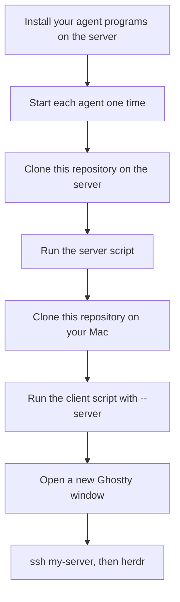
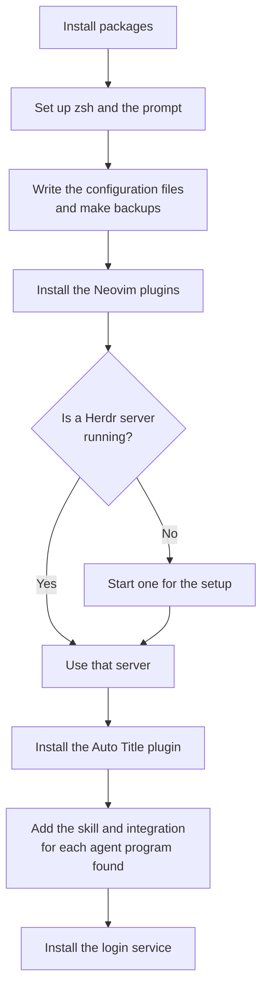
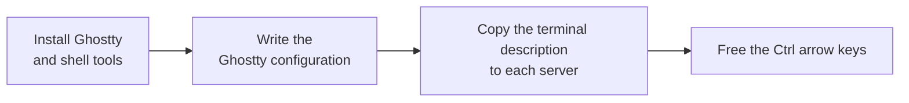
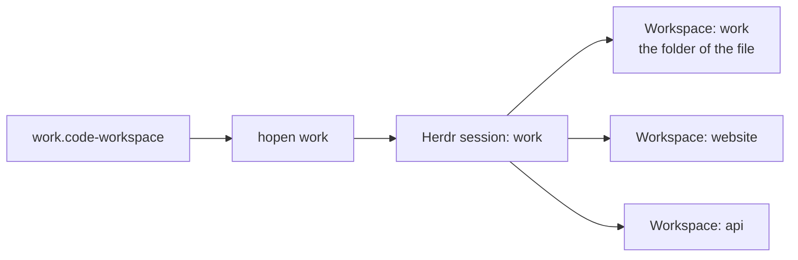

# Setup

Scope: set up a new client or server. Use one section for each computer. Set up the server first.

You need a working SSH connection from the client to the server. The name `my-server` in this document is an example. Use a host name from your `~/.ssh/config`.



Each agent program creates its configuration folder at its first start. Herdr needs that folder for the integration.

## What a server script does



The script never stops a server that was already running.

## Debian or Ubuntu server

The script needs `sudo` to install system packages and to change the login shell. If `sudo` asks for a password, type it. Run the script as the account that will use Herdr:

```bash
./bootstrap-server-linux.sh
```

The script takes some minutes. These options make it shorter:

| Option | Effect |
|--------|--------|
| `--skip-nvim-tools` | Neovim installs its language tools at its first start. |
| `--skip-login-service` | Herdr starts at your next `herdr` command. |

A systemd user service starts Herdr at boot. A computer with no systemd has no service, and the script shows a warning.

## macOS server

Homebrew must be able to write to its folder from this account. If Homebrew is not installed, the script installs it. Then the script asks for your password, so a person must be at the keyboard. Run the script:

```bash
./bootstrap-server-macos.sh
```

A LaunchAgent starts Herdr at login. If a Herdr server is already running, the LaunchAgent starts at the next login.

To start Herdr after a reboot with no person present, turn on automatic login for this account. FileVault blocks automatic login.

## macOS client

Give the name of each server:

```bash
./bootstrap-client-macos.sh --server my-server --server my-other-server
```



Without the terminal description, programs on the server can show errors. Herdr uses the `Ctrl` arrow keys, so the script turns off those Mission Control shortcuts. To keep the macOS shortcuts, add `--skip-mission-control`.

Press `Cmd+Shift+,` in Ghostty to reload the configuration. After a change to `background-opacity`, quit Ghostty and open it again.

## Effects to know about

- Ghostty cannot limit a key to one program. `Cmd+T`, `Cmd+W`, and `Cmd+K` do nothing in a Ghostty window that has no Herdr.
- The Option key sends Alt in Ghostty, so it does not type special characters there.
- The script replaces `~/.zshrc` and keeps a backup. Put your own lines in `~/.zshrc.local`.
- In a shell with no terminal, `ls` and `cat` stay plain, so agents and scripts get the output that they expect.

## Make sure that it works

1. Open a new Ghostty window on the Mac.
2. Connect with `ssh my-server`.
3. Run `herdr`.
4. Press `Cmd+T` to open a tab.
5. Press `Ctrl+Left` to go back.

If a key does nothing, Ghostty or macOS still uses that key. Run the client script again, and then log out and log in.

## Open many projects at once

`hopen` reads a VS Code workspace file and opens each folder as a Herdr workspace in one named session.



Create `~/work.code-workspace`:

```json
{
  "folders": [
    { "name": "website", "path": "./code/website" },
    { "name": "api", "path": "./code/api" }
  ]
}
```

Open it:

```bash
hopen work
```

The first workspace has the name of the session and opens the folder that holds the file. Run `hopen` again after you add a folder. It adds only the new folders.


