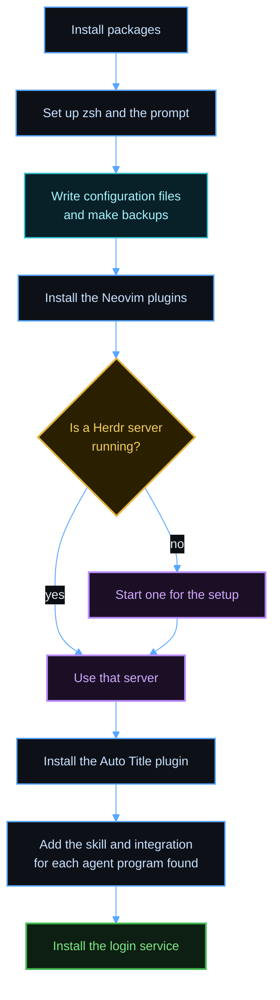
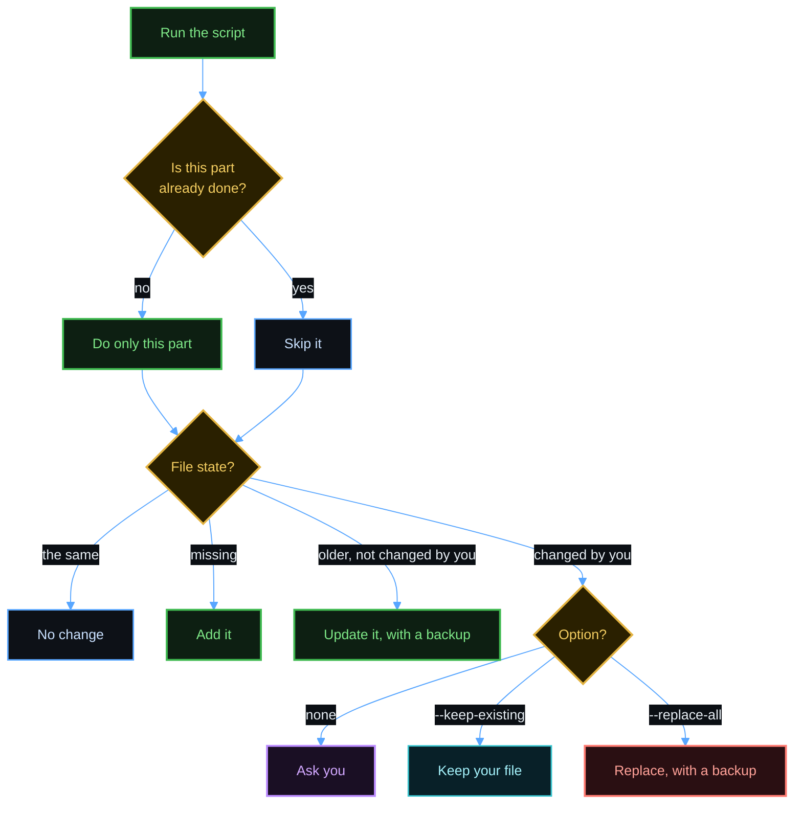
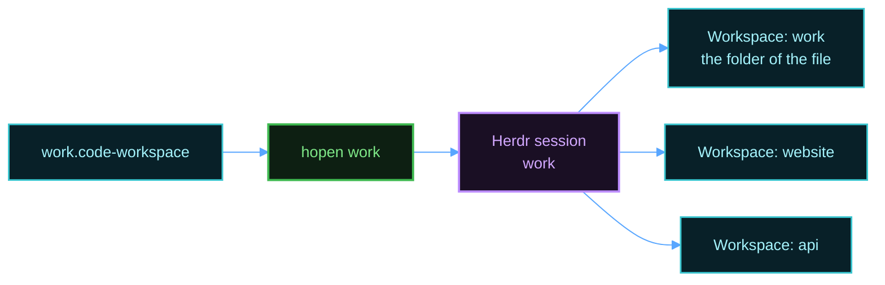
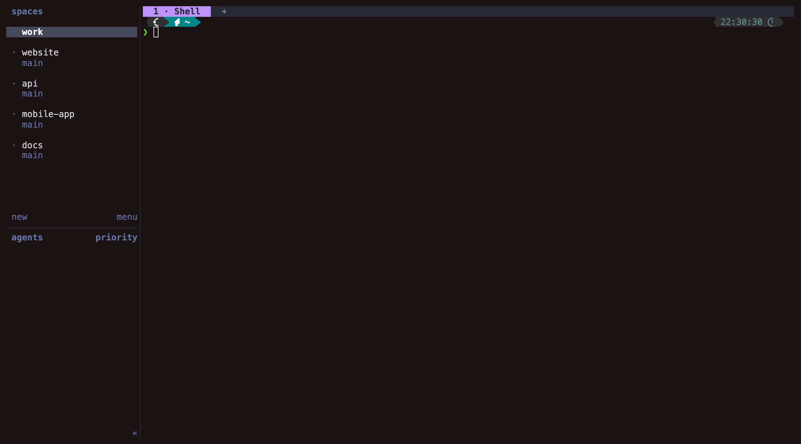

# Setup

Scope: set up a new client or server. Use one section for each computer. Set up the server first.

You need a working SSH connection from the client to the server. The name `my-server` in this document is an example. Use a host name from your `~/.ssh/config`.

```mermaid
%%{init: {'theme': 'base', 'themeVariables': {
  'fontFamily': 'Menlo, Consolas, Courier New, monospace', 'fontSize': '14px',
  'primaryColor': '#0d1117', 'primaryTextColor': '#e6edf3', 'primaryBorderColor': '#3fb950',
  'textColor': '#e6edf3', 'lineColor': '#58a6ff', 'secondaryColor': '#161b22', 'tertiaryColor': '#0d1117',
  'edgeLabelBackground': '#0b0f14', 'clusterBkg': '#0b0f14', 'clusterBorder': '#30363d', 'titleColor': '#d2a8ff',
  'actorBkg': '#0d1f12', 'actorBorder': '#3fb950', 'actorTextColor': '#7ee787', 'actorLineColor': '#30363d',
  'signalColor': '#58a6ff', 'signalTextColor': '#e6edf3', 'sequenceNumberColor': '#0b0f14'
}, 'flowchart': {'curve': 'basis', 'nodeSpacing': 34, 'rankSpacing': 42, 'wrappingWidth': 340}}}%%
flowchart LR
  classDef cmd fill:#0d1f12,stroke:#3fb950,stroke-width:2px,color:#7ee787
  classDef step fill:#0d1117,stroke:#58a6ff,stroke-width:1.5px,color:#c9e1ff
  classDef ask fill:#2a2000,stroke:#e3b341,stroke-width:2px,color:#f2cc60
  classDef host fill:#1a0f24,stroke:#bc8cff,stroke-width:2px,color:#d2a8ff
  classDef data fill:#082028,stroke:#39c5cf,stroke-width:1.5px,color:#a5f3fc
  classDef stop fill:#2a0f12,stroke:#ff7b72,stroke-width:2px,color:#ffa198
  a["Install agent programs<br/>on the server"]:::step --> b["Start each agent<br/>one time"]:::step
  b --> c["bootstrap.sh server"]:::cmd
  c --> d["bootstrap.sh client<br/>--server my-server"]:::cmd
  d --> e["Open a new<br/>terminal window"]:::step
  e --> f["ssh my-server<br/>herdr"]:::host
```



Each agent program creates its configuration folder at its first start. Herdr needs that folder for the integration.

## What a server script does



The script never stops a server that was already running.

## Get the script

You can run the script in two ways.

To download a release and run it at once, use `curl`. The script saves the release in `~/.local/share/herdspace/<tag>`, compares its checksum, and runs it from there:

```bash
curl -fsSL https://github.com/<owner>/herdspace/releases/download/v0.1.0-alpha.3/bootstrap.sh | bash -s -- server
```

To read or change the files first, clone this repository, and run the script from the clone:

```bash
git clone <repository-url> ~/herdspace
```

```bash
cd ~/herdspace && ./bootstrap.sh server
```

If the repository is private, `curl` cannot download the release. Log in with `gh auth login`, and then download the script with the GitHub CLI:

```bash
gh release download v0.1.0-alpha.3 --repo <owner>/herdspace --pattern bootstrap.sh --dir /tmp/hb && bash /tmp/hb/bootstrap.sh server
```

The script also uses the GitHub CLI for the rest of the release.

## Options

The first word is `server` or `client`. The script finds the system. Each option below works with `curl` too, after `bash -s --`.

| Option | Use |
|--------|-----|
| `--os macos`, `--os linux`, `--os wsl` | Name the system, if the script finds the wrong one. |
| `--check` | Report what is done, missing, or different. Change nothing. |
| `--keep-existing` | Add what is missing, and change no existing file. |
| `--replace-all` | Use the repository version of every file, with backups. |
| `--version <tag>` | With `curl`: download another release. |
| `--skip-nvim-tools` | Server: do not install the Neovim language tools. |
| `--skip-login-service` | Server: do not start Herdr at login. |
| `--server <name>` | Client: the SSH name of a server. Repeat it for each server. |
| `--no-ghostty` | Linux client: use another terminal. WSL always uses this. |
| `--skip-mission-control` | macOS client: keep the Mission Control shortcuts. |
| `-h`, `--help` | Show every option. |

`bootstrap.sh` runs one script from the folder `bootstrap/platforms/`, one for each role and system.

## Run a script again

You can run a script at any time. It finds what is done, and it does only the rest. On a finished computer, it prints `Everything is already set up` in a few seconds.



| Command | Effect |
|---------|--------|
| `./bootstrap.sh server` | Do what is missing, and ask about each file that you changed. |
| `./bootstrap.sh server --check` | Report what is done, missing, or different. Change nothing. |
| `./bootstrap.sh server --keep-existing` | Add what is missing, and change no existing file. |
| `./bootstrap.sh server --replace-all` | Use the repository version of every file. Each replaced file gets a backup. |

These options work for a server and for a client. For each changed file, the question offers keep, replace, show the difference, keep all, and replace all. With no terminal, for example when an agent runs the script, the script keeps your files and lists them.

`--check` exits with status 0 if nothing is missing, and with status 1 if something needs work. A file that you changed does not change the status.

A script records the hash of each file that it installs, in `~/.local/share/herdspace/manifest.tsv`. A file with the same hash is a file that you did not change.

## Debian or Ubuntu server

The script needs `sudo` to install system packages and to change the login shell. If `sudo` asks for a password, type it. Run the script as the account that will use Herdr:

```bash
./bootstrap.sh server
```

The script takes some minutes. These options make it shorter:

| Option | Effect |
|--------|--------|
| `--skip-nvim-tools` | Neovim installs its language tools at its first start. |
| `--skip-login-service` | Herdr starts at your next `herdr` command. |

A systemd user service starts Herdr at boot. A computer with no systemd has no service, and the script shows a warning.

## macOS server

Homebrew must be able to write to its folder from this account. If Homebrew is not installed, the script installs it. Then the script asks for your password, so a person must be at the keyboard. Run the script:

```bash
./bootstrap.sh server
```

A LaunchAgent starts Herdr at login. If a Herdr server is already running, the LaunchAgent starts at the next login.

To start Herdr after a reboot with no person present, turn on automatic login for this account. FileVault blocks automatic login.

## macOS client

Give the name of each server:

```bash
./bootstrap.sh client --server my-server --server my-other-server
```



```mermaid
%%{init: {'theme': 'base', 'themeVariables': {
  'fontFamily': 'Menlo, Consolas, Courier New, monospace', 'fontSize': '14px',
  'primaryColor': '#0d1117', 'primaryTextColor': '#e6edf3', 'primaryBorderColor': '#3fb950',
  'textColor': '#e6edf3', 'lineColor': '#58a6ff', 'secondaryColor': '#161b22', 'tertiaryColor': '#0d1117',
  'edgeLabelBackground': '#0b0f14', 'clusterBkg': '#0b0f14', 'clusterBorder': '#30363d', 'titleColor': '#d2a8ff',
  'actorBkg': '#0d1f12', 'actorBorder': '#3fb950', 'actorTextColor': '#7ee787', 'actorLineColor': '#30363d',
  'signalColor': '#58a6ff', 'signalTextColor': '#e6edf3', 'sequenceNumberColor': '#0b0f14'
}, 'flowchart': {'curve': 'basis', 'nodeSpacing': 34, 'rankSpacing': 42, 'wrappingWidth': 340}}}%%
flowchart LR
  classDef cmd fill:#0d1f12,stroke:#3fb950,stroke-width:2px,color:#7ee787
  classDef step fill:#0d1117,stroke:#58a6ff,stroke-width:1.5px,color:#c9e1ff
  classDef ask fill:#2a2000,stroke:#e3b341,stroke-width:2px,color:#f2cc60
  classDef host fill:#1a0f24,stroke:#bc8cff,stroke-width:2px,color:#d2a8ff
  classDef data fill:#082028,stroke:#39c5cf,stroke-width:1.5px,color:#a5f3fc
  classDef stop fill:#2a0f12,stroke:#ff7b72,stroke-width:2px,color:#ffa198
  a["Install Ghostty<br/>and shell tools"]:::step --> b["Write the Ghostty<br/>configuration"]:::data
  b --> c["Copy the terminal<br/>description to each server"]:::cmd
  c --> d["Free the keys<br/>that Herdr uses"]:::step
```

Without the terminal description, programs on the server can show errors. Herdr uses the `Ctrl` arrow keys, so the script turns off those Mission Control shortcuts. To keep the macOS shortcuts, add `--skip-mission-control`.

Press `Cmd+Shift+,` in Ghostty to reload the configuration. After a change to `background-opacity`, quit Ghostty and open it again.

## Debian or Ubuntu client

The script needs `sudo`. Give the name of each server:

```bash
./bootstrap.sh client --server my-server
```

Ubuntu 26.04 and later have a Ghostty package. Debian 13 uses a community package with a pinned checksum. For another system, install Ghostty from the [Ghostty install page](https://ghostty.org/docs/install/binary) first. Add `--no-ghostty` to set up only the shell.

On Linux, the direct keys use `Ctrl+Shift` in place of `Cmd`. The script releases those keys in Ghostty.

## Windows client

Follow [windows-wsl.md](windows-wsl.md).

## Effects to know about

- Ghostty cannot limit a key to one program. The keys that Herdr uses do nothing in a Ghostty window that has no Herdr.
- On a Mac, the Option key sends Alt in Ghostty, so it does not type special characters there.
- The script manages `~/.zshrc`. Put your own lines in `~/.zshrc.local`, so that they stay when `~/.zshrc` changes.
- In a shell with no terminal, `ls` and `cat` stay plain, so agents and scripts get the output that they expect.

## Make sure that it works

1. Open a new Ghostty window on the client.
2. Connect with `ssh my-server`.
3. Run `herdr`.
4. Press `Cmd+T` to open a tab. On Linux, press `Ctrl+Shift+T`.
5. Press `Ctrl+Left` to go back.

If a key does nothing, Ghostty or the desktop still uses that key. Run the client script again, and then log out and log in.

## Open many projects at once

`hopen` reads a VS Code workspace file and opens each folder as a Herdr workspace in one named session.



Create `~/work.code-workspace`:

```json
{
  "folders": [
    { "name": "website", "path": "./code/website" },
    { "name": "api", "path": "./code/api" }
  ]
}
```

Open it:

```bash
hopen work
```

The first workspace has the name of the session and opens the folder that holds the file. Run `hopen` again after you add a folder. It adds only the new folders.

To open every list at once, run this command:

```bash
hopen --all
```

`hopen --all` starts one session for each list, and it adds the missing workspaces. A terminal can attach to one session at a time, so add a name to attach to that session:

```bash
hopen --all work
```

To open each project with several named panes, use a template. See [templates.md](templates.md). To see every list and its state, run `hopen --list`. `hopen` finds a list at `~/<name>.code-workspace` or at `~/<name>/<name>.code-workspace`.


