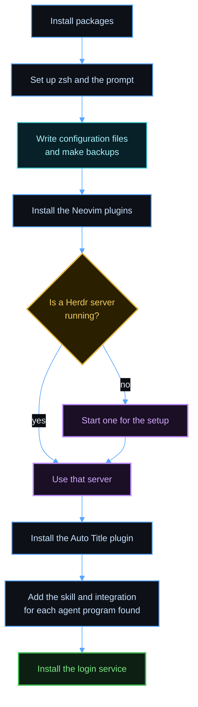
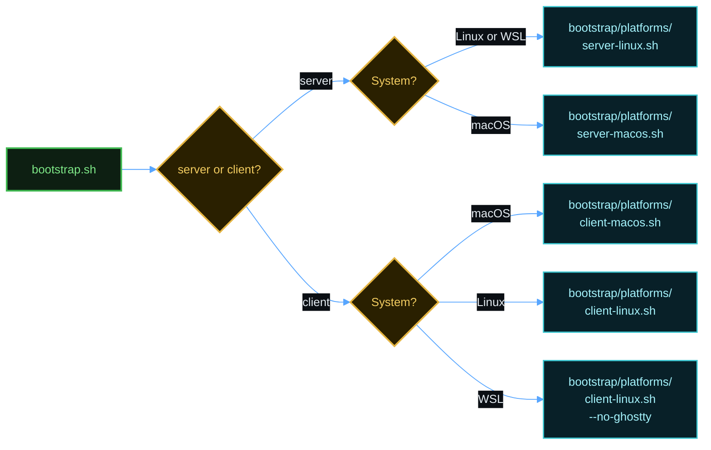
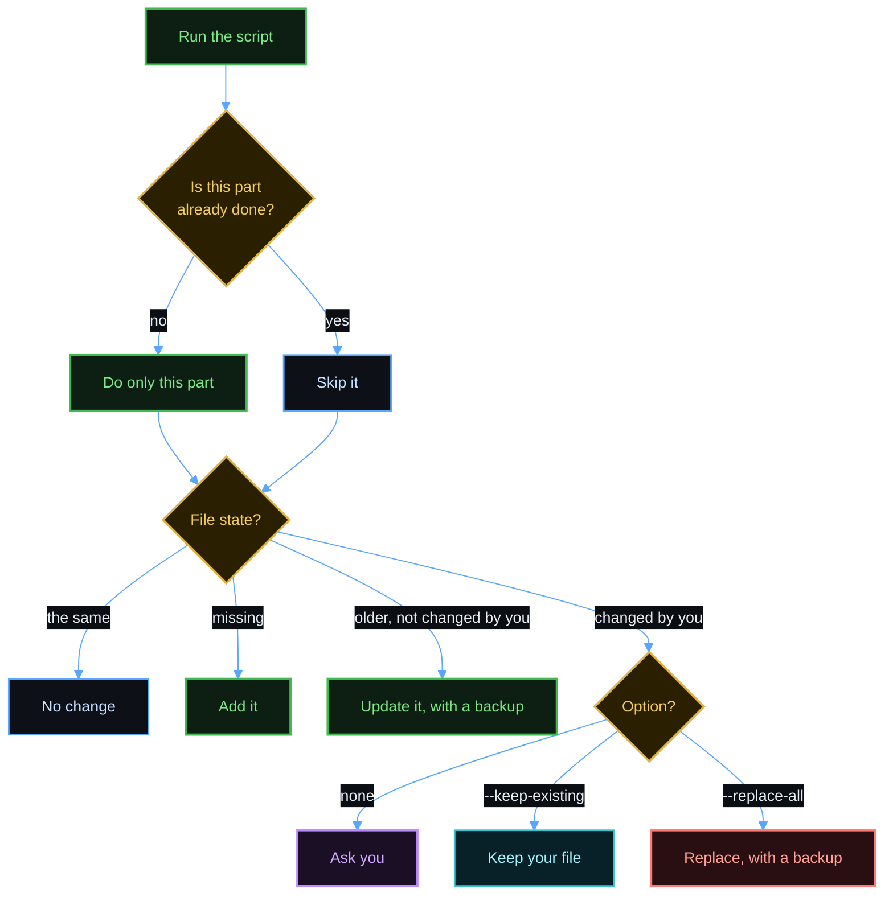

```mermaid
%%{init: {'theme': 'base', 'themeVariables': {
  'fontFamily': 'Menlo, Consolas, Courier New, monospace', 'fontSize': '14px',
  'primaryColor': '#0d1117', 'primaryTextColor': '#e6edf3', 'primaryBorderColor': '#3fb950',
  'textColor': '#e6edf3', 'lineColor': '#58a6ff', 'secondaryColor': '#161b22', 'tertiaryColor': '#0d1117',
  'edgeLabelBackground': '#0b0f14', 'clusterBkg': '#0b0f14', 'clusterBorder': '#30363d', 'titleColor': '#d2a8ff',
  'actorBkg': '#0d1f12', 'actorBorder': '#3fb950', 'actorTextColor': '#7ee787', 'actorLineColor': '#30363d',
  'signalColor': '#58a6ff', 'signalTextColor': '#e6edf3', 'sequenceNumberColor': '#0b0f14'
}, 'flowchart': {'curve': 'basis', 'nodeSpacing': 34, 'rankSpacing': 42, 'wrappingWidth': 340}}}%%
flowchart LR
  classDef cmd fill:#0d1f12,stroke:#3fb950,stroke-width:2px,color:#7ee787
  classDef step fill:#0d1117,stroke:#58a6ff,stroke-width:1.5px,color:#c9e1ff
  classDef ask fill:#2a2000,stroke:#e3b341,stroke-width:2px,color:#f2cc60
  classDef host fill:#1a0f24,stroke:#bc8cff,stroke-width:2px,color:#d2a8ff
  classDef data fill:#082028,stroke:#39c5cf,stroke-width:1.5px,color:#a5f3fc
  classDef stop fill:#2a0f12,stroke:#ff7b72,stroke-width:2px,color:#ffa198
  a["Install Ghostty<br/>and shell tools"]:::step --> b["Write the Ghostty<br/>configuration"]:::data
  b --> c["Copy the terminal<br/>description to each server"]:::cmd
  c --> d["Free the keys<br/>that Herdr uses"]:::step
```

# Setup

Scope: set up a new server machine or client machine with the setup script `bootstrap.sh`. To install only the project opener `hopen`, follow [Install only hopen](hopen.md#install-only-hopen).

herdspace has two parts. `bootstrap.sh` sets up a machine. `hopen` opens your projects in Herdr, and the server setup installs it. The first line of each run names the script and its release, for example `herdspace setup (bootstrap.sh 0.6.0): a server on macOS.`

herdspace uses two machines. The server machine runs Herdr, your projects, and your agents. The client machine is the machine that you use, and it connects to the server machine with SSH. Set up the server machine first. Use one section for each machine. If one machine is both, follow [One machine as server and client](#one-machine-as-server-and-client).

You need an SSH connection from the client machine to the server machine that works with no password. The name `my-server` in this document is an example of an SSH name. If you do not have an SSH name for your server, or you connect with an IP address, follow [Connect to the server with SSH](ssh.md) first.



```mermaid
%%{init: {'theme': 'base', 'themeVariables': {
  'fontFamily': 'Menlo, Consolas, Courier New, monospace', 'fontSize': '14px',
  'primaryColor': '#0d1117', 'primaryTextColor': '#e6edf3', 'primaryBorderColor': '#3fb950',
  'textColor': '#e6edf3', 'lineColor': '#58a6ff', 'secondaryColor': '#161b22', 'tertiaryColor': '#0d1117',
  'edgeLabelBackground': '#0b0f14', 'clusterBkg': '#0b0f14', 'clusterBorder': '#30363d', 'titleColor': '#d2a8ff',
  'actorBkg': '#0d1f12', 'actorBorder': '#3fb950', 'actorTextColor': '#7ee787', 'actorLineColor': '#30363d',
  'signalColor': '#58a6ff', 'signalTextColor': '#e6edf3', 'sequenceNumberColor': '#0b0f14'
}, 'flowchart': {'curve': 'basis', 'nodeSpacing': 34, 'rankSpacing': 42, 'wrappingWidth': 340}}}%%
flowchart LR
  classDef cmd fill:#0d1f12,stroke:#3fb950,stroke-width:2px,color:#7ee787
  classDef step fill:#0d1117,stroke:#58a6ff,stroke-width:1.5px,color:#c9e1ff
  classDef ask fill:#2a2000,stroke:#e3b341,stroke-width:2px,color:#f2cc60
  classDef host fill:#1a0f24,stroke:#bc8cff,stroke-width:2px,color:#d2a8ff
  classDef data fill:#082028,stroke:#39c5cf,stroke-width:1.5px,color:#a5f3fc
  classDef stop fill:#2a0f12,stroke:#ff7b72,stroke-width:2px,color:#ffa198
  a["Install agent programs<br/>on the server"]:::step --> b["Start each agent<br/>one time"]:::step
  b --> c["bootstrap.sh server"]:::cmd
  c --> d["bootstrap.sh client<br/>--server my-server"]:::cmd
  d --> e["Open a new<br/>terminal window"]:::step
  e --> f["ssh my-server<br/>herdr"]:::host
```

Each agent program creates its configuration folder at its first start. Herdr needs that folder for the integration.

## Before you start

The setup installs most of what it needs. You do these items yourself:

| Item | Server machine | Client machine |
|------|:--------------:|:--------------:|
| `curl`, to run the first command | yes | yes |
| An account that can use `sudo` (Linux) or that has admin rights (macOS) | yes | yes |
| SSH access from the client machine, which you turn on yourself | yes | |
| An SSH key and an SSH name for the server, in `~/.ssh/config` | | yes |

The setup does not turn on remote access, because that is a security choice for the owner of the server. To turn on SSH on the server machine, follow the official guide for its system:

- macOS: [Allow a remote computer to access your Mac](https://support.apple.com/guide/mac-help/allow-a-remote-computer-to-access-your-mac-mchlp1066/mac)
- Ubuntu: [OpenSSH server](https://documentation.ubuntu.com/server/how-to/security/openssh-server/)
- Debian: [SSH](https://wiki.debian.org/SSH)

Then follow [Connect to the server with SSH](ssh.md) on the client machine. On one machine as both, you need no SSH.

These items are optional:

- Agent programs: for the Herdr integration, start each agent program, for example Claude Code, one time before the setup. It makes its configuration folder at its first start.
- WSL login service: in WSL, Herdr starts at login only with systemd. See the [Windows with WSL guide](windows-wsl.md).

### The prerequisites step

Each run starts with a prerequisites step. It lists what the setup needs before it can start, and it marks each missing item as necessary or optional. Then it asks one question: "Install the missing necessary items?" The default is yes. For each optional item, it asks again, so that you can skip it. If an install needs a password, `sudo` or the Homebrew installer asks for it.

| System | Items that the step can install |
|--------|---------------------------------|
| Debian or Ubuntu | `sudo`, when you run the setup as root. The locale that your SSH session asks for, for example `en_US.UTF-8`. |
| macOS | Homebrew. Python 3.11 or later for `hopen` on a server. Ghostty on a client, from an admin account. |

If the step cannot install an item, it prints what to do, for example the command to run from an admin account. The step reports the SSH connection to each server, but it never changes the server. With `--yes`, the step installs the missing items with no question. With no terminal, it installs only the items that need no password.

## What a server script does



The script never stops a server that was already running.

## Connect with an IP address

Follow [Connect to the server with SSH](ssh.md). The steps are the same for an IP address and for a host name.

## Get the script

Run the script with `curl`. The command downloads the newest release to `~/.local/share/herdspace/<tag>`, compares its checksum, and runs it from there. The word after `bash -s --` is the role, and the options follow it:

```bash
curl -fsSL https://github.com/MussaCharles/herdspace/releases/latest/download/bootstrap.sh | bash -s -- server
```

Each section below shows this command. You do not need to clone the repository.

To read or change the files first, clone the repository and run `./bootstrap.sh` from the clone, with the same role and options:

```bash
git clone https://github.com/MussaCharles/herdspace.git ~/herdspace
cd ~/herdspace && ./bootstrap.sh server
```

### Make sure that a release is genuine

This step is optional. The setup needs no new tool for it.

Each release file has a GitHub artifact attestation. An attestation is a signed record of the workflow, the commit, and the checksum of a file. The release workflow makes it only when the published files match a new build of the tag.

To compare in a browser, open the [attestations](https://github.com/MussaCharles/herdspace/attestations) of the repository, and open the one of the release. Make sure that the SHA256 value of `bootstrap.sh` is the same as its line in `SHA256SUMS` of the release.

If you have the GitHub CLI, download the script, and make sure that its attestation is correct:

```bash
curl -fsSLO https://github.com/MussaCharles/herdspace/releases/latest/download/bootstrap.sh
```

```bash
gh attestation verify bootstrap.sh --repo MussaCharles/herdspace
```

Then run the downloaded script, in a folder that is not a clone of the repository:

```bash
bash bootstrap.sh server
```

## Options

The first word is `server`, `client`, or `both`. The script finds the system. Put the options after the role.

| Option | Use |
|--------|-----|
| `--os macos`, `--os linux`, `--os wsl` | Name the system, if the script finds the wrong one. |
| `--check` | Report what is done, missing, or different. Change nothing. |
| `--keep-existing` | Add what is missing, and change no existing file. |
| `--replace-all` | Use the repository version of every file, with backups. |
| `--yes` | Install the missing prerequisites with no question. See [The prerequisites step](#the-prerequisites-step). |
| `--version <tag>` | With `curl`: download another release. |
| `--skip-nvim-tools` | Server: do not install the Neovim language tools. |
| `--skip-login-service` | Server: do not start Herdr at login. |
| `--server <name>` | Client: the SSH name of a server, or `user@address`. Repeat it for each server. |
| `--no-ghostty` | Linux client: use another terminal. WSL always uses this. |
| `--skip-mission-control` | macOS client: keep the Mission Control shortcuts. |
| `--keep-terminal-keys` | Client: keep the keys of Ghostty and macOS. The setup saves the choice. See the [keyboard shortcuts guide](keyboard-shortcuts.md). |
| `--use-herdspace-keys` | Client: use the editor keys of herdspace again. This is the default. |
| `--keep-terminal-look` | Client: keep the look of Ghostty, with no herdspace colors or window size. The setup saves the choice. |
| `--use-herdspace-look` | Client: use the herdspace look of Ghostty again. This is the default. |
| `-h`, `--help` | Show every option. |

`bootstrap.sh` runs one script from the folder `bootstrap/platforms/`, one for each role and system.



## What the setup installs

| Part | Client | Server |
|------|:------:|:------:|
| Ghostty with keys that reach Herdr | yes | |
| Terminal description for Ghostty on each server | yes | |
| Free `Ctrl` arrow keys on a Mac | yes | |
| zsh, Oh My Zsh, and Powerlevel10k, with a different color on each side | yes | yes |
| fzf, zoxide, eza, bat, and fd | yes | yes |
| ripgrep and Node.js, for Neovim and its language tools | | yes |
| Herdr, with keys, colors, and sidebar | | yes |
| Auto Title plugin | | yes |
| Agent skill and integration for each agent program that it finds | | yes |
| Neovim with a file tree, and lazygit with delta | | yes |
| `hopen`, which opens the projects of one list or of every list, with templates | | yes |
| A login service that starts Herdr, and a check for new versions | | yes |

The scripts do not install the agent programs. Install them first, or run the server script again after you install one.

## Rules that the setup follows

- A script does only the parts that are not done. [Run a script again](#run-a-script-again) lists the options.
- A script asks before it replaces a file that you changed, and it makes a backup first.
- A script never stops a Herdr server that was already running, because a stop closes every pane.
- On Linux, tools from release pages have a pinned version and a checksum. On macOS, the tools come from Homebrew.
- Herdr and Neovim do not contact their sites in the background. The update check asks the Homebrew API.

## Update herdspace

To update to the latest release, run:

```bash
herdspace update
```

The command does these steps:

1. It downloads `bootstrap.sh` and `SHA256SUMS` of the latest release.
2. It makes sure that the checksum of `bootstrap.sh` is correct.
3. It runs the setup with the role and the options of your last setup.
4. It says if a new Herdr exists.

Each setup that passes saves its role and options in `~/.local/share/herdspace/last-setup`. A `--check` run saves nothing. The options for one run are not saved: `--replace-all`, `--keep-existing`, and `--yes`. To add an option, give it after `update`:

```bash
herdspace update --replace-all
```

If the latest release is already installed, the command says so and changes nothing. To run the setup again anyway, for example to put back a missing file, run:

```bash
herdspace update --force
```

To see the installed version and the latest release, run `herdspace --version`. `herdspace version` prints the same text.

When a new release exists, the herdspace shell prints one line before the prompt, at most once a day:

```text
  herdspace 0.7.1 is available (you have 0.7.0). Run: herdspace update
```

The shell asks GitHub in the background, so the prompt does not wait for the network. The request goes to the link of the latest release, and it sends nothing about your machine. A pre-release never counts as the latest release. The result is in `~/.cache/herdspace`. To turn the check off, add this line to your `~/.zshrc`:

```bash
export HERDSPACE_UPDATE_CHECK=0
```

## Run a script again

You can run a script at any time. It finds what is done, and it does only the rest. On a finished machine, it prints `Everything is already set up` in a few seconds.



Put these options after the role in the `curl` command, for example `bash -s -- server --check`:

| Role and option | Effect |
|-----------------|--------|
| `server` | Do what is missing, and ask about each file that you changed. |
| `server --check` | Report what is done, missing, or different. Change nothing. |
| `server --keep-existing` | Add what is missing, and change no existing file. |
| `server --replace-all` | Use the repository version of every file, with no question. Each replaced file gets a backup. Your `~/.zshrc` only gets a block that loads the shell extras. Use it with care: a file that you changed can have more than the herdspace version. |

These options work for a server and for a client. With no terminal, for example in a run by an agent, the script keeps your files and lists them.

### The questions about changed files

If more than one file differs from the herdspace version, the script first lists them all, and asks one question for all of them:

```text
  3 files differ from the herdspace version:
    1. ~/.p10k.zsh
    2. ~/.config/herdr/config.toml
    3. ~/.config/nvim/lua/config/keymaps.lua

    v  Review one file at a time, with its difference             (Enter)
    K  Keep all 3 files
    R  Replace all 3 files with the herdspace version (backups first)
```

| Answer | Effect |
|--------|--------|
| `v`, or Enter | Ask about each file, one at a time. |
| `K` | Keep all the files. The end of the run lists them. |
| `R` | Replace all the files. The script saves each file first, as `<file>.bak-<time>`. |

In the review, the script asks about one file at a time:

```text
  File 1 of 3: ~/.p10k.zsh

    k  Keep your file                                             (Enter)
    r  Replace it with the herdspace version (backup first)
    d  Show the difference of this file                           (q comes back)
```

| Answer | Effect |
|--------|--------|
| `k`, or Enter | Keep your file. The end of the run lists it. |
| `r` | Replace your file with the herdspace version. The script saves your file first, as `<file>.bak-<time>`. |
| `d` | Show how many lines differ, your own lines that the herdspace version does not have, and the difference of this file only. The difference opens in a pager: press `q` to come back to the question. The script uses `delta`, `git diff`, or `diff`, the first one that it finds. |

These questions never include `~/.zshrc`. The next section explains why.

### Your ~/.zshrc

herdspace never replaces a `~/.zshrc` of yours. It owns only its own files in `~/.config/herdspace/`:

| File | What it holds |
|------|---------------|
| `zshrc.zsh` | The herdspace shell: the prompt, Oh My Zsh, and the shell extras. |
| `extras.zsh` | The shell extras: the `fzf` keys, `zoxide`, `ff`, `fif`, the completion of `hopen`, and `eza` and `bat` for `ls` and `cat`. |

Your `~/.zshrc` loads one of them from a marked block, between `# >>> herdspace >>>` and `# <<< herdspace <<<`. A later run changes only the text of the block. The script does this with your `~/.zshrc`:

- If you have no `~/.zshrc`, the script writes a short one with the block. Put your own lines below the block. They load after herdspace, so they can change what it sets.
- If your `~/.zshrc` is the file of an older herdspace, which owned the whole file, the script saves it as `~/.zshrc.bak-<time>` and writes the short file. It copies your own lines from the old file to the end of the new one, each behind `# `. Remove the `# ` of each line that you want, and keep `if` and `fi` blocks complete.
- If your `~/.zshrc` is your own file, the script asks:

```text
  ~/.zshrc is your own file. herdspace never replaces it.
  It can add a marked block. Your own lines stay as they are.

    f  Add a block at the top that loads the full herdspace shell (Enter)
    e  Add a block at the end that loads only the shell extras
    k  Keep your file with no change
    d  Show what each block does
```

If your file loads Oh My Zsh already, the default is `e`, so that Oh My Zsh does not load two times. With `--replace-all`, the script adds the `e` block. With `--keep-existing`, or with no terminal, it keeps your file with no change.

The extras add and never replace. If you set an alias, a function, a variable, or a key before the extras load, yours stays. For example, your own `ls` alias stays, and a tool of yours on `Ctrl+R` keeps that key. To see what the extras skipped, run `print -l $HERDSPACE_EXTRAS_SKIPPED` in a terminal.

An older herdspace put your own lines in `~/.zshrc.local`. The herdspace shell still loads that file if it exists. You can move its lines into `~/.zshrc`, below the block.

### Your Neovim files

herdspace keeps its Neovim files in `~/.config/herdspace-nvim`, and its plugins in `~/.local/share/herdspace-nvim`. Your `~/.config/nvim` stays yours, and the setup writes nothing in it. Neovim reads the herdspace folder when `NVIM_APPNAME=herdspace-nvim` is set.

The herdspace shell sets `NVIM_APPNAME=herdspace-nvim` only if you have no `~/.config/nvim`. Then `nvim`, and the layouts of `hopen`, start the herdspace editor. If you have your own `~/.config/nvim`, `nvim` starts your own Neovim.

To try the herdspace editor one time:

```bash
NVIM_APPNAME=herdspace-nvim nvim .
```

To use the herdspace editor always, add this line to your `~/.zshrc`, below the herdspace block:

```bash
export NVIM_APPNAME=herdspace-nvim
```

To change the herdspace editor, put your own plugin settings in `~/.config/herdspace-nvim/lua/plugins/local.lua`. LazyVim loads each file in `lua/plugins/`, and the setup never writes that file.

An older herdspace put its Neovim files in `~/.config/nvim`. If that folder holds only those files, the setup moves it to a backup folder, `~/.config/nvim.bak-<date>`, and says so. If the folder holds a file that you changed or added, the setup leaves the folder where it is. The old plugins in `~/.local/share/nvim` stay. You can remove them.

### Bash aliases in zsh

On Linux, the setup changes your login shell from bash to zsh. Before it does, it names your bash files, because zsh does not read them. Do not load all of `~/.bashrc` from zsh: lines such as `shopt`, `complete`, and the bash `PS1` give errors in zsh.

To use the same aliases in both shells, keep them in `~/.bash_aliases`. The default `~/.bashrc` of Debian and Ubuntu loads that file. Put only `alias` and `export` lines in it. Then add this line to your `~/.zshrc`, below the herdspace block:

```bash
[[ -f ~/.bash_aliases ]] && source ~/.bash_aliases
```

### Exports from your bash files

An `export` line that is only in `~/.bashrc` or `~/.bash_profile` does not reach zsh. The variable is then missing in each Herdr pane, and in each shell that an agent starts. For example, an API key that an agent needs is missing.

When zsh is your login shell, the setup looks for these lines. At a terminal, it names the variables, and it asks whether to move the lines to `~/.zshenv`. zsh reads `~/.zshenv` for every shell. The setup never shows a value. With no terminal, or if you answer no, the setup only names the variables. It asks again only when the list of variables changes.

The setup moves only plain one-line `export NAME=value` lines at the start of a line. A value can use `$HOME`, `$PATH`, `$USER`, and the variables that move before it. These lines stay, and the setup names them, so you move them by hand:

- A line in a function, or in an `if` or `case` block.
- A line that ends with `\`, or a value with a quote that runs over more lines.
- A value with a command, for example `$(...)`, or with another variable.

When you answer yes:

1. The setup backs up `~/.bashrc`, `~/.bash_profile`, and `~/.zshenv`. Only you can read the backups (mode 600), because they hold the values.
2. It puts the lines in a marked block, `# >>> herdspace bash env >>>`, at the end of `~/.zshenv`, and sets the mode of the file to 600. In the bash file, each line becomes a note, for example `# herdspace moved the export of API_TOKEN to ~/.zshenv.` The value is not in the note.
3. It makes sure that each variable has the same value in zsh as in bash, and that each file has no syntax error. If a test fails, it puts the files back, deletes the backups, and says so.

The end of the run shows the commands that put a backup back, for example:

```bash
mv ~/.bashrc.bak-20261122-155530 ~/.bashrc
```

After the move, bash no longer sets these variables. zsh is your login shell, so put new variables in `~/.zshenv`.

A secrets store is safer than a shell file for a token. Examples are the macOS Keychain, [`pass`](https://www.passwordstore.org/), and the command-line tool of a password manager. `~/.zshenv` can read a value from the store when the shell starts, so no shell file holds the token. For example, on a Mac:

```bash
export API_TOKEN="$(security find-generic-password -a "$USER" -s API_TOKEN -w)"
```

### Put a file back

The end of a run lists each backup of the run, with the command that puts the file back, for example:

```bash
mv ~/.p10k.zsh.bak-20261113-054849 ~/.p10k.zsh
```

`--check` exits with status 0 if nothing is missing, and with status 1 if something needs work. A file that you changed does not change the status.

A script records the hash of each file that it installs, in `~/.local/share/herdspace/manifest.tsv`. A file with the same hash is a file that you did not change.

An install from before the manifest has no hash for its files. The setup then compares each file with the list of older herdspace versions in `bootstrap/known-hashes.tsv`. If the file matches an older version, you did not change it, and the setup updates it with no question. If it matches no version, the setup asks.

## Debian or Ubuntu server

The script needs `sudo` to install system packages and to change the login shell. If `sudo` asks for a password, type it. `hopen` reads `herdspace.toml` with Python 3.11 or later. If `python3` is older, for example on Ubuntu 22.04, the script also installs `python3.11`, and `hopen` uses it. With no `sudo`, see [Python for herdspace.toml](hopen.md#python-for-herdspacetoml). The script installs only the system packages that are missing, and it does not upgrade a package that is already installed, so other accounts on a shared server keep their versions. If `apt-get update` fails for a package source that herdspace does not use, the script shows the error and goes on. Run the script as the account that will use Herdr:

```bash
curl -fsSL https://github.com/MussaCharles/herdspace/releases/latest/download/bootstrap.sh | bash -s -- server
```

The script takes some minutes. These options make it shorter:

| Option | Effect |
|--------|--------|
| `--skip-nvim-tools` | Neovim installs its language tools at its first start. |
| `--skip-login-service` | Herdr starts at your next `herdr` command. |

A systemd user service starts Herdr at boot. On a machine with no systemd user session, the script skips the service. If the script cannot turn on linger, it shows a warning, and Herdr starts at your first login.

## macOS server

Homebrew must be able to write to its folder from this account. If Homebrew is not installed, the script installs it. Then the script asks for your password, so a person must be at the keyboard. Run the script:

```bash
curl -fsSL https://github.com/MussaCharles/herdspace/releases/latest/download/bootstrap.sh | bash -s -- server
```

A LaunchAgent starts Herdr at login. If a Herdr server is already running, the LaunchAgent starts at the next login.

To start Herdr after a reboot with no person present, turn on automatic login for this account. FileVault blocks automatic login.

## macOS client

Give the name of each server:

```bash
curl -fsSL https://github.com/MussaCharles/herdspace/releases/latest/download/bootstrap.sh | bash -s -- client --server my-server --server my-other-server
```



Without the terminal description, programs on the server can show errors. Herdr uses the `Ctrl` arrow keys, so the script turns off those Mission Control shortcuts. To keep the macOS shortcuts, add `--skip-mission-control`. To keep every key of Ghostty and macOS, add `--keep-terminal-keys`. The [keyboard shortcuts guide](keyboard-shortcuts.md) lists each key that changes.

Press `Cmd+Shift+,` in Ghostty to reload the configuration. After a change to `background-opacity` or `macos-titlebar-style`, quit Ghostty and open it again.

## Debian or Ubuntu client

The script needs `sudo`. Give the name of each server:

```bash
curl -fsSL https://github.com/MussaCharles/herdspace/releases/latest/download/bootstrap.sh | bash -s -- client --server my-server
```

Ubuntu 26.04 and later have a Ghostty package. Debian 13 uses a community package with a pinned checksum. For another system, install Ghostty from the [Ghostty install page](https://ghostty.org/docs/install/binary) first. Add `--no-ghostty` to set up only the shell.

On Linux, the direct keys use `Ctrl+Shift` in place of `Cmd`. The script releases those keys in Ghostty.

## Windows client

Follow the [Windows with WSL guide](windows-wsl.md).

## One machine as server and client

If Herdr runs on the machine that you use, and you do not connect to another machine with SSH, use this section. `both` runs the server setup and then the client setup on this machine. It takes the options of both setups. `--server` is not necessary.

```bash
curl -fsSL https://github.com/MussaCharles/herdspace/releases/latest/download/bootstrap.sh | bash -s -- both
```

Do not run `server` and `client` one after the other on the same machine. Each one writes its own role into `~/.config/herdspace/env.zsh` and `~/.zprofile`. Then each check reports the file of the other one as not done. `both` writes one role for the two setups.

To start Herdr in a terminal on this machine, open Ghostty and run `herdr`. You do not need SSH. If you do not want Herdr to start at login, add `--skip-login-service`.

## Effects to know about

- The client setup changes some keys of Ghostty and macOS, so that Herdr and Neovim use the keys of a code editor. The [keyboard shortcuts guide](keyboard-shortcuts.md) lists each key, and it explains `--keep-terminal-keys`, which keeps your keys.
- Ghostty cannot limit a key to one program. The keys that Herdr uses do nothing in a Ghostty window that has no Herdr. Ghostty gets [replacement keys](keyboard-shortcuts.md#replacement-keys-for-ghostty).
- The setup never replaces your Ghostty file. It writes marked blocks at its top. See [Your Ghostty file](keyboard-shortcuts.md#your-ghostty-file).
- On a Mac, the Option key sends Alt in Ghostty, so it does not type special characters there.
- The script never replaces your `~/.zshrc`. It adds a marked block that loads the herdspace shell. See [Your ~/.zshrc](#your-zshrc).
- In a shell with no terminal, `ls` and `cat` stay plain, so agents and scripts get the output that they expect.

## Make sure that it works

1. On the client, quit Ghostty and start it again, so that the new keys and look load.
2. Connect with `ssh my-server`.
3. Run `herdr`.
4. Press `Cmd+T` to open a tab. On Linux, press `Ctrl+Shift+T`.
5. Press `Ctrl+Left` to go back.
6. In a Ghostty window with no Herdr, press `Cmd+Option+T` to open a Ghostty tab. On Linux, press `Ctrl+Alt+Shift+T`.

If a key does nothing, Ghostty or the desktop still uses that key. Run the client script again, and then log out and log in.

## Open many projects at once

Follow the [hopen guide](hopen.md).
