# Templates and panes

Scope: open projects with several panes at once, and move between panes with the keyboard. The full key list is in the [cheat sheet](cheat-sheet.md).

## Templates

A template splits a new workspace into named panes, and it starts a program in each pane. `install.sh` and the server setup install these templates in `~/.config/hopen/templates`:

| Template | Panes |
|----------|-------|
| `plain` | One pane with a shell. This is the default. |
| `code` | Neovim on the left, an agent pane on the top right, and lazygit on the bottom right |
| `agent` | An agent pane on the left, and a shell on the right |
| `grid` | Four panes: two agent panes, tests, and a shell |
| `review` | lazygit on the left, and Neovim on the right |

An agent pane starts with a shell. The template does not start an agent, so that many projects do not start many paid agent sessions at once.

To see every template, run this command:

```bash
hopen --templates
```

### code

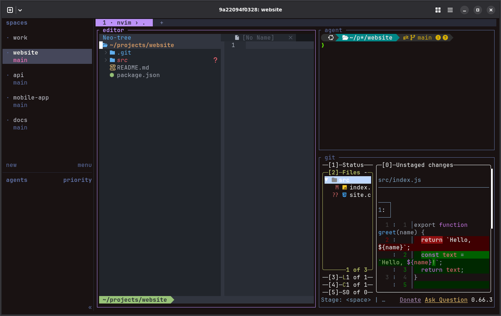

### agent

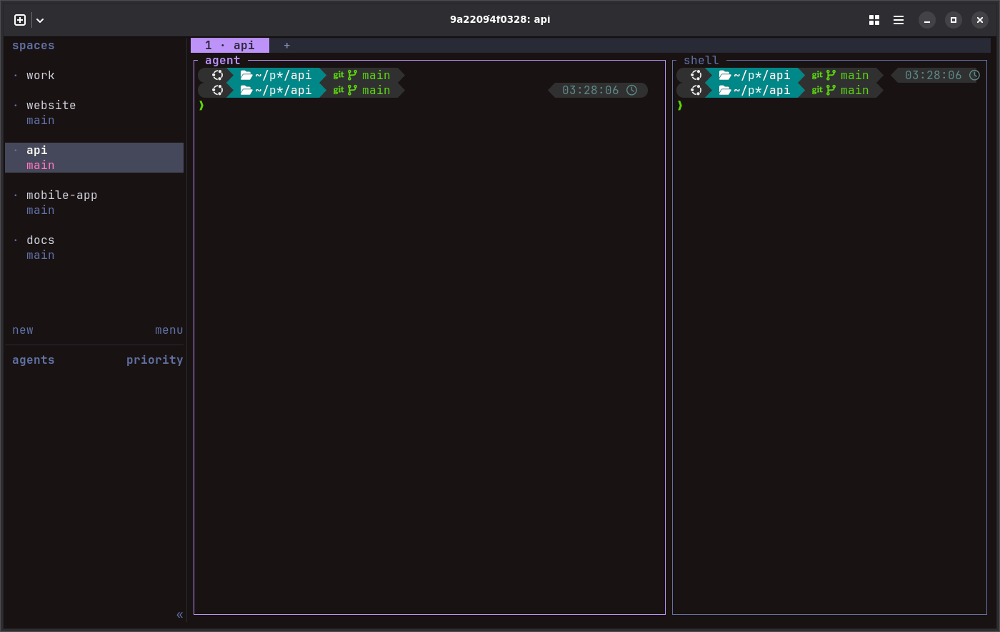

### grid

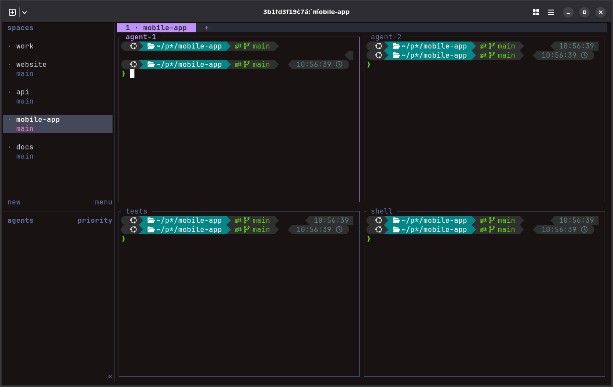

### review

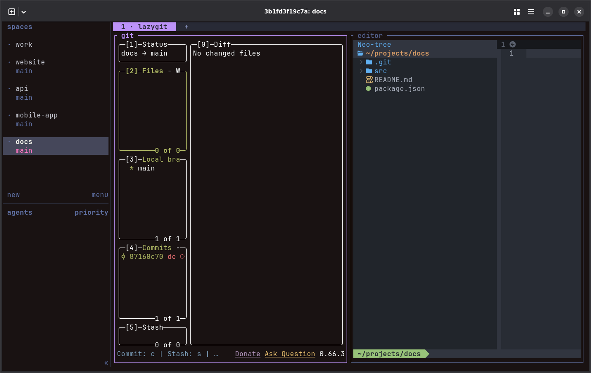

## Choose a template

Add the template names to your list. `template` at the top of the file is the template for each project. `template` in a project sets the template of that project:

```toml
template = "agent"

[[project]]
name = "website"
path = "~/code/website"
template = "code"

[[project]]
name = "api"
path = "~/code/api"
```

In a VS Code workspace file, the same settings are `hopen.template` and `hopen.templates`. VS Code can show a warning for them, because it does not know them. The warning does no harm. The [hopen guide](hopen.md#settings) has every setting.

To use one template for each new workspace of one run, use `--template`:

```bash
hopen work --template code
```

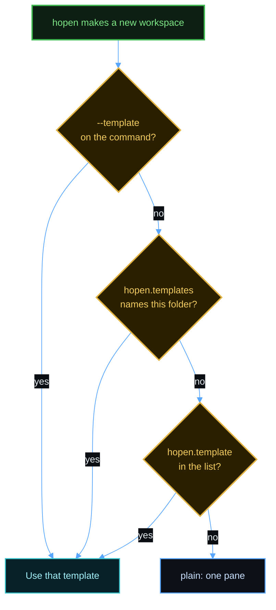

A template applies only to a workspace that `hopen` creates. A workspace that exists already keeps its panes.

To split the current tab with a template, open a new tab, and then run this command in it:

```bash
hopen --apply review
```

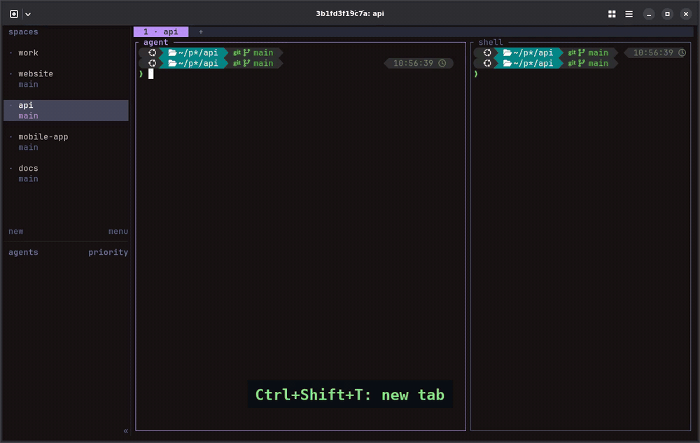

## Write your own template

A template is a text file in `~/.config/hopen/templates`. The name of the file is the name of the template. Each line is one pane:

```text
# name: A short description. hopen --templates shows it.
NAME  FROM  DIRECTION  SIZE  COMMAND
```

| Column | Meaning |
|--------|---------|
| `NAME` | The name of the pane. Herdr shows it at the top of the pane. |
| `FROM` | The pane to split. The first line has `-`, because it is the first pane. |
| `DIRECTION` | `right` or `down` |
| `SIZE` | The part of the `FROM` pane that stays with `FROM`, from `0.1` to `0.9` |
| `COMMAND` | The program to start, or `-` for a plain shell |

This example makes `~/.config/hopen/templates/tests.layout`, with an editor on top and a test runner below:

```text
# tests: Neovim on top, and the tests below.
editor  -       -     -    nvim .
tests   editor  down  0.7  npm test -- --watch
```

No install changes a template that you added. If you change a template that came with herdspace, the server setup asks before it replaces it, and `install.sh` writes the new version next to it as `<name>.layout.new`.

## After a restart

```mermaid
%%{init: {'theme': 'base', 'themeVariables': {
  'fontFamily': 'Menlo, Consolas, Courier New, monospace', 'fontSize': '14px',
  'primaryColor': '#0d1117', 'primaryTextColor': '#e6edf3', 'primaryBorderColor': '#3fb950',
  'textColor': '#e6edf3', 'lineColor': '#58a6ff', 'secondaryColor': '#161b22', 'tertiaryColor': '#0d1117',
  'edgeLabelBackground': '#0b0f14', 'clusterBkg': '#0b0f14', 'clusterBorder': '#30363d', 'titleColor': '#d2a8ff',
  'actorBkg': '#0d1f12', 'actorBorder': '#3fb950', 'actorTextColor': '#7ee787', 'actorLineColor': '#30363d',
  'signalColor': '#58a6ff', 'signalTextColor': '#e6edf3', 'sequenceNumberColor': '#0b0f14'
}, 'flowchart': {'curve': 'basis', 'nodeSpacing': 34, 'rankSpacing': 42, 'wrappingWidth': 340}}}%%
flowchart LR
  classDef cmd fill:#0d1f12,stroke:#3fb950,stroke-width:2px,color:#7ee787
  classDef step fill:#0d1117,stroke:#58a6ff,stroke-width:1.5px,color:#c9e1ff
  classDef ask fill:#2a2000,stroke:#e3b341,stroke-width:2px,color:#f2cc60
  classDef host fill:#1a0f24,stroke:#bc8cff,stroke-width:2px,color:#d2a8ff
  classDef data fill:#082028,stroke:#39c5cf,stroke-width:1.5px,color:#a5f3fc
  classDef stop fill:#2a0f12,stroke:#ff7b72,stroke-width:2px,color:#ffa198
  stop["Server stops<br/>or the machine restarts"]:::stop --> back["Herdr restores the panes<br/>as plain shells"]:::host
  back --> hopen["hopen work"]:::cmd
  hopen --> again["hopen starts the template<br/>programs in idle panes"]:::data
```

Herdr restores the panes and their names after a restart, but not the programs in them. `hopen` starts each template program again, in a pane that shows only its shell prompt. It does this only when it starts a stopped session, so a program that you closed on purpose stays closed.

The Auto Title plugin names tabs and panes, and it keeps a name that you set. But all sessions save those names in one shared file, and the pane IDs repeat across sessions. For that reason, Auto Title can forget the template names of a session after a restart. `hopen` saves the ID of each template pane, and it uses the IDs to start the programs again. For 30 seconds after it names or restarts panes, `hopen` also puts back each template name that changed. The same watch keeps the name of each extra tab of a list. Auto Title still names every other pane and tab.

If you rename a template pane by hand in those 30 seconds, `hopen` puts the template name back. To turn the watch off, set `HOPEN_GUARD_SECONDS=0`.

## Open every project

Run `hopen --all work` to open the projects of every list. Then press `Ctrl+Down` to go to the next project, and `Ctrl+Up` to go to the previous project.

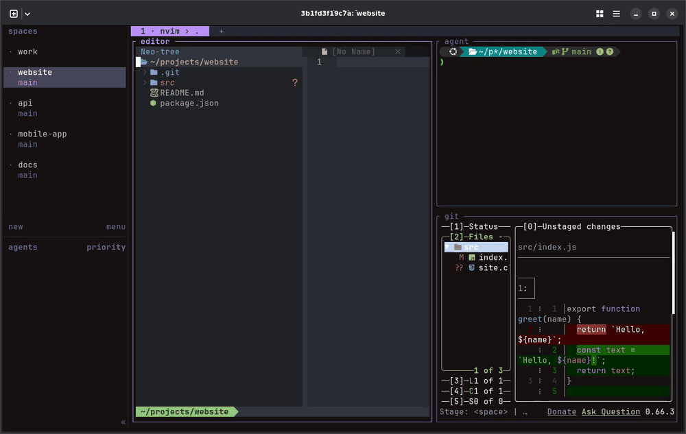

## Move between panes

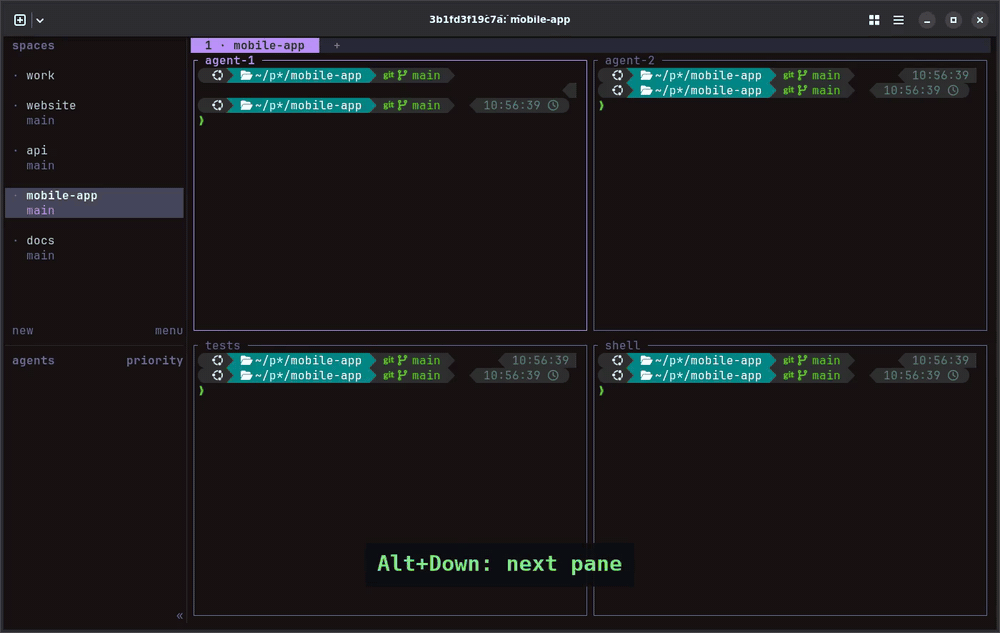

| Action | Mac | Linux or Windows |
|--------|-----|------------------|
| Next pane | `Alt+Down`, or `ctrl+b`, `tab` | The same |
| Previous pane | `Alt+Up`, or `ctrl+b`, `shift+tab` | The same |
| Pane to the left, below, above, or right | `ctrl+b`, then `h`, `j`, `k`, or `l` | The same |
| Zoom the pane, or return | `ctrl+b`, `z` | The same |
| Focus a pane with the mouse | Click it | The same |

A pane that changes size can show an extra copy of the first prompt line. The extra line does no harm. Run `clear` to remove it.

## Split and close panes

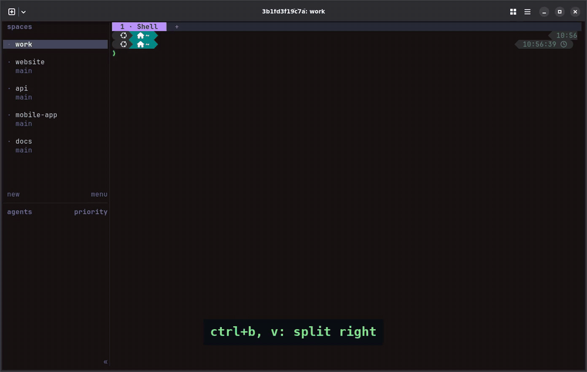

| Action | Keys |
|--------|------|
| Split right | `ctrl+b`, `v` |
| Split down | `ctrl+b`, `-` |
| Close the pane | `ctrl+b`, `x` |
| Resize | Drag a border with the mouse, or press `ctrl+b`, `r` |
| Rename the pane | `ctrl+b`, `shift+p` |

## Go to any project or pane

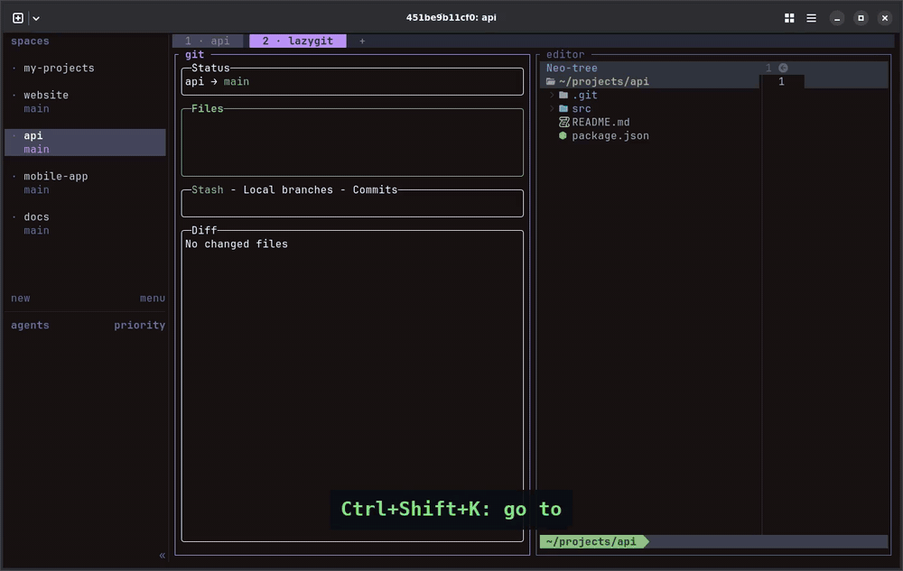

Press `Cmd+K` on a Mac or `Ctrl+Shift+K` on Linux. Press `/`, type part of a name, and press `Enter`.

## References

- [Herdr keyboard](https://herdr.dev/tui/docs/keyboard/)
- [Herdr CLI reference](https://herdr.dev/tui/docs/cli-reference/)
- [Herdr session state](https://herdr.dev/tui/docs/session-state/)
