# Updating

Scope: change the tools and the configuration in this repository, and apply a change to a machine.

```mermaid
%%{init: {'theme': 'base', 'themeVariables': {
  'fontFamily': 'Menlo, Consolas, Courier New, monospace', 'fontSize': '14px',
  'primaryColor': '#0d1117', 'primaryTextColor': '#e6edf3', 'primaryBorderColor': '#3fb950',
  'textColor': '#e6edf3', 'lineColor': '#58a6ff', 'secondaryColor': '#161b22', 'tertiaryColor': '#0d1117',
  'edgeLabelBackground': '#0b0f14', 'clusterBkg': '#0b0f14', 'clusterBorder': '#30363d', 'titleColor': '#d2a8ff',
  'actorBkg': '#0d1f12', 'actorBorder': '#3fb950', 'actorTextColor': '#7ee787', 'actorLineColor': '#30363d',
  'signalColor': '#58a6ff', 'signalTextColor': '#e6edf3', 'sequenceNumberColor': '#0b0f14'
}, 'flowchart': {'curve': 'basis', 'nodeSpacing': 34, 'rankSpacing': 42, 'wrappingWidth': 340}}}%%
flowchart LR
  classDef cmd fill:#0d1f12,stroke:#3fb950,stroke-width:2px,color:#7ee787
  classDef step fill:#0d1117,stroke:#58a6ff,stroke-width:1.5px,color:#c9e1ff
  classDef ask fill:#2a2000,stroke:#e3b341,stroke-width:2px,color:#f2cc60
  classDef host fill:#1a0f24,stroke:#bc8cff,stroke-width:2px,color:#d2a8ff
  classDef data fill:#082028,stroke:#39c5cf,stroke-width:1.5px,color:#a5f3fc
  classDef stop fill:#2a0f12,stroke:#ff7b72,stroke-width:2px,color:#ffa198
  a["Change this<br/>repository"]:::step --> b["Run the tests"]:::cmd
  b --> c{"Did they pass?"}:::ask
  c -- " no " --> a
  c -- " yes " --> d["Merge the change"]:::data
  d --> e["Make a release"]:::cmd
  e --> f["Run bootstrap.sh<br/>again on each machine"]:::cmd
```



## Apply the newest version of this repository

Run the same `curl` command again, with the same role and options. It downloads the newest release and runs it. To install another release, add `--version <tag>` after the role.

If you use a clone, run `git pull` in the clone. Then run `./bootstrap.sh` with the same role and options as before.

### Running sessions

You do not have to stop your Herdr sessions before an update. The setup never stops a running server, so the programs in your panes keep running.

- If the update changes `config.toml`, the setup runs `herdr server reload-config` for each running session. Herdr applies the new settings and keeps the panes. A few settings apply only after a restart. The [Herdr configuration reference](https://herdr.dev/tui/docs/config-reference/) names them.
- If the update installs a new Herdr version, each running session keeps the old version. The new Herdr attaches to it. The setup names each session with an older version.

To use the new Herdr version in a session, stop it and open it again:

```bash
herdr session stop my-projects
```

A stop ends the programs in the panes of the session. When you open the session again, the layout comes back, the shells start again, and an agent with an integration resumes its conversation.

The script changes only what is different. It updates a file that you did not change, and it asks about a file that you changed. It keeps a backup of each replaced file.

## Update the tool versions

| What | Where | How to update |
|------|-------|---------------|
| Linux release files and their checksums | `tools/versions.tsv` | `tools/update-versions.sh` |
| Shell plugins and Auto Title commits | `tools/versions.env` | `tools/update-versions.sh` |
| macOS tools | Homebrew | `brew upgrade`, and then run the server setup again |
| Neovim plugins | `config/nvim/lazy-lock.json` | `:Lazy update`, and then copy the file from `~/.config/nvim/` |

Update the versions:

```bash
tools/update-versions.sh
```

The script takes a release or a commit only when it is at least 7 days old. Most bad upstream releases are found in the first days. For a git pin, the age is the date of the commit. The script never moves a pin back to an older release or commit. To change the wait, set `PIN_MIN_AGE_DAYS`, for example `PIN_MIN_AGE_DAYS=14`.

Test a change before you use it. The [testing guide](testing.md) lists every test:

```bash
tests/run-linux.sh
```

```bash
tests/run-macos.sh
```

## Make a release

A release holds `bootstrap.sh`, the archive `herdspace-<tag>.tar.gz` that it downloads, `install.sh`, an archive with `hopen` and its templates, and `SHA256SUMS`. A tag is a version with no v in front, for example `0.1.2`. A tag with a dash, for example `0.2.0-alpha.1`, becomes a pre-release.

1. In `CHANGELOG.md`, change `## [Unreleased]` to `## [<tag>] - <date>`, and add a new empty `## [Unreleased]` above it. Change the links at the end of the file to the new tag. Run `tools/known-hashes.sh`, so that the list of older file versions holds the `hopen` of the new tag. Merge the change, and run the tests.
2. Build the files and look at them. The script writes the release notes to `dist/<tag>.notes.md`: the section of the tag from `CHANGELOG.md`, with a link to the install steps at the top.

   ```bash
   tools/release.sh 0.1.2
   ```

3. Publish the release:

   ```bash
   tools/release.sh 0.1.2 --publish
   ```

4. Install the published release in fresh sandboxes, and try each feature. See [After a release](testing.md#after-a-release):

   ```bash
   tests/run-release-check.sh --version 0.1.2
   ```

The docs use the `releases/latest` address, so they do not change for a release. A pre-release does not become the latest release.

The script reads the repository name from `gh`, and it writes the name into `bootstrap.sh` and `install.sh`.

`--publish` stops if `git status` shows a change or an untracked file, so that a release holds only committed files. It also stops if `CHANGELOG.md` has no section for the tag.

`--publish` also stops in these cases:

- The commit is not the head of `origin/main`.
- A CI check of the pull request of the commit did not pass.
- The tag already has a release. A published release does not change. If a release is wrong, publish a new tag.
- `bootstrap/known-hashes.tsv` is not up to date.

To run only these checks, and publish nothing, use `tools/release.sh <tag> --preflight`.

After the publish, the job "Release files match the tag" of the workflow "Release check" builds the release again from the tag on a clean runner. It compares each published file with that build. If a file differs, is missing, or is extra, the job fails. Do not use the release then, and publish a new tag. If all files match, the job signs each file with a [GitHub artifact attestation](https://docs.github.com/en/actions/concepts/security/artifact-attestations). An attestation is a signed record of the workflow, the commit, and the checksum of a file.

## Add something new

1. Put a configuration file in `config/`.
2. Add an install step to `bootstrap/lib/server.sh` for all servers, or to one script in `bootstrap/platforms/` for one system. Use `run_part` with a check function, so that a new run skips the step when it is done.
3. Add a line to `tests/verify-server.sh` that proves the step works.
4. Add the step to the [setup guide](setup.md) and to the cheat sheet.
5. If you change a file that the setup installs from `config/` or `bin/`, run `tools/known-hashes.sh`, and commit `bootstrap/known-hashes.tsv`. The list holds the hash of each older version of the file. With it, an update replaces the older version with no question, also for an install from before the manifest. CI fails if the list is not up to date.
6. Add a line under `## [Unreleased]` in the [changelog](../CHANGELOG.md). See [Update the changelog](../.github/CONTRIBUTING.md#update-the-changelog).
7. Run the tests. If the change affects an update, run `tests/run-upgrade.sh`.

Do not put names, host names, or private project names in this repository.
