# Updating

Scope: change the tools and the configuration in this repository, and apply a change to a machine.

```mermaid
%%{init: {'theme': 'base', 'themeVariables': {
  'fontFamily': 'Menlo, Consolas, Courier New, monospace', 'fontSize': '14px',
  'primaryColor': '#0d1117', 'primaryTextColor': '#e6edf3', 'primaryBorderColor': '#3fb950',
  'textColor': '#e6edf3', 'lineColor': '#58a6ff', 'secondaryColor': '#161b22', 'tertiaryColor': '#0d1117',
  'edgeLabelBackground': '#0b0f14', 'clusterBkg': '#0b0f14', 'clusterBorder': '#30363d', 'titleColor': '#d2a8ff',
  'actorBkg': '#0d1f12', 'actorBorder': '#3fb950', 'actorTextColor': '#7ee787', 'actorLineColor': '#30363d',
  'signalColor': '#58a6ff', 'signalTextColor': '#e6edf3', 'sequenceNumberColor': '#0b0f14'
}, 'flowchart': {'curve': 'basis', 'nodeSpacing': 34, 'rankSpacing': 42, 'wrappingWidth': 340}}}%%
flowchart LR
  classDef cmd fill:#0d1f12,stroke:#3fb950,stroke-width:2px,color:#7ee787
  classDef step fill:#0d1117,stroke:#58a6ff,stroke-width:1.5px,color:#c9e1ff
  classDef ask fill:#2a2000,stroke:#e3b341,stroke-width:2px,color:#f2cc60
  classDef host fill:#1a0f24,stroke:#bc8cff,stroke-width:2px,color:#d2a8ff
  classDef data fill:#082028,stroke:#39c5cf,stroke-width:1.5px,color:#a5f3fc
  classDef stop fill:#2a0f12,stroke:#ff7b72,stroke-width:2px,color:#ffa198
  a["Change this<br/>repository"]:::step --> b["Run the tests"]:::cmd
  b --> c{"Did they pass?"}:::ask
  c -- " no " --> a
  c -- " yes " --> d["Merge the change"]:::data
  d --> e["Make a release"]:::cmd
  e --> f["Run bootstrap.sh<br/>again on each machine"]:::cmd
```



## Apply the newest version of this repository

If you used `curl`, run the same command with the new tag. The script downloads the new release and runs it.

If you use a clone, run this command in the clone:

```bash
git pull
```

Then run `./bootstrap.sh server` or `./bootstrap.sh client` again. The script changes only what is different. It updates a file that you did not change, and it asks about a file that you changed. It keeps a backup of each replaced file.

## Update the tool versions

| What | Where | How to update |
|------|-------|---------------|
| Linux release files and their checksums | `tools/versions.tsv` | `tools/update-versions.sh` |
| Shell plugins and Auto Title commits | `tools/versions.env` | `tools/update-versions.sh` |
| macOS tools | Homebrew | `brew upgrade`, and then run the server script |
| Neovim plugins | `config/nvim/lazy-lock.json` | `:Lazy update`, and then copy the file from `~/.config/nvim/` |

Update the versions:

```bash
tools/update-versions.sh
```

Test a change before you use it. the [testing guide](testing.md) lists every test:

```bash
tests/run-linux.sh
```

```bash
tests/run-macos.sh
```

## Make a release

A release holds `bootstrap.sh`, the archive `herdspace-<tag>.tar.gz` that it downloads, `install.sh`, an archive with `hopen` and its templates, and `SHA256SUMS`. A tag is a version with no v in front, for example `0.1.2`. A tag with a dash, for example `0.2.0-alpha.1`, becomes a pre-release.

1. In `CHANGELOG.md`, change `## [Unreleased]` to `## [<tag>] - <date>`, and add a new empty `## [Unreleased]` above it. Change the links at the end of the file to the new tag. Merge the change, and run the tests.
2. Build the files and look at them. The script writes the release notes to `dist/<tag>.notes.md`: the section of the tag from `CHANGELOG.md`, with a link to the install steps at the top.

   ```bash
   tools/release.sh 0.1.2
   ```

3. Publish the release:

   ```bash
   tools/release.sh 0.1.2 --publish
   ```

The docs use the `releases/latest` address, so they do not change for a release. A pre-release does not become the latest release.

The script reads the repository name from `gh`, and it writes the name into `bootstrap.sh` and `install.sh`.

`--publish` stops if `git status` shows a change or an untracked file, so that a release holds only committed files. It also stops if `CHANGELOG.md` has no section for the tag.

## Add something new

1. Put a configuration file in `config/`.
2. Add an install step to `bootstrap/lib/server.sh` for all servers, or to one script in `bootstrap/platforms/` for one system. Use `run_part` with a check function, so that a new run skips the step when it is done.
3. Add a line to `tests/verify-server.sh` that proves the step works.
4. Add the step to the [setup guide](setup.md) and to the cheat sheet.
5. Add a line under `## [Unreleased]` in the [changelog](../CHANGELOG.md). See [Update the changelog](../CONTRIBUTING.md#update-the-changelog).
6. Run the tests.

Do not put names, host names, or private project names in this repository.
