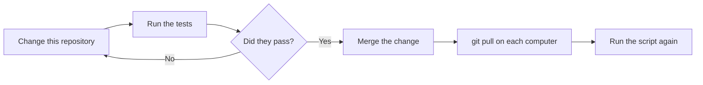

# Updating

Scope: change the tools and the configuration in this repository, and apply a change to a computer.



## Apply the newest version of this repository

Run this command on each computer:

```bash
git pull
```

Then run the script for that computer again. The script changes only what is different, and it keeps a backup of each changed file.

## Update the tool versions

| What | Where | How to update |
|------|-------|---------------|
| Linux release files and their checksums | `tools/versions.tsv` | `tools/update-versions.sh` |
| Shell plugins and Auto Title commits | `tools/versions.env` | `tools/update-versions.sh` |
| macOS tools | Homebrew | `brew upgrade`, and then run the server script |
| Neovim plugins | `config/nvim/lazy-lock.json` | `:Lazy update`, and then copy the file from `~/.config/nvim/` |

Update the versions:

```bash
tools/update-versions.sh
```

Test a change before you use it:

```bash
tests/run-linux.sh
```

```bash
tests/run-macos.sh
```

## Add something new

1. Put a configuration file in `config/`.
2. Add an install step to `lib/server.sh` for all servers, or to one bootstrap script for one system.
3. Add a line to `tests/verify-server.sh` that proves the step works.
4. Add the step to [setup.md](setup.md) and to the cheat sheet.
5. Run the tests.

Do not put names, host names, or private project names in this repository.
