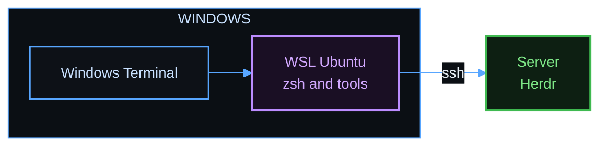

# Windows with WSL

Scope: use a Windows computer as a client, or run a Herdr server inside WSL. WSL (Windows Subsystem for Linux) runs Linux inside Windows. Ghostty has no Windows build, so Windows Terminal is the terminal in this setup.

The tests in this repository do not run on Windows. The Linux scripts have tests in containers, but the Windows Terminal steps have no test.

## Windows as a client



Install Ubuntu in WSL. Run this command in PowerShell:

```powershell
wsl --install -d Ubuntu
```

Open Ubuntu from the Start menu, and clone this repository there. Then run the Linux client script with no Ghostty:

```bash
./bootstrap-client-linux.sh --no-ghostty
```

Windows Terminal does not need the terminal description, because it uses `xterm-256color`.

Do these steps in Windows Terminal:

1. Install a Nerd Font on Windows, and select it in the Ubuntu profile. Without it, the prompt shows boxes in place of icons.
2. Open Settings, then Actions. Remove `Ctrl+Shift+T` and `Ctrl+Shift+W`, so that those keys reach Herdr.
3. Use `Ctrl+Shift+V` to paste.

The prefix keys always work, for example `ctrl+b`, then `c` for a new tab. The [cheat sheet](cheat-sheet.md) lists them.

## WSL as a server

Run the Linux server script inside WSL. WSL needs systemd for the login service. Add these lines to `/etc/wsl.conf`:

```ini
[boot]
systemd=true
```

Restart WSL. Run this command in PowerShell:

```powershell
wsl --shutdown
```

Then run the server script:

```bash
./bootstrap-server-linux.sh
```

A Herdr server in WSL stops when WSL stops. Use this setup for a computer that you work on. For a server that must stay on, use Linux or macOS.

## References

- [Install WSL](https://learn.microsoft.com/windows/wsl/install)
- [Systemd in WSL](https://learn.microsoft.com/windows/wsl/systemd)
- [Windows Terminal](https://learn.microsoft.com/windows/terminal/)
